#### 20260214
- 13:25{6R>B,7T>T}[澱粉湯, 肉]<!-- R=regular human insulin, ">B"=right belly, "7T"=7 units Tresiba, ">T"=right buttock -->
- 15:06 126mg/dL₉(1³⁴,1³⁵){6R>B}<!-- ₉=left forefinger, (1³⁴,1³⁵) means it is 1H34mins of duration from 7T injection, and 1H35mins from 6R injection -->
- 18:36 46mg/dL₀(5¹¹,3²⁶)[肉,菜湯],{3R>B}[cf. ]<!-- "cf."=coffee powder, "₀"=left thumb -->
- 22:12 114mg/dL⁰{2R8T<T內}<!-- ""<T内"=left buttock and left inner-thigh -->

#### 20260215
- 02:41 113mg/dL⁹{3R<B}
- 06:23 73 mg/dL⁸(8⁵, )[杏仁茶,cf.],{5T>T,2R<A}<!-- "⁸"=left middle-finger -->
- 12:36 94 mg/dL⁷ (4⁴⁰, 4³⁸), 5T>B<!-- ⁷=left ring-finger -->
- 15:20 96 mg/dL⁶ (7²⁴, 2⁴ )<!-- ⁶=left little-finger -->
- 17:04 111mg/dL⁵ (3⁴⁸, ){3½R<B, 12T>>T內}[肉，澱粉，菜]<!-- ">>T內"=right buttock and right inner-thigh, ⁵=right little-finger-->
- 18:41 126mg/dL⁴{1H6R>B}[肉、澱粉、菜]<!-- ⁴=right ring-finger; H=humalog -->

#### 20260216
- 05:08 114mg/dL³(15⁵², ){4½R<B, 7T>A}[cf. cf.+cream]<!-- ">A"=right arm, ³=right middle-finger -->
- 12:37 74 mg/dL², (5⁵⁶,){4R<B}[澱粉,糖,肉,菜]<!-- ²=right forefinger -->
- 15:37 120mg/dL¹{5R>B}<!-- ¹=right thumb -->
- 17:59 34 mg/dL₁, (12¹⁷,2¹⁸), [糖,澱粉,肉,菜]<!-- right thumb on nail-side -->
- 19:39 144mg/dL(13⁵⁸, 3⁵⁸){6R<B, 7T>內}[杏仁茶]
- 22:52 126mg/dL₃(3⁰⁶, 3⁰⁹){2+H>B}[杏仁茶]<!-- right middle-finger on nail-side -->
- 01:00 43mg/dL₄(5¹⁴, 2⁰⁶)[糖],{7T<T}<!-- right ring-finger on nail-side -->
#### 20260217

- 06:52 79mg/dL₅(4⁴⁸, ){7T<T, 3+<B}[cf. ], [cf. ]<!-- right little-finger on nail-side -->
- 12:35 40mg/dL₆, (5²², 5²⁰), [肉,糖,菜],{5R>A}<!-- left little-finger on nail-side -->
- 15:53 133mg/dL₇, (8³⁹, 2¹⁵){4R>B, 7T<內}, [cf. 杏]<!-- left ring-finger on nail-side -->
- 18:47 115mg/dL₈, (2⁴¹, 2⁴¹){5R<B}, [醬料, 肉, 菜]<!-- left middle-finger on nail-side -->
- 22:45 [蝦肉]
- 23:54 118mg/dL₉, (7⁴⁸, 5⁴){(6+6)T>內>T, 2+R>B}<!-- left forefinger on nail-side -->

#### 20260218
- 05:05 74mg/dL₀, (5⁶, 5⁵), 睡<!-- left thumb on nail-side -->
- 08:16 59mg/dL₀, (8¹⁶, 8¹⁵){7T<A}
- 11:36 60mg/dL₉, (3¹³, ), {4R<B}
- 14:33 100mg/dL₈, (6¹⁰, 2⁵⁵){7T>B}, [cf. ]
- 17:48 121mg/dL₇, (3¹¹, ){7R<B}, [南投辦桌:澱粉,肉,菜]
- 20:44 85mg/dL₅, (6⁷, 2⁵¹), [微甜酸梅紅茶⅓杯]
- 22:54 141mg/dL₄, (8¹⁸, 5²){(7+7)T<<T內, 9½R><BB}, [堅果]

#### 20260219
- 04:11 65mg/dL₃, (5⁸, 5⁹)
- 09:11 110mg/dL₂, (10⁸){7T<T, 6R>B},
- 11:47 [澱粉, 炸雞],{5R<B}, [cf. ]
- 13:57 121mg/dL₁, (0442,0210),{4R>A}, [cf. ]
- 18:16 100mg/dL¹, (9¹, 0416),{4½R<A}, [肉,菜,澱粉], [糖肉], 〘W〙<!-- 〘W〙=walk -->
- 22:46 88mg/dL², (, 4²⁷), [椰奶, 茶],{(6+6)T>>T內}

#### 20260220
- 07:09 103mg/dL², (7³⁰, ),{4½R>A, 7T<內}, [cf.多, 椰奶], [egg₂]
- 12:49 76mg/dL³, (5²⁹, 5²⁹)
- 17:27 69mg/dL⁴, (, ), [醬,肉,竹筍,egg₃],{4½R>B, 6T<T}, [堅果, 杏茶,cf.]<!-- egg₃=3 eggs -->
- 21:12 107mg/dL⁵, (2⁴⁸,2⁴⁹), {3+R<B}
- 23:35 29mg/dL⁶, (5¹⁰,1⁵⁶), [橘子]
- 01:11 103mg/dL⁷, (6⁴⁷,3³²), {(7+7)T>>T內}
- 03:17 92mg/dL⁸, (2³,)

#### 20260221
- 07:09 85mg/dL⁹, (5⁵⁵,),{9²⁵: 2½R>B,7T<T}, [cf. cream₁₅]<!-- "cream₁₅"=15個奶油球 -->
- 12:14 40mg/dL⁰, (2⁴⁸,2⁴⁹), [紅/白蘿蔔,牛],{(,3²⁹),6½R<A}, [cl. cf.]<!-- I forget what "cl." means; will add it on later when remembering -->
- 15:01 53mg/dL⁰, (5³⁴,2⁴), [糖,澱粉]
- 18:29 82mg/dL⁹, (9²,5³¹),{4-T>A,4R<B},[牛,紅白蘿蔔,蛋,肉,菜]
- 21:23 63mg/dL⁸, (2¹³,2¹¹),{7T<內}, [糖]

#### 20260222
- 05:02 156mg/dL⁷,(7³⁵,){7R>B, 1½R7T>T,2½H<B}, [糖,starch. cf. 杏茶]<!-- Multiple sites injections (right belly, right buttock and left belly) -->
- 12:20 71mg/dL⁶(7¹²,7¹⁰){5½R<B}[火鍋,澱粉]
- 14:22 227mg/dL⁵(,1¹⁹){(7+7)R>B<A}[cf.]
- 17:17 35mg/dL⁴(12⁸,2⁵³)[果糖, cf., creamer],{6R<B,7T>內}[糖澱醬,牛,菜,egg₂]
- 21:35 112mg/dL³(3⁰,3¹){2+R>B}[澱]
- 00:41 132mg/dL²(2⁵⁸,6⁷){3½R<B,(7+7)T<T<內}

#### 20260223Mon
- 06:33 39mg/dL¹(5⁴⁵,)[cf.],{5+R>B}[牛,豬,蘿蔔,egg]
- 10:32 107mg/dL₁(,0⁴⁶){1-R6+T>T},[醬,肉]
- 15:15 118mg/dL₂(4³⁸,5³⁰){4R<B}[醬,肉]
- 18:22 118mg/dL₃(7⁴⁵,3⁴){3R>B,7T>A},{4½R<A}[貢丸,豆腐,肉,澱粉,杏茶]
- 23:48 130mg/dL₄{3R<B,(6+6)T<T>內}

#### 20260224Tue
- 06:05 82mg/dL₅, 〘睡〙[cf.],{10:09: 2R7T<A}, [cf.]
- 15:30 85mg/dL₆(5²¹),{17:26: 4R>B}[豬三層,蒜],{18:48: 7T<B}
- 21:06 111mg/dL₇(2¹⁹,){3R>B}[醬+海瓜子、啤酒、肉(少)],{2½H<B} [ml. cf.]<!--ml.=milk-->
- 00:13 106mg/dL₈(5²⁶,2⁴⁴),{(6+6)T<内>T,1.0R>B}

#### 20260225Wed
- 08:35 39mg/dL₉(8⁰⁸)[cf.杏],{09:30: 4½I>A}<!--I: Insulatard (NPH)-->
- 11:36 43mg/dL₀(11⁹,2⁵)[豚三層(少),cf.杏],{6T<B}[cf.杏; 魚卵,菜,cf.]
- 18:39 66mg/dL₀(5⁴⁵/9⁹,)[豚,菜,cf.],{3⁺R½⁻I>B}[魚卵,cf.杏,cf.]
- 23:14 51mg/dL₉(10¹⁹/13⁴⁴,3⁴⁵)[ml₃],{7T>內}<!--ml₃=3 spoons of milk powder-->

#### 20260226Thu
- 06:49 109mg/dL₈(7¹⁴,){2½H<B,7T<A}〘睡 to 10:30〙[南瓜子, cf.],{4R½I<T}[豚三層,cf.]<!--ml₃ last night；早起不舒服﹑回籠覺後拉肚子，可能是晚上喝太多咖啡所致-->
- 14:39 75mg/dL₇(7²⁹,2⁴⁷)[cf.]
- 18:40 82mg/dL₆(11³⁰,6⁴⁷){19:48: 3½⁺R½I>B}[火雞蛋₃+豚三層]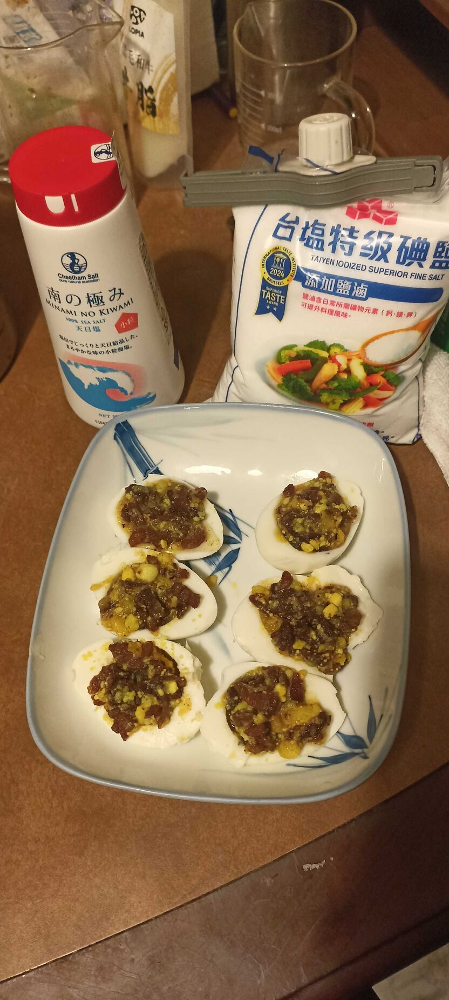[grilled courgette, pan-fried roe and mulled wine]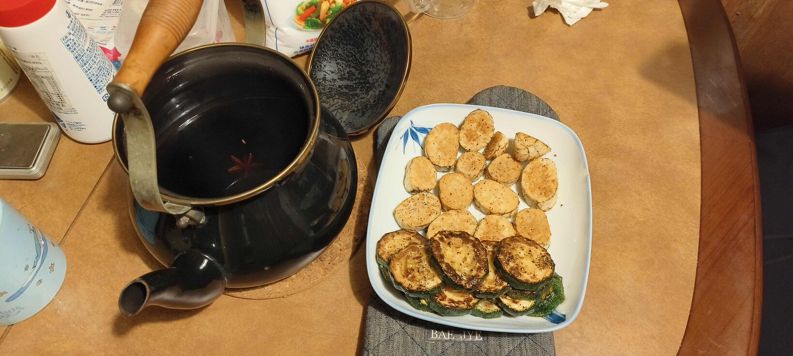
- 23:06 89mg/dL₅(15⁵⁵,3¹⁷){(6+6)T<內>T}

#### 20260227Fri
- 06:29 163mg/dL₄(7¹⁸,){6H<B}〘睡 to 10:00〙<!--睡前吃蛋白質-->
- 10:07 46mg/dL₃(10⁵⁶,3³³), [醬,cf. ],{4R½I>B,7T>內}[devil-egg]〘W〙
- 17:29 85mg/dL₂(5³⁶,5³⁷){6T<T,2R<B}[spinach(炒菠菜)]
- 23:07 35mg/dL₁(3³⁵,3³⁶)[ml₄]
- 00:32 80mg/dL¹(5⁰,5⁰){(5+5)T>A>內}

#### 20260228Sat
- 07:55 65mg/dL²(7¹⁷,)[cf., 沙拉(少) BC.]<!--BC.=bullet-proof coffee-->
- 13:19 107mg/dL³(12⁴¹,){7T<A,3½R½⁺I>B}[豚炒櫛瓜+菠菜]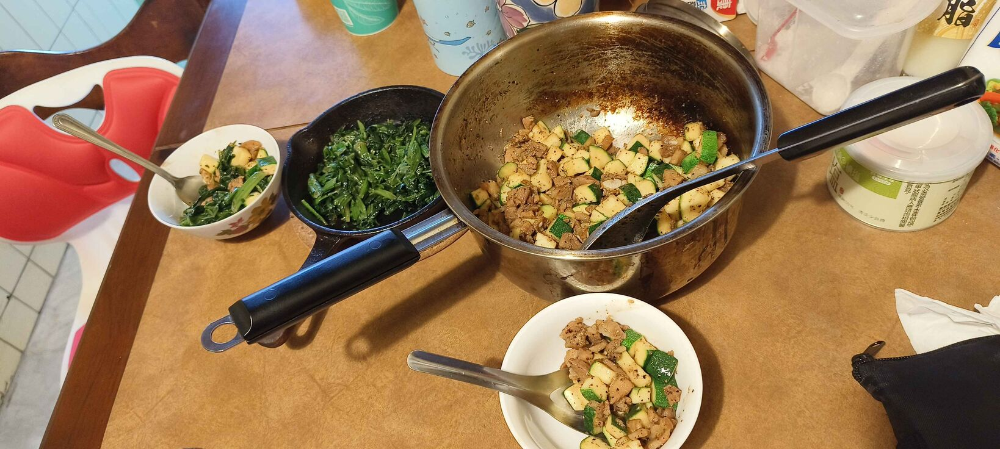〘W₂〙<!--walked for 2 hours without drinking/eating salt, feeling tired and exhausted, thinking unpleasant memories and violent imagination about people and family-->
- 17:51 78mg/dL⁴(4³⁰,4⁶,〘W₂〙⁰)[ml.杏],{2R½I<B,}[ml.杏,南瓜籽仁]<!--〘W₂〙⁰: walking for 2H today-->
- 23:48 100mg/dL⁵(10²⁶,2¹⁷,〘W₂〙⁰){(7+7)T<內>T,1.2R<B}

#### 20260301Sun〘W₂〙¹<!--The day 1 after walking for 2H-->
- 07:55 27mg/dL⁶(7⁵⁶,)[ml.],{7T>A,2R>B}[ml.豚三層,cf.南瓜籽仁]
- <!-- 11:11 --> 136mg/dL⁷(2⁵⁴,2⁵³){6R<B},{5R1⁻II>B}[豚,魚,菜,豆腐,ml₃,cf.]
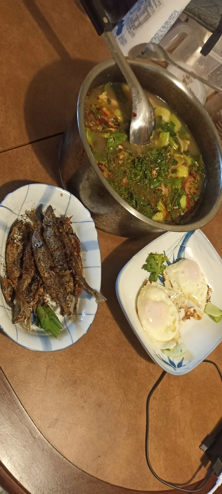
- 15:20 65mg/dL⁸(7²,2³⁵)[ml.],{17:35: 7T<T,2½R<B}
- 21:08 85mg/dL⁹(3³²,3³²)[鹽₄,雞胸肉₂],{3R>內}<!--salt-eating notation added-->
- 00:35 125mg/dL⁰(6⁵⁹,2⁰){(7+7)T>B>T, 0.8R<B}

#### 20260302Mon
1. 06:24 118mg/dL⁰(5⁴⁵)
    - {3H>B}〘睡〙<!--feeling terrible-->
2. 10:07 38mg/dL⁹(,3⁴⁰)[BC.鹽,豚三層+菜,鹽]
    - {3½R<B,7T<内}[BC.鹽]<!--feeling terrible, but recovered after eating-->
3. 16：48 63mg/dL⁸(4⁴⁰,4⁴²)〘W+鹽〙[beer+鹽]
    - {3½R½I>B}[豚,豆腐,蛋+山茼蒿,鹽]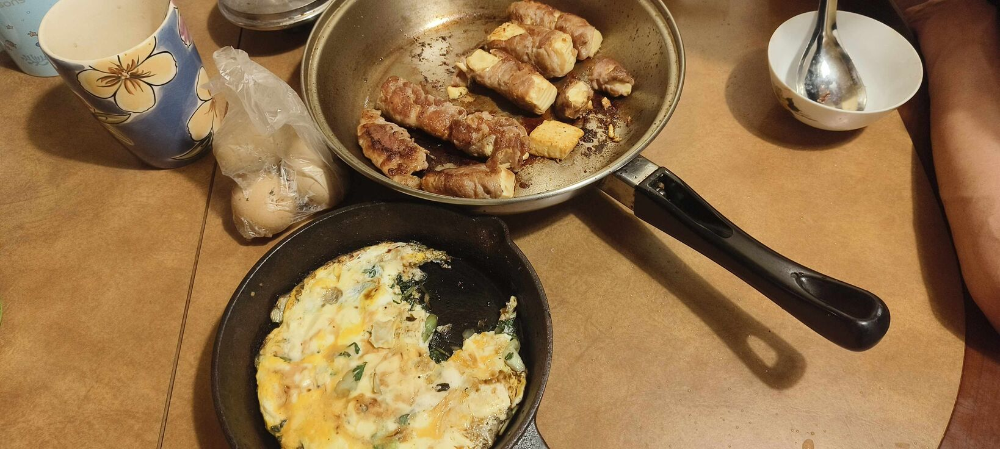[cf.,ml₂]
4. 23:00 36mg/dL⁷(,3⁵⁰)[cf. ml₃]
    - {00:34: (5+5)T<T<A}

#### 20260303Tue
1. 07:02 130mg/dL⁶(6²⁷,)
    - {3H<B, 7T>A}₂〘鹽₂,睡〙<!--felt not good with peeing several times at night and going to sleep again, but better than yesterday-->
2. 10:16 70mg/dL⁴(2³⁹,3¹³)[cf.鹽,豚三層,菜],
    - {3R½I>B}[BC.egg₁,鹽]〘17:45: W½〙
    - {17:48: 3½R½I<B}[Burgerking without buns+鹽,fries. 澱粉,糖,diet coke+鹽],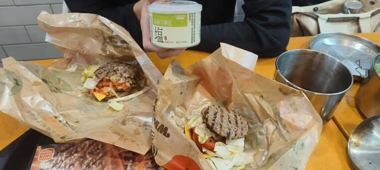
    - {6R>B}〘W₁〙[diet coke+鹽]<!--eating out without bloodsugarmeter-->
3. 21:48 29mg/dL⁵,[ml₅鹽,芝麻粉+乳清,豆腐]
4. 23:57 46mg/dL³(16²⁰,3⁵²)
5. 01:42 90mg/dL²(,5³⁹)
    - {2½R<B,(6+6)T>T<A}₃

#### 20260304Wed
1. 08:48 94mg/dL¹(6⁵⁸,)<!--pee₂+鹽. Feel away better, and no back sleep again-->
    - {7T>A,2½R>B}[cf.鹽]
2. 13:05 54mg/dL₁(4⁶,4³)[豚三層+菜]
    - {3⁻R½⁺I<B}(5¹⁴,5¹¹)[BT.鹽], 〘睡〙<!--BT.=bullet-proof tea. When eating meat, insulin must be injected or sleeping happens.-->
3. 18:46 39mg/dL₂(9⁴⁵,4³¹)[BT.鹽]
    - {3⁺R½I>B}[豚三層,菠菜. 油蔥酥, 鹽]
    - {3H<B}(13²²,2³⁴),[油蔥酥,beer,豆腐,花生,鹽]
4. 00:57 112mg/dL₃(15¹⁸,2³³)
    - {4½R>B,(6+6)T>內<A}
5. 02:13 137mg/dL₄(0⁵⁰,0⁵³)
    - {3½R<B}

#### 20260305Thu
1. 06:54 26mg/dL₅(5³¹,4³⁹)[鹽,15cg,]〘睡〙
2. 09:39 93mg/dL₆(8¹⁶)
    - {4R>B,7T>A}[豚三層,菜. 油蔥酥, cf.]
3. 15:11 122mg/dL₇(4⁵⁹,5⁰)
    - {4I<內,3R>B}〘W1〙[chedda cheese,鹽]<!--feel hypo when walking-->[ml₄,豚,菜,豆腐,鹽]
    - {21:04: 3R<B}〘W½〙<!--feel hyper-->[堅果,beer,tea]
4. 22:52 146mg/dL₈(12⁴⁰,1⁴⁷)
    - {4H>B}〘bed-yoga〙
5. 00:47 65mg/dL₉(14³⁵,1⁵¹)[堅果]
    - {(5+5)T<T>內}

#### 20260306Fri
1. 04:47 67mg/dL₀(2⁵¹,)〘pee, check BG and go back sleep〙
2. 06:43 65mg/dL₀(4⁴⁷,)<!--pee 3 times at night, mental score is about 6~7-->[cf.鹽,堅果(少)]
3. 09:18 72mg/dL₉(7²²,)[cf.鹽]
4. 12:01 79mg/dL₈(10⁵,)[tea鹽]
    - {5T<A}[tea杏鹽]
5. 16:14 78mg/dL₇(4⁴,)
6. 18:55 67mg/dL₆(6⁴³,)<!--5T ia too much (in fasting), and it shows its power in 6 hours-->
    - {3R½I>B}[油蔥酥,牛漢堡,豆腐,鹽]
|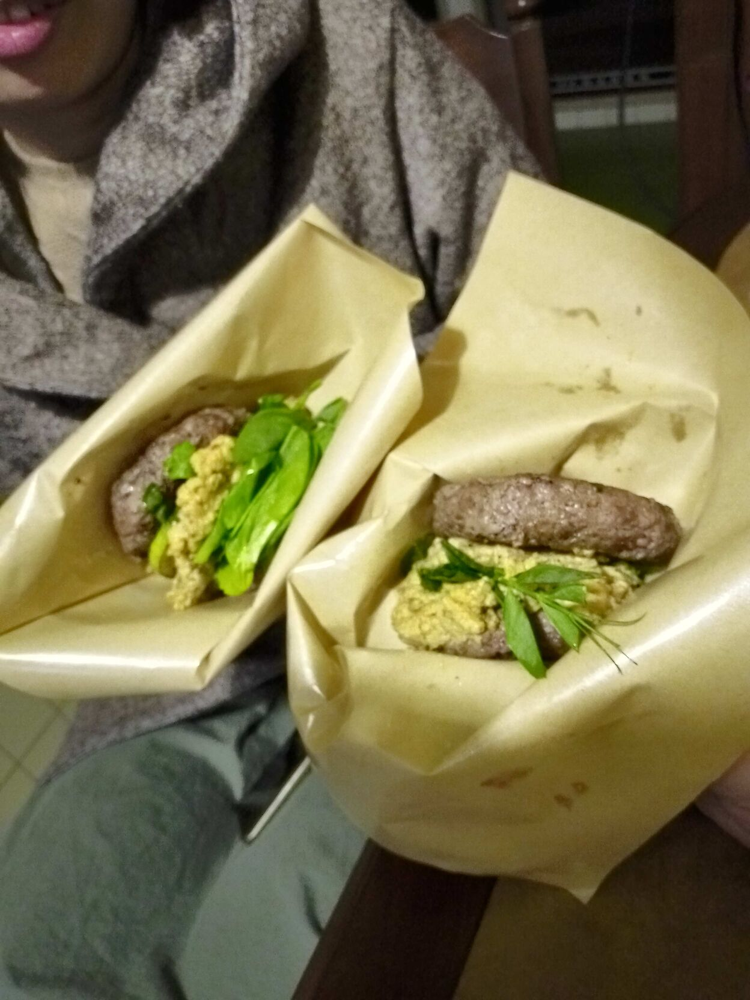|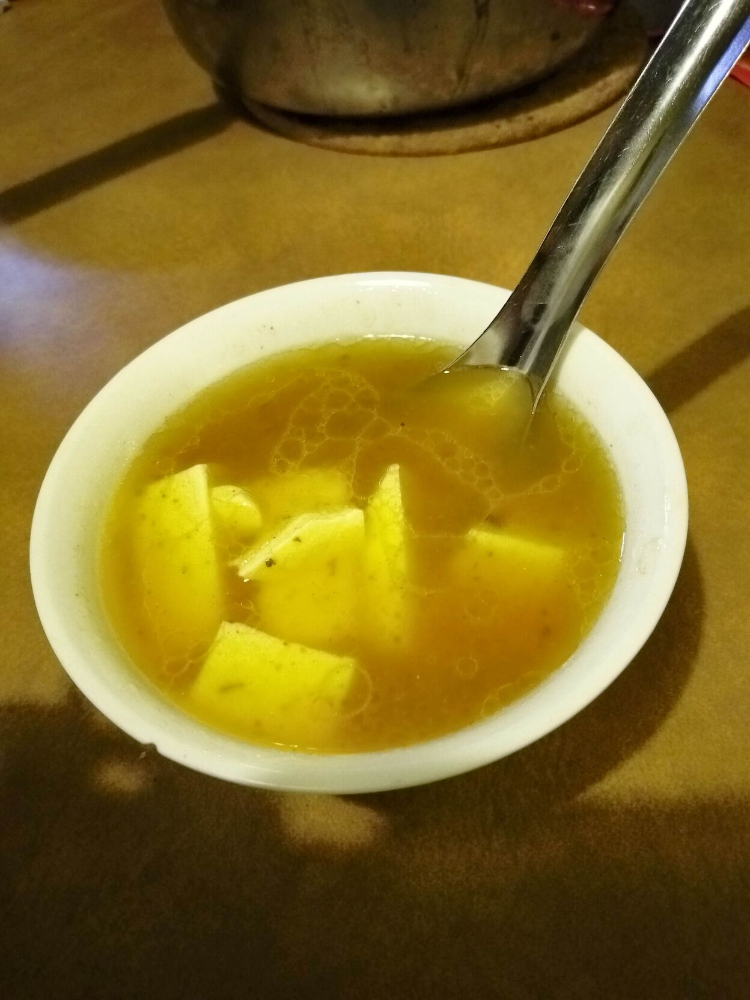|
7. 22:01 113mg/dL₅(9⁴⁹,3¹)
8. 22:39 130mg/dL₆(10²⁷,3³⁹)<!--應在發現吃過多時在餐中/後再補打一劑-->
    - {1½H2½R<B,(6+6)T<內>A},〘W₁〙,[cf.鹽]

#### 20260307Sat
1. 05:06 84mg/dL₃(6²⁰,6²⁵)〘睡〙
2. 08:26 102mg/dL₂(9³⁹,)[cf.鹽]<!--felt better after drinding almost immediately-->
    - {3R>B,5T>A}〘W₁〙[cf.鹽]
3. 14:34 46mg/dL₁(5⁴⁸,5⁵⁰)<!--hypo but ok, will eat sth-->[肉,egg. tea鹽]
4. 18:03 160mg/dL¹(9¹⁸,9²⁰)[ct.+salt]<!--ct.=Carmién Tea-->
    - {2½H2R<B}
5. 20:11 80mg/dL³(11²⁵,2³)
6. 21:40 32mg/dL⁴(12⁵⁴,3³³)[肉,菜,黑芝蔴糊(starch+oil)]
7. 00:36 77mg/dL⁵(15⁵⁰,6²⁸)
8. 01:08 78mg/dL⁶(16²²)
 -`{(5+5)T>T<A}`

#### 20260308Sun
1. 03:55 80mg/dL⁷(2⁴¹,)[鹽]<!--pee then go back sleep-->
2. 07:58 63mg/dL⁸(6⁴⁴)[cf.鹽]
3. 12:42 81mg/dL⁹(11²⁸)[ct.鹽]〘scooter-riding₁〙[ct.鹽]
4. 16:53 87mg/dL⁰,[tea鹽]〘scooter-riding₁〙
5. 19:49 97mg/dL⁰(18³⁵)
 -`{2½R½I>B}`[豚三層,菜,蛋,鹽]
6. 21:56 59mg/dL⁹(20⁴²,1⁵³)[堅果:腰果,杏仁,南瓜子,核桃. half of beer]
7. 23:31 66mg/dL⁷(22¹⁸,3²⁹)
 -`{(3+3)T>内>A}`[鹽(4g)]〘bed-yoga〙

#### 20260309Mon
1. 04:28 150mg/dL⁶(4³⁸)
 -`{2½H2R<B}`〘睡〙
2. 07:07 92mg/dL⁵(7¹⁷,2³⁶)〘睡〙
3. 10:28 71mg/dL⁴(10³⁷,5⁵⁶)
 -`{3½R½I>B}`[豚三層,鹽]
4. 16:33 132mg/dL³(16⁴³,4⁶)
 -`{3½H<B}`
 -`{18:43 3½R½I>B}`[火鍋湯底,菇,菜,豚三層,egg₂,cheese]
5. 21:38 110mg/dL²(21⁴⁹,2⁵⁶)
 -`{3½H<B}`[ml₃,黑芝麻糊,乳清蛋白,杏,ct.]
6. 00:18 112mg/dL¹(24²⁸,2²⁵)
7. 01:22 136mg/dL₁(25³²,3²⁹)
 -`{1½H1R>B,(3+3)T<T<A}`

#### 20260310Tue
1. 07:02 158mg/dL₂(5²⁹,5³³)
 -`{4½H<B}`〘睡〙
2. 10:55 109mg/dL₃(9²²,3⁴⁸)
 -`{4½R>B}`[剩菜:菜,豚三層,egg][黑芝麻糊,乳清蛋白,cf.鹽]
3. 14:05 159mg/dL₅(12³¹,2³⁰)
 -`{4H<B,4T>A}`[18:19 肉沫油湯鹽]
4. 20:14 100mg/dL₆(6⁰,6⁰)[ct.杏鹽]
5. 23:13 125mg/dL₇(9⁰,9⁰)<!--4T less than 8 hours-->
 -`{1H>B,(4+4)T>A<內}`[2.2g鹽(3 capsules)]<!--stomach pain after salt-capsule, water solve it-->

#### 20260311Wed
1. 05:26 124mg/dL₈(6⁰,6³)[鹽]〘睡〙
2. 10:54 84mg/dL₉(11²⁸,5²⁰)
 -`{4R½⁺I>B,5T>T}`[豚三層,egg₃鹽],[漢堡肉₁,櫛瓜,egg₂]
3. 15:20 120mg/dL₀(2³⁰,2³²)
 -`{2½H<B}`[BC.鹽]
4. 18:51 102mg/dL₉(6²,3²⁷)<!--5T is eliminated in 6-7 hours-->
 -`{5T<A}`〘W₁.₅+鹽〙
5. 20:50 145mg/dL₈(1⁵⁴,)<!--5T won't start in 2 hours-->
 -`{3½H>B}`[鹽BT.]
6. 00:13 77mg/dL₇(5¹⁶,3¹⁸)
7. 02:42 81mg/dL₆(7⁴⁶)
 -`{7T>內}`

#### 20260312Thu
1. 08:48 118mg/dL₅(6¹,)
 -`{2H<B}`<!--pee:2, 5&5.5-->〘睡〙
2. 11:35 88mg/dL₄(8⁴⁸,2⁴³)
 -`{4⁺R½I>B}`[豚三層,egg₂鹽]
 -`{5I<A}`[ct.杏鹽]<!--using I instead of T for gluconeogenesis-->
3. 16:53 99mg/dL(2³⁰I,4³²)〘W₁.₅+鹽〙
4. 20:09 106mg/dL₁<!--BG is fine-->
 -`{20:11 5⁻R0⁺I<B}`[聚·北海道鍋物：糖,澱粉,肉,菜]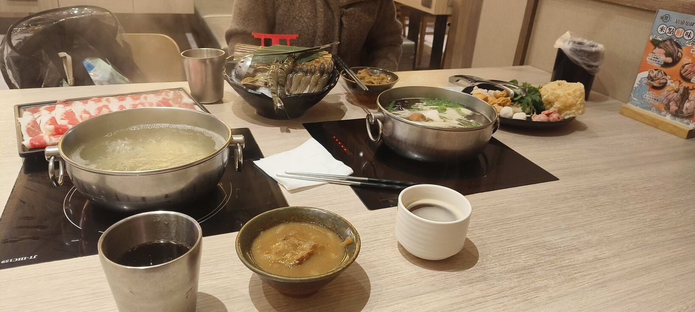
5. 22:17 147mg/dL¹(7⁵³,2⁵)
 -`{5H>B}`[cf.杏鹽]
6. 02:43 132mg/dL²(12²⁰,4²¹)
 -`{5R<B,7T<T}`

#### 20260313Fri
1. 06:38 105mg/dL³(3⁴⁸,3⁴⁷)<!--pee:2,5&5½-->
 -`{4⁻R>A}`[BC.鹽]
2. 13:08 109mg/dL⁴(10¹⁸,)
 -`{5I<內}`
3. 18:49 133mg/dL⁵(5³⁸:5I)
 -`{3⁻H5R>B}`[豚,牛,菠菜,egg₃,菇]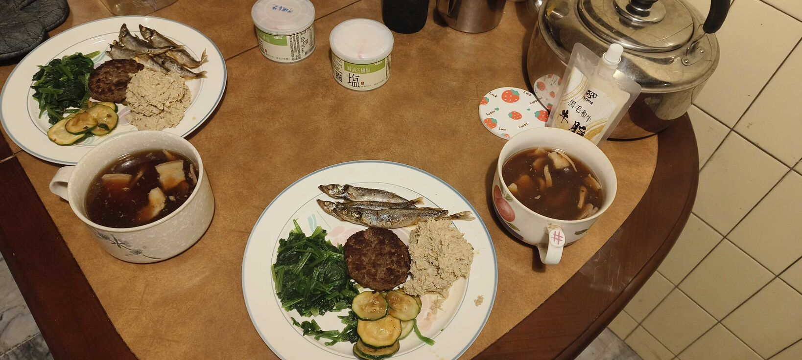
4. 21:50 92mg/dL⁶(19¹7T,8³⁹5I,2⁵⁸)
 -`{7T<A,3R>T}`

#### 20260314Sat
1. 00:52 50mg/dL⁷(2³⁴,2³³)〘睡,not back-sleep〙
2. 06:23 67mg/dL⁸(8⁶,8⁵)[cf.BC.鹽]
3. 09:33 144mg/dL⁰(11¹⁶,,)
 -`{3⁺H2⁻R<B}`〘W₁〙[豆製品(少),cf.]
 -`{6I>A}`[豆製品,肉湯]
4. 15：55 81mg/dL⁰(,1⁵⁰,)
 -`{4⁻R>B}`[豚三層,egg₂,鹽]
5. 22:53 125mg/dL⁹(,8⁴⁸,5⁵)
 -`{6T>内,4R<B}`

#### 20260315Sun
1. 06:51 49mg/dL⁸(7⁵³,7⁵¹)<!--1,5.5&6-->
 -`{5I<A}`[ml.+BC.,cf.鹽,肉]
2. 10:29 124mg/dL⁷(11³¹,3¹⁵,)
 -`{3½H2½R>B}`[plain-yogurt(lots carb)]
 -`{12:28: 4I<B}`[cf.鹽]〘W₁〙[肉,ml.+yogurt,漢堡肉₁]
3. 18:10 117mg/dL⁶(,5⁴¹,)
 -`{5⁺R>B}`[肉,菜,egg₂,漢堡肉₁]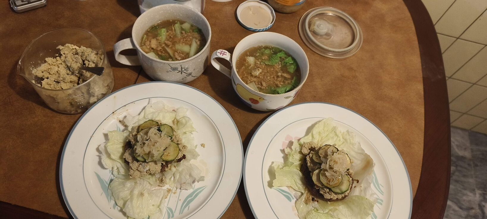,[plain-yogurt]
4. 21:41 140mg/dL⁵(,9¹²,3²⁹)
 -`{5H<B}`[plain-yogurt,ml.]
5. 23:57 115mg/dL³(,11²⁸,2¹³)
 -`{3⁻R>A,6T<T}`

#### 20260316Mon
1. 05:28 159mg/dL¹(5⁰)
 -`{4½H<B}`〘睡〙
2. 07:59 120mg/dL₁(7³¹,,2²⁸)<!--(2,5,5.5)-->
 -`{2½H>B}`[cf.鹽]
3. 12:11 115mg/dL₂
 -`{2H4½R>T}`[大全聯: 味噌炸豚排(裏澱粉),大雞腿(塗糖醬)]
 -`{6⁺I<A}`
4. 14:49 240mg/dL₃(,0⁵⁷,)<!--sleeping because of hyper-->
 -`{(6+6)H<>BB}`[cf.ml.]
5. 17:09 31mg/dL₄(3¹⁷,2¹⁶)[ml.+10g GP.,乳清蛋白₂]<!--GP.=glucose-powder-->
6. 18:42 103mg/dL₅(,4⁵⁰,3⁴⁹)
 -`{4R½I<内}`[豚,菜,egg]
7. 23:44 223mg/dL₆
 -`{6½H<B}`[ch.₃]<!-- ch.=cheese -->
8. 01:48 176mg/dL₇
 -`{7R>B}`

#### 20260317Tue
1. 07:03 77mg/dL₈(,5⁷)
 -`{6I>A}`〘睡〙
2. 10:45 97mg/dL⁹(,3³³,)[ml.(少)]
 -`{5R<B}`[豚三層,egg₂]
 -`{6I<T}`
3. 15:11 167mg/dL⁶(,1³⁰,3³²)
 -`{5H>B}`[BC.杏]
4. 16:29 133mg/dL⁵(,2⁴⁹,1¹⁵)
5. 17:48 87mg/dL⁶(,4⁸,2³⁴)
 -`{4⁺R½⁻I<B}`〘W₂〙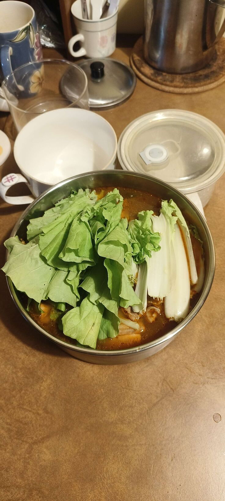
6. 21:52 85mg/dL³(,8¹⁵,3⁴²)[pumpkin-seeds]
7. 00:56 185mg/dL⁴(,11¹⁶,6⁴⁶)
 -`{3H4R>B,8T>内}`
8. 02:13 166mg/dL⁵(,,1¹⁴)

#### 20260318Wed
1. 07:14 103mg/dL⁶(6¹⁴)
 -`{2½R<A}`〘睡〙
2. 11:07 101mg/dL⁷(10⁸,,3⁴⁹)
 -`{2½R<B}`[pumpkin-seeds]
3. 13:28 131mg/dL⁸(,,2⁵)
 -`{4½H>B}`[BC鹽]
4. 17:46 72mg/dL⁹(,,4¹³)
 -`{3½R½I<B}`[豚,egg₃,菜,豆腐(少),pumpkin-seeds]
5. 20:02 96mg/dL⁰
 -`{5I>B}`[BT.鹽]
6. 22:36 166mg/dL⁰(,2²⁴,4⁴⁵)
 -`{6H<B}`[ch.]〘bed-yoga〙

#### 20260319Thu
1. 03:41 95mg/dL₉(,,5²)
 -`{½H2½R>T}`<!--(0,6.5,7)-->[BT.杏]
2. 07:21 97mg/dL⁸(,,3³⁷)
 -`{2R>A}`[BC.杏]
3. 11:23 102mg/dL⁷(,,3⁵²)<!--slewp for about 1½h, (0,5,5.5)-->
 -`{3H>B}`[BC.鹽]
4. 14:11 94mg/dL⁶(,,2³⁶)
 -`{5I<B}`[hypo(,1⁴⁸,): 南瓜子]
5. 18:06 192mg/dL⁵(,3⁴⁶,)
 -`{7H>B,7R<内}`[豚,菜,ch₁]
 -`{6I<B}`
6. 20:36 126mg/dL⁴(,0²⁶,2²⁹)
 -`{7T<T,3N>B}`[豚,南瓜子,啤酒]
7. 23:08 32mg/dL³(2³⁰,3⁰,2²⁸)[ml.,15g(glucose powder)]
8. 01:33 138mg/dL²(4⁵⁴,5²²,4⁵²)
 -`{1½H4R<B,7T>内}`

#### 20260320Fri
1. 08:54 175mg/dL¹(7⁶,,)<!--(2,5,4.5)-->
 -`{7H>B,7T>T}`〘睡〙
2. 11:22 138mg/dL₁(9³⁴,,2²⁵)<!-- not so well-being, but better than days before -->
 -`{5H<B}`[南瓜子,ml.,cf.]
 -`{4H>B,7T<A}`[豚,菜,egg₂]
 -`{4R1I<T}`[乳清蛋白]
3. 16:18 77mg/dL₂(3²⁰,,2⁰)
 -`{5½R½I<B}`[豚,egg₃,豆腐,菜]
4. 20:23 141mg/dL₃(7²⁶,,1⁵¹)
 -`{3½R3N>B,6T>A}`
5. 23:35 56mg/dL₄(3⁸,,3¹⁰)[15g,ml.]
6. 00:14 66mg/dL₅[6g,ml.]
 -`{2½R<内,6T<B}`

#### 20260321Sat
1. 03:31 107mg/dL₆(3⁷,,3⁸)
 -`{2⁻R>B}`〘睡〙
2. 09:25 106mg/dL₇(9⁰,,)
 -`{6T<A,2H<B}`<!--(2,5,4.5)-->[cf.鹽]〘W₁〙
3. 13:10 118mg/dL₈(3⁴¹,,3³²)
 -`{2⁻H>B,5I>T}`[cf.鹽]
4. 17:15 45mg/dL₉(7⁴⁶,4¹,4³)[15g]
 -`{3½R1½I<B}`[豚,egg₂,菜,豆腐]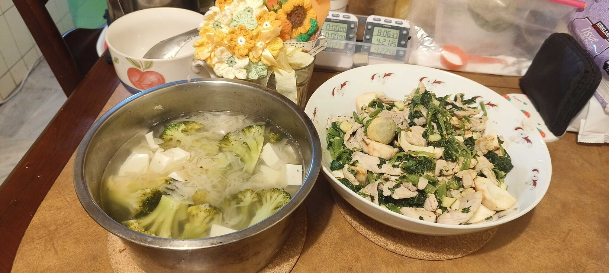
5. 19:15 77mg/dL₀(9⁴⁶,6¹,6²)
 -`{4⁺I>内}`〖W½〗<!--hypo feeling-->
6. 21:25 57mg/dL₀(,2⁷,3⁵²)[6g,糖(少)]
7. 23:14 87mg/dL₉(,3⁵⁷,)<!--I can't concentrate on my reading-->[6g+鹽+butter]<!--twittering instead of reading-->
8. 00:51 88mg/dL₈(,5³⁴,)
 -`{7T>A,2½R<B}`<!--yoga-->

#### 20260322Sun
1. 07:36 37mg/dL₇(6³⁶,,6³³)<!--hypo felt, 1,6,6-->
 -`{5½I<A}`[cf.鹽杏]
2. 12:03 131mg/dL₆(,3³³,)[cf.鹽杏]
3. 14:02 139mg/dL₅(,5²⁸,)
 -`{2½H>B,5T<T}`
4. 16:11 90mg/dL₄(1⁵⁸,7³⁷,2⁰)[tea,鹽]
5. 18:04 53mg/dL₃(3⁵²,9³⁰,3⁵⁴)[貢丸,蛋餃,豚,egg₃,菜]<!--hypo feeling-->
 -`{5R<B}`[貢丸,蛋餃,豚,菜]
6. 21:09 75mg/dL₂(6⁵⁶,,2³⁰)[南瓜子,tea杏]
7. 22:44 96mg/dL¹(8³¹,,4⁵)<!--cannot focus on reading, agitated and violent scenes emerging-->
 -`{7T<内,3½R>A}`[南瓜子(少)]
8. 01:25 110mg/dL²(2²⁶,,2²³)
 -`{2R>B}`[4g]

#### 20260323Mon
1. 06:49 127mg/dL³(7⁵⁰,,5²¹)
 -`{3⁻R<B}`[南瓜子]〖睡〗
 -`{2R>B}`〖睡〗
2. 11:29 106mg/dL⁴(12³⁰,,2⁷)
 -`{4⁻R<A}`[南瓜子]<!--(4,4.5,4),not good-->[cf.鹽]<!--a terrible day with bad sleeping, foggy and agitated-->
 -`{6⁻I>T}`[晚餐剩菜,南瓜子]
 -`{3⁺R>内}`
 -`{4⁻R<B,7T>A}`[ch.,egg₃,豚,菜]
 -`{3½I>B}`[BT.]
3. 20:16 54mg/dL⁵(3⁸,1⁴⁴,3⁹)[南瓜子,6g,啤酒]
 -`{3½I>B}`
4. 22:32 85mg/dL⁶(5²⁴,0³¹,)
5. 01:28 98mg/dL⁷(8²⁰,3²⁷,)
 -`{3I<B}`[南瓜子]
6. 03:23 120mg/dL⁸(,1⁴⁴,)
 -`{4½R>B,6T<T}`

#### 20260324Tue
1. 06:32 41mg/dL⁹(2⁵⁶,,2⁵⁸)
 -`{2H<B}`〘睡〙
2. 10:03 32mg/dL⁰(7¹⁰,,3³⁸)<!--0,5,5.5-->
 -`{6I<A}`[egg₂,酸菜,cf.杏]<!--feel good-->
3. 13:05 113mg/dL⁹(9²⁹,1⁵⁸,)
 -`{3⁺R>B}`[cm.杏鹽]
4. 16:12 96mg/dL⁸(,5⁶,2⁵⁵)
 -`{2½R<B}`
 -`{4I<内}`(,6⁵,0⁵⁵)
5. 18:00 64mg/dL⁷(,0⁴⁸,1⁴⁴)[豚,egg₂,菜]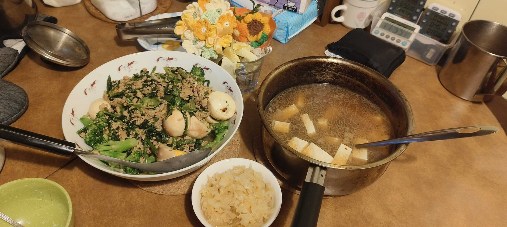
 -`{3⁺R>T}`(,1⁵⁰,2⁴⁶)<!--sleeping; too late to take bolus shot-->
6. 20:45 54mg/dL⁶(,3³³,1⁴²)[花生,ml.(少)]
 -`{1H1R>B}`(,4¹²,2²⁰)
 -`{½H1½R>A}`(0,5⁵⁶,1⁴⁴)<!--agitated so take a little dosage-->[ml.(少)]
7. 00:20 58mg/dL⁵(,7⁸,1¹¹)[8g]
 -`{3⁻R<A,7T>内}`

#### 20260325Wed
 -`{02:40 4⁻R<B}`
1. 06:30 79mg/dL⁴(5⁴⁵,,7²²/3⁵¹)<!--pee:3, sleep terrible-->
 -`{2R6T<T}`〘睡〙
2. 11:09 95mg/dL³(4²⁸,,4²⁸)<!--keep peeing, feeling bad-->
 -`{3H6T<内}`[ml.(少),cf.]
3. 14:30 139mg/dL²(3¹⁸,,3¹⁸)
 -`{2½H4R<B}`[egg₂,酸菜,fat],[ml.,cf.,fat]
4. 18:20 120mg/dL¹(6⁵⁷,,3³⁷)
 -`{4½R½I>B}`[雞肉,egg₃,酸菜]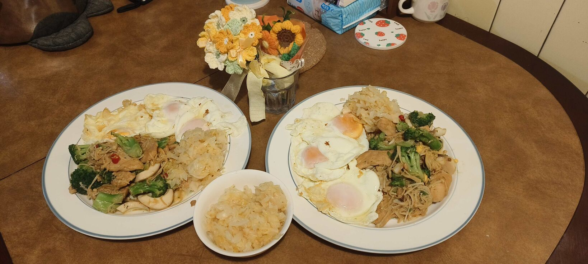
 -`{3R1⁻I>A}`(9⁴⁸,,2¹⁵)〘W₁〙
5. 22:39 72mg/dL₁(,,1³⁷)[ml₄+cm.+butter+鹽]
6. 00:19 136mg/dL₂(,,3¹⁶)
 -`{2½H2R<B}`[南瓜子]
7. 02:34 91mg/dL₃(,,2¹⁰)
 -`{2⁺R>内,(4⁺+4)T>T<A}`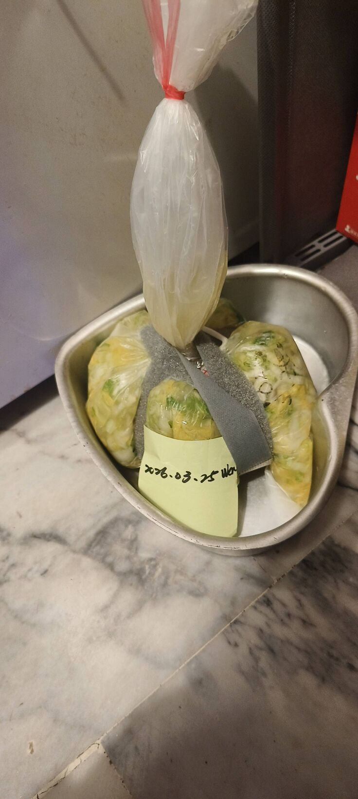

#### 20260326Thu
1. 07:11 37mg/dL₄(4²³,,4²⁵)[南瓜子,ml.(少),cf.]<!--0,5,5.5; feeling quite good. BG will go up 'cause DP, so I'll check it later.-->
2. 10:10 161mg/dL₅(7²²,,7²⁴)
 -`{6H>B,7T>A}`[cf.,杏]
3. 12:35 111mg/dL₆(2²²,,2²³)
 -`{2⁺I<B}`
4. 15:16 83mg/dL₇(5³,2³²,5⁴)[南瓜子,BC.]
5. 18:22 87mg/dL₈(8⁹,5³⁹,)
 -`{5½R½I>B}`[dinner: 豚(多),egg₂,菜,豆腐,酸菜]
 -`{7T<T,4R<B}`(10¹⁸,7⁵⁰,2⁶)[ml.(少),cm.杏]
6. 22:35 82mg/dL₉(2⁴,,2³)[ml₃+fat鹽]
 -`{3⁺R<内,6T<A}`

#### 20260327Fri
1. 04:00 120mg/dL₀(4⁶,,4⁷)
 -`{3⁺R>B}`〘睡〙
2. 08:38 147mg/dL₉(8⁴⁵,,4³⁶)
 -`{6½H<B,7T>A}`〘睡〙
 -`{11:51 4⁻R<B}`[豚三層,egg₁酸菜]
 -`{14:02 7T>内,2½R2½I>B}`
 -`{15:39 5⁻H<B}`[ml₃+cf.+fat鹽]
3. 18:07 90mg/dL₇(4⁷,,2²⁸)[南瓜子]
4. 20:05 86mg/dL₆(6⁶,,4²⁶)〘睡〙
5. 22:30 106mg/dL₅(8³¹,,6⁵²)
 -`{7T>T,2½H>B}`[椰奶+fat鹽],[椰奶+fat鹽]
6. 03:30 93mg/dL₄(4⁵⁶,,4⁵⁵)[南瓜子]
 -`{7T<A,4⁻R<T}`(6³³,,6³²)

#### 20260328Sat
1. 10:18 97mg/dL₃(5¹²,,5¹¹)
 -`{7T>A,2½>B}`
 -`{11:27 5R1⁻I<B}`[「聚」火鍋:澱粉,肉,菜]
 -`{14:16 5⁺R>T}`(9¹⁰,,2⁴⁸)
2. 16:19 223mg/dL₂(,,2³)
 -`{16:21 7½H>B,7T<A,3R3I<内}`〘W½〙
3. 19:44 45mg/dL₁(3²²,,3²³)[23g powder milk(≈9g乳糖)+butter]
 -`{22:05 7T<B}`
4. 00:34 102mg/dL¹(2²⁹,,)
 -`{00:44 7T>B,5⁻R<T}`

#### 20260329Sun
1. 08:35 34mg/dL²(7⁵¹,,7⁵⁰)[南瓜子,cf.鹽]
 -`{09:46 6I>A}`
2. 11:53 98mg/dL³(,2⁶,)
 -`{12:53 6R<B}`[豚,酸菜,BC.,椰奶]
3. 15:23 115mg/dL⁴(,5³⁷,2³⁰)
 -`{15:25 6⁺T>内}`
 -`{15:28 3½R>B}`〘W½〙[水煎包(少)]
4. 18:10 52mg/dL⁵(2⁴⁴,,2⁴²)[ml.,澱粉,]
 -`{19:23 4⁻R<B}`[egg₂,豚,酸菜]
5. 21:37 192mg/dL⁶(6¹²,,2¹⁴)
 -`{21:40 (7+5)R>B<A}`
6. 00:33 57mg/dL⁷(9⁷,,2⁵³)[Doritos,15g]
 -`{01:05 (5+5)T>T<B}`
7. 03:09 73mg/dL⁸(2³,,)
 -`{03:21 2R<内}`

#### 20260330Mon
1. 08:38 39mg/dL⁹(7³³,,5¹⁸)[10g,Doritos, 南瓜子]
 -`{08:49 7T<A}`
 -`{08:50 2R>B}`[Doritos]
2. 12:03 121mg/dL⁰(3¹⁴,,3¹³)
 -`{12:06 1⁺H4⁺R<T}`[banana. Egg₂+酸菜]
3. 14:31 121mg/dL⁰(5⁴³,,2²⁵)
 -`{14:42 2H6T>内}`
4. 17:43 60mg/dL⁹(3¹,,3¹)[豚,菜]
 -`{18:05 4R½I<B}`[豚,菜]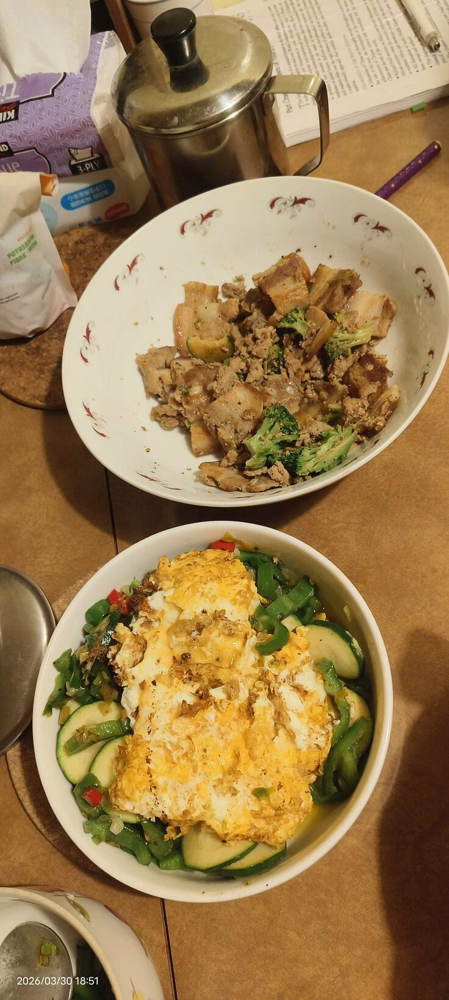
5. 20:27 98mg/dL⁸(5⁴⁵,,5⁴⁵)
 -`{20:45 3H>B}`[beer,南瓜子]
6. 22:46 97mg/dL⁷(8⁴,,2²)
 -`{23:24 (6+6)T>A>T}`
 -`{23:25 3½R<B}`

#### 20260331Tue
1. 06:18 161mg/dL⁶(6⁵⁴,,6⁵²)
 -`{06:20 6½H>B}`〘睡〙
2. 09:48 67mg/dL⁵(,,3²⁸)
 -`{11:47 5R<A}`[剩菜,egg₁+butter+cf.+tea]
3. 13:49 118mg/dL⁴(,,2⁰)
 -`{13:54 2½H7T<内}`
 -`{17:29 4½R<T}`[豚三層,酸菜]
4. 19:25 151mg/dL³(5³¹,,1⁵⁶)[[BT.+egg₁]
 -`{19:29 4N6T<B}`[BT.+egg₁,南瓜子,banana]
5. 23:16 189mg/dL²(3⁴⁶,,3⁴⁶)
 -`{23:19 5H>B}`
6. 00:52 171mg/dl¹(5²³,,1³³)
 -`{00:58 5R>T}`
 -`{00:59 7T>A}`

#### 20260401Wed
1. 03:27 86mg/dL₁(2²⁸,,2²⁹)
 -`{03:32 3½I<A}`〘睡〙[南瓜子,鹽]
2. 06:59 75mg/dL₂(6²,3²⁸,)
 -`{07:04 6½T>内}`〘睡〙[南瓜子,鹽]
3. 09:12 85mg/dL₃(2⁸,5⁴⁰,)
 -`{09:15 3I<B}`〘睡〙[南瓜子,鹽]
4. 11:04 75mg/dL₄(4²⁹,2¹⁸/8²,)[10g]
 -`{12:56 2H3R>B}`[豚三層,酸菜.,BC+鹽]
5. 14:47 84mg/dL₅(7⁴³,5³²,1⁵²)
 -`{15:01 8T<T}`
6. 16:06 82mg/dL₆(1⁵,6⁵¹,3¹⁰)
7. 18:25 122mg/dL₇(3²⁴,9¹⁰,5²⁹)
 -`{18:29 4H4R<B}`[豚,酸菜,櫛瓜,egg₂,菜]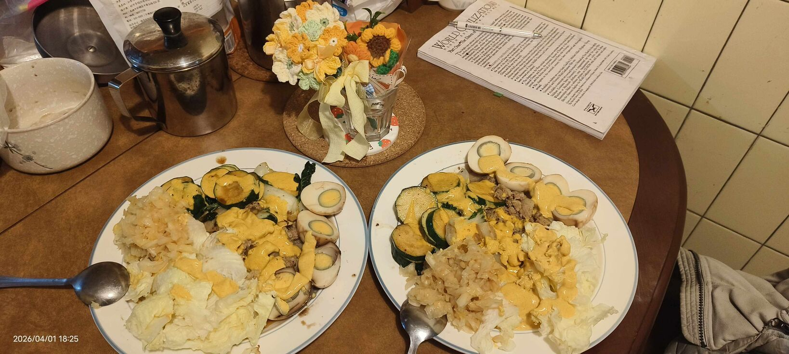
8. 20:56 108mg/dL₈(5⁵⁴,,2²⁶)
9. 22:01 125mg/dL₉(7⁰,,3³²)<!--4R's effect is less than 3h when eating-->
 -`{22:08 3H7T<内}`[BC.+egg₁.,椰奶+芝麻糊(少)]
10. 23:33 129mg/dL₀(8₃₁,,1₂₅)
 -`{23:40 4R>T}`
11. 01:32 118mg/dL₀(3²⁵,,1⁵³)
 -`{01:50 7T>A}`
 -`{01:52 2½R>B}`

#### 20260402Thu
1. 04:03 77mg/dL₉(2¹²,,2¹⁰)<!--(1,6,6)-->
 -`{04:08 1½I<B}`[ml.南瓜子]
 -`{06:54 2½H7T<A}`[BC+egg₁+cf.]
2. 07:44 101mg/dL₈(5⁵⁴/0⁵⁰,3³⁶,0⁵⁰)
3. 08:29 96mg/dL₇(6³⁸/1³⁴,4²⁰,1³⁵)
 -`{08:36 1H2R>B}`[10:04 egg,酸菜,豚]
4. 11:01 53mg/dL₅(4⁷,,2²⁵)[10g,豚₂]
 -`{11:34 3R4T<T}`〘12:00 W½〙
5. 14:53 175mg/dL₄(3¹⁸/7⁵⁸,,3¹⁸)
 -`{14:56 9R>B}`
6. 17:11 95mg/dL₃(5³⁶,,2¹⁵)
 -`{17:48 3R7T<B}`[外食牛排:澱粉,肉,菜]
7. 20:03 64mg/dL₂(,,5⁷/2¹⁵)
8. 21:11 70mg/dL¹(3²²,,3²²)[糖]
9. 22:58 89mg/dL²(5¹⁰,,5¹⁰)
 -`{23:10 3R7T>内}`

#### 20260403Fri
1. 03:50 39mg/dL³(4⁴⁰,,4⁴⁰)[12g]
2. 05:45 78mg/dL⁴(6³²,,)
3. 07:35 71mg/dL⁵(8²⁵,,)
 -`{07:46 4R6T>B}`[7-11外食,coffee]〘W₁〙
4. 12:53 108mg/dL⁶(5⁷,,)
 -`{13:26 4½R7T>T}`[火鍋,料(有澱粉)]
5. 15:18 199mg/dL⁷(1⁵²,,1⁵²)
 -`{15:21 3H6R<B}`
6. 17:33 83mg/dL⁸(4⁶,,2¹¹)[12g]
7. 19:29 127mg/dL⁹(6³,,4⁸)
 -`{19:32 5R7T>A}`[The German sausage]
8. 21:52 94mg/dL⁰(2¹⁹,,2¹⁹)
 -`{22:38 3R7T<内}`

#### 20260404Sat
1. 06:32 41mg/dL⁰(7⁵³)[12g]
 -`{07:09 4½R7T<A}`[cookies.,豚,香腸,菜]
2. 09:09 141mg/dL⁹(2⁰)
 -`{09:11 2H4R>B}`
3. 11:39 73mg/dL⁹(4³⁰,,2²⁸)
 -`{11:41 5R1I<B}`[香腸,肉,菜]
4. 14:02 85mg/dL⁸(6⁵²,,2²⁰)
 -`{14:20 7T<T}`
5. 17:47 103mg/dL⁷(3²⁷)
 -`{17:50 7R>内}`[香腸(少),肉,菜] 
6. 20:41 123mg/dL⁶(6²²,,2⁵²)
 -`{20:49 3½H7T>B}`
7. 01:08 160mg/dL⁵(4²⁰)
 -`{01:16 6R4T<B}`

#### 20260405Sun
1. 06:33 60mg/dL⁴(5¹⁶)〘睡〙
2. 08:55 51mg/dL³(7³⁹)
 -`{08:58 4R7T>A}`[醬,egg₂]<!--feeling not comfortable after going back sleeping, might resulting from without insulin after 6:33-->
3. 13:23 96mg/dL²(4²⁶)
 -`{13:37 5⁺R>B}`[lunch:醬,肉,菜]
4. 16:54 116mg/dL¹(7⁵⁵,,3¹⁶)
 -`{17:03 5R7T<B}`[ml.奶茶],[dinner]
5. 20:46 178mg/dL₁(3⁴³)
 -`{20:49 3H5R>B}`[椰奶,tea]
6. 23:04 110mg/dL₂(6⁰,,2¹⁴)
 -`{23:13 1H3R>T}`
 -`{00:23 5T<内}`
7. 01:53 65mg/dL₃(1²⁹,,2³⁹)[12g]
 -`{02:40 2½R<B}`
 -`{02:41 4T>A}`

#### 20260406Mon
 -`{05:01 3I>B}`〘睡〙
1. 08:08 33mg/dL₄(5²⁸,3⁰⁸,)[12g,椰奶,cf.]
 -`{09:32 5I<A}`
2. 10:04 109mg/dL₅(7²⁶,0³⁵,)
 -`{11:27 6½R<B}`[lunch]
3. 13:04 107mg/dL₆(,3⁵⁵,2⁰)
 -`{13:33 2½R>B}`[椰奶+cf.]
4. 14:04 110mg/dL₇(5⁴,1³,)
 -`{14:44 1½H5I<T}`
5. 16:04 57mg/dL₉(,1¹⁷,1¹⁷)[12g, dinner: 醬,肉]
 -`{16:51 4R>内}`
 -`{18:47 2R7T>A}`<!--in the brink of violent imagination, and can't take 2 shots of R and T but combining them in the bus-->
6. 21:04 129mg/dL₀(2²²)
 -`{21:11 4½R<B}`〘W½〙
7. 22:49 84mg/dL₀(4³,,1³⁹)[醬+肉,8g,椰奶]
8. 00:35 70mg/dL₉(5⁴⁸,,3²⁵)[12g]
 -`{00:49 (4+4)T>T>B}`
 -`{00:53 3½R<内}`

#### 20260407Tue
1. 07:04 92mg/dL₈(6⁴²,, 6³⁸)
 -`{07:35 6I<A}`〘睡〙
2. 09:04 105mg/dL₇(,2¹⁷,)
 -`{09:54 2½R>B}`
 -`{09:56 7T<T}`[椰奶tea]
3. 14:04 82mg/dL₆(4⁵³,7¹⁴,4⁵⁵)
 -`{14:53 4R<B}`[豚]
 -`{18:02 7T>内}`
4. 18:20 57mg/dL₅(8²⁴/0¹⁸,,3²⁸)
 -`{18:23 3½R1½I>B}`[dinner:豚,菜,egg₂]
5. 20:58 96mg/dL₄(2⁵⁶,,2³⁵)
 -`{21:00 3½R<B}`[ml₂]
6. 00:04 112mg/dL₃(6⁹,,3¹¹)
 -`{00:17 (4+4)T>A<内}`
 -`{00:19 5R>T}`

#### 20260408Wed
1. 06:20 106mg/dL₂(6²,,)
 -`{06:27 3⁺R<A}`〘睡〙
2. 09:40 61mg/dL₁(9²³,,3¹³)
 -`{09:43 7T<T}`
 -`{10:43 2R>B}`[12g+BC.鹽]
3. 12:48 121mg/dL¹(3⁴,,2⁴)
 -`{12:51 3⁺R<B}`
4. 15:22 51mg/dL²(5³⁹,,2³¹)
 -`{15:25 3I>内}`<!--3⁺R is too much-->[15g+fat鹽]
5. 18:07 55mg/dL³(8²⁴,2⁴², )
 -`{18:25 7T<内}`<!--having frequent urination feeling and taking 7T-->[egg₃,酸菜]
 -`{20:03 ½I2½R>B}`<!--20:55 the frequent urinated feeling is gone-->
 -`{22:38 2R<B}`
6. 22:40 56mg/dL⁴(4¹⁵,,2³⁶)[12g+BT.,egg₁]
7. 00:41 33mg/dL⁵(6¹⁷,,4³⁹/2⁴)<!--violent imagination-->[24g]
8. 01:37 111mg/dL⁶(7¹⁰,,2⁵⁸)
 -`{01:39 (4+4)T>A>B}`
 -`{01:42 4R>T}`

#### 20260409Thu<!--fasting day1-->
1. 05:21 33mg/dL⁷(3⁴¹,,3³⁸)[12g]
 -`{05:26 2R<B}`[6g]〘睡〙
2. 09:11 49mg/dL⁸(7³²,,3⁴⁵)
 -`{09:15 7T<A}`[6g+BC., cf.鹽]
3. 12:18 96mg/dL⁹(3²,,)
 -`{12:21 6T<T}`
4. 15:52 85mg/dL⁰(3³⁰/6³⁶,,)[6g+BT.鹽]
5. 17:08 98mg/dL⁰(7⁵³/4⁴⁷,,)
 -`{17:19 6T>内}`[BT.鹽]
6. 20:21 96mg/dL⁹(3³/8¹,,)
 -`{20:27 6T>B}`[BT.鹽]
7. 23:34 67mg/dL⁸(3⁷/6¹⁵,,)[20g+BT.鹽]
8. 00:30 121mg/dL⁷(4³/7¹¹,,)<!--18g is much; 10g is enough-->
 -`{00:34 (5+6+6)T<B>A>T}`

#### 20260410Fri<!--fasting day2, f.u. feeling-->
1. 04:56 75mg/dL⁶(4²²)[5g]
2. 06:59 68mg/dL⁵(6²⁵)
 -`{07:01 7T<内}`[4g+BC鹽]<!--too much, should be less after the 1st day of fasting-->
3. 10:43 38mg/dL⁴(3⁴²)[24g]
 -`{11:08 6T<B}`
4. 11:39 109mg/dL³(4³⁷/0³⁰)<!--30-35mg/dL per 10g-->
 -`{12:33 0.7N>B}`
5. 14:03 97mg/dL²(7¹/2⁵⁴,,1²⁹)
 -`{14:10 4T<A}`[BT.鹽]
6. 17:01 42mg/dL¹(2⁵¹/5⁵³)[15g]
7. 18:05 71mg/dL₂(6⁵⁶/3⁵⁴,,)
 -`{18:56 3T>T}`[4g+BT鹽]
8. 20:28 70mg/dL₃(6¹⁶/1³⁰,,)

1. 23:45 44mg/dL₄(4⁴⁹/9³⁵)[12g]
 -`{23:50 2T>A}`〘睡〙
#### 20260411Sat<!--fasting day3-->
1. 06:53 51mg/dL₅(7²)
 -`{07:02 2T<A}`[10g+BC鹽]
2. 10:33 105mg/dL₆(3³⁰,,)
 -`{10:40 2T<B}`〘out-going〙
3. 13:02 102mg/dL₇(2²²,,)
 -`{13:06 3T>A}`
4. 15:22 95mg/dL₈(4⁴²/2¹⁶,)[cf.鹽]
    `{16:31 2T>B}`
5. 19:45 65mg/dL₉(6³⁹/3¹⁴,,)[10g]
 -`{20:30 2T<T}`[ct.杏]
6. 00:36 67mg/dL₀(8⁴/4⁶,,)[6.3g]
 -`{01:00 1½T>内}`

#### 20260412Sun<!--4st fasting day-->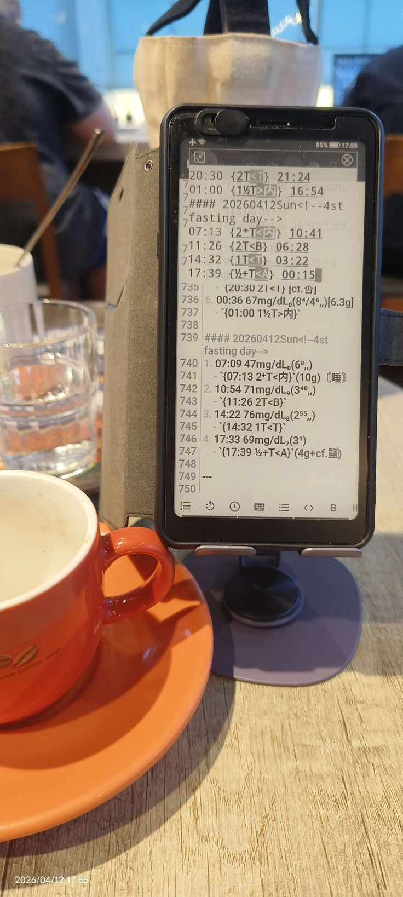
1. 07:09 47mg/dL₀(6⁸,,)
 -`{07:13 2⁺T<内}`(10g)〘睡〙
2. 10:54 71mg/dL₉(3⁴⁰,,)
 -`{11:26 2T<B}`
3. 14:22 76mg/dL₈(2⁵⁵,,)
 -`{14:32 1T<T}`
4. 17:33 69mg/dL₇(3¹)
 -`{17:39 ½+T<A}`(4g+cf.鹽)
5. 19:09 73mg/dL₆(4³⁶/1³⁰,,)[3g+BT]
6. 20:46 79mg/dL₅(6¹³/3⁶,,)
 -`{20:52 1T>内}`
7. 23:40 48mg/dL₄(6¹/2⁴⁸,,)
 -`{23:45 ½T>T}`[11g]
8. 01:45 75mg/dL₃(4⁵³/2⁰,,)
 -`{01:48 ½T>A}`

#### 20260413Mon<!--5th fasting day-->
1. 06:20 29mg/dL₂(6³⁵/4³²,,)[10g]
 -`{06:29 1T<A}`
2. 07:28 83mg/dL₁(0⁵⁸)〘睡〙
3. 10:18 56mg/dL¹(3⁴⁸)
 -`{10:28 ½⁺T>B}`[8g+BC]
4. 13:11 94mg/dL²(6⁴¹/2⁴²,,)
 -`{13:16 ½⁺T<B}`[BT鹽]
5. 16:04 96mg/dL³(5³⁵/2⁴⁷)
 -`{16:10 ½T<T}`[BT鹽]
6. 19:21 83mg/dL⁴(6⁶/3¹²)
 -`{19:33 0.3I<内}`〖bike+W〗
7. 22:56 78mg/dL₅(6⁴⁵,3²²,)
 -`{23:06 0.2I>T}`

#### 20260414Tue<!--6th fasting day-->
1. 05:55 55mg/dL⁶(,6⁴⁹,)[5g+鹽]
 -`{06:09 0.3I>A}`〖睡〗
2. 10:00 80mg/dL⁷(,3⁵⁰,)
 -`{10:03 0.3I>B}`[(BC鹽)x2]
3. 13:00 98mg/dL⁸(,2⁵⁶,)
 -`{13:06 0.35+I<B}`<!--got stomach pain; might be too much BT-->
4. 16:08 121mg/dL⁹(,3²,)
 -`{16:15 0.4I>内}`
 -`{16:17 0.35N<A}`[德佑胃乳10g]
5. 19:04 139mg/dL⁰(,2⁴⁸,2⁴⁶)<!--hyper, can't be lowered-->
 -`{19:17 0.7N>B}`
 -`{19:20 0.4I<T}`[泡菜汁]
6. 21:50 139mg/dL⁰(,2³⁰,2³³)
 -`{21:57 0.8N<B}`
 -`{22:23 3T>T}`

#### 20260415Wed<!--7th fasting day-->
1. 01:42 108mg/dL(3²³,,)
 -`{01:43 2T>B}`
2. 05:49 129mg/dL<!--吐 serious-->
 -`{05:52 4T<B}`
3. 10:14 191mg/dL
 -`{10:15 5R>B}`
 -`{10:16 4T<B}`
4. 13:41 177mg/dL
 -`{13:43 5R>A}`
5. 16:49 132mg/dL⁵
 -`{16:52 2R<A}`
 -`{16:54 2T<T}`
6. 19:57 105mg/dL
 -`{20:04 4½T<内}`[hot pod soup]
7. 22:31 148mg/dL³
 -`{22:37 3R>内}`[hot pod soup]
8. 01:38 184mg/dL²
 -`{01:40 8R>B}`
 -`{01:42 7T>T}`

#### 20260416Thu
1. 04:42 119mg/dL¹
 -`{04:46 7T<B}`
 -`{05:54 2½R<内}`〘睡〙
2. 10:43 104mg/dL₁(5⁵⁶,,4⁴⁸)
 -`{10:51 5R>A}`
 -`{10:52 7T<内}`[豚soupx2]
 -`{15:16 3R>B}`
 -`{15:16 5T<A}`[豚soup]
 -`{17:22 2½R<T}`
3. 19:03 96mg/dL₂(豚,雞,soup,椰奶)
 -`{20:04 8T>T}`
 -`{20:05 3½R<B}`
4. 00:28 127mg/dL₃[椰奶]
 -`{00:33 2½R<B}`
 -`{02:25 8T>内}`

#### 20260417Fri
1. 06:20 68mg/dL₄
 -`{06:31 5T>A}`〘睡〙
2. 11:49 57mg/dL₅
 -`{12:14 1I4R>B}`
 -`{12:16 7T<T}`[雞,酸菜]
3. 18:18 120mg/dL₆(6²,,)
 -`{18:21 7T<内}`
 -`{18:23 ½⁻I4½⁺R<B}`[澱粉,魚丸,貢丸,椰奶]
4. 22:08 185mg/dL₇
 -`{22:10 4H4R>B}`
5. 01:52 44mg/dL₈(7³⁰,,3⁴²)[15.4g]
 -`{02:09 8T>内}`
6. 03:28 92mg/dL₉(1²⁰,,)
7. 05:22 81mg/dL₀

#### 20260418Sat
1. 09:43 54mg/dL₉
 -`{09:41 7T>A}`[12g]〖睡,bike〗
2. 15:06 152mg/dL₈
 -`{15:08 8R>T}`
 -`{16:14 6T<内}`[costco雞塊x6,ml₄]
3. 17:27 145mg/dL₇
 -`{17:32 5R<B}`
4. 19:58 140mg/dL₆<!--chicken is just like sugar, its gluconeogenesis is terrible and hugh-->
 -`{20:01 4⁺H>B}`[ml₃]
 -`{22:11 5R<B}`
 -`{22:11 7T<A}`[hotpod,豚,鴨血,豆腐]
5. 00:36 39mg/dL₅(2²⁵,,2²⁵)[24g]
6. 02:12 114mg/dL₄
 -`{02:14 10T<T}`

#### 20260419Sun
1. 05:04 154mg/dL₃
 -`{05:46 1H3R>B}`〖睡〗
2. 10:16 106mg/dL₂
 -`{10:48 7I>A}`
 -`{11:57 8R>B}`[外食:skylark]
3. 14:37 98mg/dL₁
 -`{14:39 8T>内}`
4. 16:20 93mg/dL¹(1⁴¹,5³²,4²³)
5. 19:37 62mg/dL²(4⁵⁸,8⁴⁹,)
 -`{20:15 8I>T}`[外食:hotpod]
6. 21:51 121mg/dL³(7¹³,1³⁷,)
 -`{22:01 7T<A}`
 -`{23:00 3⁺H<B}`
7. 00:56 89mg/dL⁴
 -`{02:04 7T<内}`

#### 20260420Mon
1. 06:59 43mg/dL⁵[12g]〖睡〗
2. 09:38 63mg/dL⁶
 -`{09:40 4T<A}`〖睡〗
 -`{12:28 7I<T}`
 -`{13:04 3H1R>B}`[hotpod]
3. 14:52 71mg/dL⁷(5¹²,2²⁴,1⁴⁸)[ml₃+cf.]
 -`{15:38 7T>内}`
 -`{16:47 6I<B}`[ml₂+cf.]
4. 18:20 133mg/dL⁸
 -`{18:25 3H>B}`
5. 22:31 43mg/dL⁹[8g,豆腐+泡菜]
 -`{23:41 6I>A}`
6. 01:19 41mg/dL⁰[15g]
 -`{01:26 6T>T}`

#### 20260421Tue
1. 08:26 40mg/dL⁰
 -`{08:32 6I<A}`[ml₄+cf.]
2. 09:43 92mg/dL⁹
3. 11:56 103mg/dL⁸
 -`{11:58 7T<内}`[15:40 BT,泡菜+egg₂]
4. 16:04 91mg/dL⁷
 -`{16:20 5I<T}`
 -`{19:15 6T>B}`
5. 19:16 86mg/dL⁶[20:40 蝦+egg+泡菜]
6. 23:11 71mg/dL⁵
 -`{23:50 5T>T}`[00:58 ml₃+fat, 泡菜]
7. 02:06 82mg/dL₄
 -`{02:10 3T>A}`

#### 20260422Wed
1. 09:15 25mg/dL³
 -`{09:22 6I<A}`[ml₅+BC]
2. 12:11 133mg/dL²
 -`{12:13 3½H<B}`
 -`{12:13 7T>内}`[14:40 egg₂+泡菜]
3. 17:37 63mg/dL¹
 -`{18:08 6T<T}`[蝦+egg+泡菜]
4. 21:19 115mg/dL₁<!--should use NPH for dinner-->
 -`{21:25 3½I>T}`
 -`{21:26 6T>A}`

#### 20260423Thu
1. 04:24 21mg/dL₂<!--should take 9T instead of 3½T+6T-->[ml₃+cf.]
 -`{04:36 7T<A}`[BC]
2. 08:13 81mg/dL₂
 -`{09:22 5½I>B}`[09:40 蝦+泡菜,BC]
3. 12:05 152mg/dL₃<!--violent thought-->
 -`{12:07 4½H<B}`
 -`{12:24 7T<内}`
4. 17:07 43mg/dL₄[ml₃+BT]
 -`{18:25 6½I<T}`[雞(糖),蝦,菜,豆腐]
 -`{19:25 6T>内}`
5. 21:48 169mg/dL₅
 -`{21:50 6H>B}`[ml₃BT]
6. 23:59 164mg/dL₆
 -`{00:01 7T>A}`
 -`{00:02 7I>T}`
 -`{00:03 2H<B}`

#### 20260424Fri
1. 05:11 64mg/dL₇〖睡〗
 -`{08:36 5I<A}`[ml₃+BT,茹,BC]
2. 11:06 82mg/dL₈
 -`{11:41 7T>B}`
 -`{16:53 5T<内}`[炸青椒]
3. 19:06 70mg/dL₉[菜湯,炸菜]
4. 22:11 45mg/dL₀
 -`{22:19 5T<B}`[ml₃, egg₂+泡菜]
5. 00:44 82mg/dL₉
 -`{00:46 6T<T}`

#### 20260425Sat
1. 05:40 70mg/dL₈
 -`{07:28 5I>A}`〘睡〙<!--terrible wakeup, feeling miserable, take I then go back sleep-->[10:21 BC]
2. 11:12 43mg/dL₇[10:40 ml₃+cf.][12:00 烤雞₃]
 -`{12:21 2I4R>B}`
 -`{13:44 7T>内}`
3. 18:24 80mg/dL₆
 -`{18:26 6I>T}`[牛+fat]
4. 21:31 65mg/dL₅
 -`{23:12 7T<A}`[ml₃BT]
5. 01:59 148mg/dL₄
 -`{02:01 12T<T}`

#### 20260426Sun
1. 05:30 123mg/dL₃
 -`{05:34 2⁺H<B}`〖睡〗
2. 09:39 66mg/dL₂
 -`{10:01 6I>A}`[ml₃+TBT]
3. 14:04 83mg/dL₁
 -`{16:46 5I>B}`[egg₄,菜]
 -`{20:18 5I<B}`[豆腐,牛,菜]
4. 22:10 108mg/dL¹
 -`{22:28 12T<A}`

#### 20260427Mon
1. 05:26 114mg/dL²
 -`{05:28 1H3½R>B}`[BC]
 -`{08:21 3I<内}`[ml₃+BC]
2. 12:05 102mg/dL³
 -`{12:16 6I<B}`[外食：糖豚、菜]
 -`{12:46 3H>A}`
3. 15:59 126mg/dL⁴
 -`{16:01 2½H>B}`
 -`{18:22 6I>T}`[dinner]
4. 22:51 52mg/dL⁵
 -`{23:08 13T<B}`

#### 20260428Tue
1. 06:46 92mg/dL⁶
 -`{06:48 2R<A}`〘睡〙[ml₃BC]
 -`{11:33 6I>内}`[蒜+egg₂]
2. 14:00 98mg/dL⁷
 -`{14:24 5I>B}`[16:40 steak+蒜]
 -`{18:15 6½I<B}`[ml₅]
3. 20:06 162mg/dL⁸
 -`{20:09 6H>B}`[ml₄+炸雞]
 -`{21:59 7I<T}`
4. 22:42 200mg/dL⁹
 -`{22:43 9H>B}`
5. 00:30 114mg/dL⁰
 -`{00:31 12T>A}`

#### 20260429Wed
1. 05:22 47mg/dL⁰
 -`{09:33 6I>A}`[ml₃+BC]
2. 12:13 108mg/dL⁹
 -`{12:15 5I<内}`[炸菇]
3. 17:30 103mg/dL⁸
 -`{17:32 7I>T}`[牛]<!--feeling sleeping-->
 -`{18:58 3⁺H<B}`
 -`{19:17 3H>B}`[ml₃+BT]
4. 22:03 63mg/dL⁷
 -`{22:13 10T<A}`[ml₂][豆腐]
5. 01:17 130mg/dL⁶
 -`{01:19 5R>内}`

#### 20260430Thu
1. 07:02 65mg/dL⁵
 -`{07:04 2H<B}`[ml₃BC]
2. 11:08 150mg/dL⁴
 -`{11:09 5H>B}`
 -`{11:10 6I>A}`
 -`{17:07 6I<内}`
3. 19:21 93mg/dL³
 -`{19:25 6½R<B}`[dinner]
 -`{22:32 5I<T}`
4. 00:03 49mg/dL²
 -`{00:40 10T>T}`

#### 20260501Fri
1. 05:56 61mg/dL¹
 -`{06:10 6I<A}`[ml₄BC]
 -`{10:55 6I>B}`
2. 12:09 164mg/dL₂
 -`{12:10 7H<B}`[lunch][ml₃]
 -`{14:50 9I>内}`[ml₃,牛]
3. 17:26 130mg/dL₃
 -`{17:28 4H>B}`
 -`{20:31 6½I<T}`[egg₃]
4. 21:37 111mg/dL₄
 -`{21:39 3½H<B}`
 -`{22:34 11T>A}`

#### 20260502Sat
1. 06:58 42mg/dL₅
 -`{07:06 6I<A}`[ml₂BC]
2. 12:54 126mg/dL₆
 -`{13:17 4H4R>A}`[starch,fried chicken]
3. 15:00 95mg/dL₇
 -`{15:02 6½I>T}`
4. 18:53 37mg/dL₈
 -`{21:59 1I8R>B}`[starch,meat,coconut cream,tea]
5. 00:30 269mg/dL₉
 -`{00:32 (8+7)H<B>B}`
6. 01:37 167mg/dL₉
 -`{01:41 4R<内}`
 -`{01:42 12T>T}`
7. 02:48 50mg/dL₈[5g+ml]

#### 20260503Sun
1. 06:02 51mg/dL₃
 -`{06:18 2½R<A}`[睡]
 -`{08:55 7I>内}`[coconut cream+cf.]
2. 13:12 164mg/dL₂
 -`{13:15 6H2R<B}`[starch,beef,coconut cream]
 -`{14:36 10I<T}`
3. 15:37 122mg/dL¹
 -`{16:27 3⁻H>B}`
4. 20:04 53mg/dL²
 -`{20:52 8I>A}`[dinner:cc.,豚三層]
5. 23:10 92mg/dL³
 -`{23:49 13T<内}`

#### 20260504Mon
1. 05:18 141mg/dL⁴
 -`{05:22 5H<A}`
 -`{06:49 4I>T}`[睡]
 -`{08:44 5H<B}`
2. 11:52 79mg/dL⁵
 -`{11:55 5I5R>A}`[lunch:澱粉、糖、肉]
3. 14:27 215mg/dL⁶
 -`{14:30 10H>B}`
 -`{14:31 7I>内}`
4. 18:17 88mg/dL⁷
 -`{20:48 7I<B}`[豚菜]
5. 23:12 97mg/dL⁸
 -`{23:14 (8+8)T<T>B}`

#### 20260505Tue
1. 05:42 182mg/dL⁹
 -`{05:43 8H<A}`
2. 09:34 72mg/dL⁰
 -`{09:39 0.7I<B}`[豚(少),菜]
 -`{12:26 5I<内}`[炸牛+]
 -`{14:52 4½R>B}`
 -`{17:30 7I>T}`[豚]
 -`{18:08 4½R>A}`
3. 22:51 144mg/dL⁰
 -`{22:55 4⁺H<B}`
 -`{00:23 4H>B}`[ml₃+cf.]
 -`{00:24 6I>内}`
4. 02:47 138mg/dL⁹
 -`{02:50 4½R<B}`
 -`{02:51 14T<T}`

#### 20260506Wed
1. 09:19 60mg/dL⁸
 -`{09:37 4I<A}`[BC.x2]
2. 12:49 112mg/dL⁷
 -`{12:51 4I>B}`
3. 16:31 96mg/dL⁶
 -`{18:17 6R<内}`
4. 22:14 103mg/dL⁵
 -`{22:17 12T>T}`
5. 01:07 171mg/dL⁴
 -`{01:08 4½I>A}`
 -`{01:10 7½R<B}`

#### 20260507Thu
1. 06:54 35mg/dL³[ml₃BC]
 -`{07:15 2½R<A}`
 -`{10:00 5I>内}`[BC]
2. 12:04 76mg/dL²[riced-cauliflower+egg₃]
 -`{14:13 4I>B}`
3. 16:53 114mg/dL¹
 -`{16:56 2½H<B}`
 -`{18:29 3I>B}`
4. 00:09 137mg/dL₂
 -`{00:12 3½H<B}`[ml₃]
5. 01:57 134mg/dL₃
 -`{02:00 3R>T}`
 -`{02:01 13T>A}`

#### 20260508Fri
1. 07:41 85mg/dL₄
 -`{07:48 2½R<A}`[BC]
 -`{09:26 4I<内}`[BC]
2. 12:23 76mg/dL₅
 -`{14:36 3I<T}`
3. 18:32 57mg/dL₆[牛,r.c.,泡菜]
 -`{19:22 4R>B}`
4. 00:10 144mg/dL₇
 -`{00:12 13T>A}`
 -`{01:26 4½R<B}`

#### 20260509Sat
1. 06:26 80mg/dL₈
 -`{06:30 3⁺R>内}`[BC,雞塊₂]
 -`{09:06 3I<A}`
2. 13:04 63mg/dL₉[豆漿+cf.]
 -`{13:42 3⁺I>B}`[hotdog+cf.]
3. 19:09 94mg/dL₉
 -`{19:23 3½R<B}`[豚三層(半條)+泡菜]
4. 21:44 90mg/dL₈
 -`{22:00 10T>T}`[ml₂]
 -`{22:31 2½R>A}`

#### 20260510Sun
1. 03:27 81mg/dL₇(5²⁶,,4⁵⁵)[睡]
2. 07:12 96mg/dL₆(9¹²,,8⁴¹)
 -`{07:15 1H3½R>B}`
 -`{08:57 2½I<A}`
3. 13:05 59mg/dL₅[皮,cf.+豆漿]
4. 18:27 109mg/dL₄
 -`{18:30 5⁻R<B}`[r.c.+豚三層+泡菜]
 -`{22:32 10T<T}`[豆漿,花生]
5. 01:12 139mg/dL₃
 -`{01:15 2½R<内}`
 -`{01:17 3I>B}`
 
#### 20260511Mon
1. 06:55 123mg/dL₂
 -`{06:56 3⁻H>A}`
 -`{08:27 5⁺I<B}`[花生,BC₂]
2. 11:59 114mg/dL¹
 -`{12:02 2½H>内}`
 -`{14:16 3⁻I>B}`[ml₂+豆漿+BC]
3. 19:30 88mg/dL²
 -`{19:31 4⁺R>T}`[牛+r.c., ml₂]
 -`{21:06 10T<A}`[南瓜(starch),豆漿]
4. 23:18 100mg/dL³
 -`{23:28 0.8⁺R<B}`
 -`{23:30 2⁺I<内}`

#### 20260512Tue
1. 06:18 154mg/dL⁴
 -`{06:20 3½H3R>B}`[BC]
 -`{08:07 6I>A}`[BC]
2. 11:30 48mg/dL⁵[ml₃BC]
3. 17:21 130mg/dL⁶
 -`{17:22 5½R>内}`[dinner]
4. 21:05 79mg/dL⁷
 -`{21:09 8T<B}`
 -`{22:42 1½R>B}`
 -`{22:45 2⁺I<T}`

#### 20260513Wed
1. 05:28 94mg/dL⁸
 -`{05:31 2½H<B}`[BC]
 -`{06:59 3½I<A}`[BC]
2. 11:31 98mg/dL⁹
 -`{11:33 0.6I>B}`
3. 17:58 99mg/dL₀
 -`{18:59 4R<内}`[豚三層+c.r.+泡菜,南瓜(少)]
4. 21:22 77mg/dL⁰
 -`{22:14 8T>T}`
 -`{22:16 1.2R>A}`

#### 20260514Thu
1. 05:56 170mg/dL⁹
 -`{05:58 6H<B}`
 -`{07:25 4I<A}`[BC₂]
2. 12:17 114mg/dL⁸
 -`{12:22 5I>内}`
3. 17:08 101mg/dL⁷
 -`{17:31 4⁻R<B}`[dinner]
 -`{19:22 4⁻R<B}`[ml多,南瓜]
4. 21:57 124mg/dL⁶
 -`{22:01 (10+10)T<T>A}`
5. 23:42 224mg/dL⁵
 -`{23:44 6R>B}`
 -`{23:45 3H<内}`
 -`{23:46 6T>T}`

#### 20260515Fri
1. 03:21 104mg/dL⁴
2. 06:44 146mg/dL³
 -`{06:46 4⁻H<B}`
3. 11:40 104mg/dL²
 -`{11:46 4½I<A}`
 -`{17:13 3R>B}`[dinner]
4. 18:09 111mg/dL¹
 -`{18:15 4I>内}`
 -`{19:27 2½H<B}`[ml]
5. 23:09 86mg/dL₂
 -`{23:17 14T<T}`
 -`{00:01 2R>B}`
    
#### 20260516Sat
1. 05:56 103mg/dL₃
 -`{06:17 2⁺H>A}`[BC]
 -`{08:46 4I<内}`[ml+cf.]
2. 11:58 134mg/dL₄
 -`{12:03 3H<B}`
3. 15:53 127mg/dL₅
 -`{16:00 4⁻R>B}`[醬+牛+菜]
4. 19:43 95mg/dL₆[BC]
5. 22:45 94mg/dL₇
 -`{23:13 10T>T}`

#### 20260517Sun
1. 02:55 104mg/dL₈
 -`{03:00 4I<B}`
2. 05:31 103mg/dL₉
 -`{05:36 4I<A}`[BC]
3. 12:55 119mg/dL₉
 -`{13:06 6R>B}`[外食:澱粉,糖]
 -`{14:55 10I>内}`
4. 16:15 183mg/dL₈
 -`{16:17 6½H<B}`
5. 17:42 107mg/dL₇[19:30 澱粉]
6. 20:44 106mg/dL₆
 -`{20:52 16½T<T}`
7. 00:02 139mg/dL₅
 -`{00:07 4½R>B}`

#### 20260518Mon
1. 05:31 32mg/dL₄[ml]
 -`{05:45 5I>A}`[ml₃]
2. 09:05 162mg/dL₃
 -`{09:07 5½H<B}`
3. 12:01 71mg/dL₂
 -`{14:10 3⁺R<内}`[牛+菜]
 -`{15:51 4I>T}`
4. 19:06 109mg/dL¹[rc₂+泡菜]
5. 21:19 152mg/dL²
 -`{21:22 14T<A}`
 -`{21:23 4R>B R}`

#### 20260519Tue
1. 03:59 124mg/dL³
 -`{04:05 2½H>B}`
2. 07:55 87mg/dL⁴
 -`{08:07 3½⁺I>A}`[BC₂]
3. 12:54 155mg/dL⁵
 -`{12:56 4H<B}`
 -`{13:48 4R>内}`[牛+泡菜]
 -`{16:34 6I<T}`
 -`{20:06 3½R>B}`[豚+泡菜]
4. 01:14 53mg/dL⁶
 -`{01:18 10⁺T<A}`[ml]
5. 05:09 143mg/dL⁷
 -`{05:11 4½R<B}`

#### 20260520Wed
 -`{09:24 6I<内}`
1. 12:21 75mg/dL⁸[豚,牛,菜]
 -`{13:58 5⁺R>B}`
 -`{15:27 5I<B}`[ml]
2. 16:40 67mg/dL⁹[fried shallots]
3. 19:24 153mg/dL⁰
 -`{19:26 5H>T}`
 -`{20:40 13T>A}`

#### 20260521Thu
1. 04:02 38mg/dL⁰
 -`{04:04 5I>内}`[ml₃+BC]
2. 09:24 33mg/dL⁹[ml₃]
3. 11:48 116mg/dL⁸
 -`{11:50 6⁻I<T}`[牛(少)]
4. 18:20 171mg/dL⁷
 -`{18:00 3½H6R>B}`[dinner:澱粉,肉]
 -`{20:24 6I>A}`
5. 01:01 110mg/dL⁶
 -`{01:04 14T<内}`

#### 20260522Fri
1. 05:25 62mg/dL⁵
2. 07:06 71mg/dL⁴[BC₃]
3. 12:11 81mg/dL³
4. 16:23 74mg/dL²
 -`{17:41 5I<B}`[egg₃+rc.,cf.]
5. 22:01 186mg/dL¹
 -`{22:02 15T<A}`
 -`{22:03 4H>B}`

#### 20260523Sat
1. 06:33 48mg/dL₂ 
2. 11:54 110mg/dL₃
 -`{11:56 6½R<B}`[lunch:澱粉,飲料:糖]
3. 13:47 167mg/dL₄
 -`{13:49 8½I>A}`[飲料:糖]
4. 15:55 144mg/dL₅
5. 19:33 167mg/dL₆[飲料:糖]
 -`{19:35 2½H3R>B}`[豆腐+菜]
6. 00:48 65mg/dL₇
 -`{01:03 10T>内}`[ml₃]

#### 20260524Sun
1. 08:14 142mg/dL₈
 -`{08:16 4H<B}`
2. 12:01 112mg/dL₉
 -`{12:06 5I>T}`
3. 18:11 124mg/dL₉
 -`{18:13 7R<A}`[外食:我家牛排]
4. 21:04 248mg/dL₈
 -`{21:06 7H>B}`
5. 00:07 55mg/dL₇[ml₃]
 -`{02:54 15⁺T<内}`

#### 20260525Mon
1. 06:42 185mg/dL₆
 -`{06:45 6½H>A}`
 -`{08:24 6I>内}`
2. 13:49 97mg/dL₅
 -`{14:26 5½I<B}`
 -`{18:48 5R>B}`[r.c.,牛(少),泡菜]
3. 21:25 77mg/dL₄
 -`{21:29 11T<T}`

#### 20260526Tue
1. 06:03 53mg/dL₃[BC]
 -`{09:05 3½I<A}`
2. 11:55 125mg/dL₂
 -`{11:56 4½I>A}`
3. 17:42 84mg/dL¹<!--不舒服、無法專心-->[堅果,熱狗]
4. 23:16 159mg/dL²
 -`{23:19 15T<B}`
5. 01:11 159mg/dL³
 -`{01:13 2H>B}`

#### 20260527Wed
1. 07:41 45mg/dL⁴[BC₃]
 -`{09:21 3I<内}`
2. 12:05 83mg/dL⁵[14:40 fat+花椰菜+蒜]
 -`{15:06 4⁻I>T}`
3. 19:03 90mg/dL⁶
 -`{21:50 9T<B}`

#### 20260528Thu
1. 04:24 31mg/dL⁷[BC]
2. 11:19 59mg/dL⁸[rc.+泡菜]
 -`{12:54 2½I<A}`
3. 18:30 94mg/dL⁹[酸奶(糖)+菜+鵝(少)]
4. 22:28 173mg/dL⁰
 -`{22:31 4½H>B}`[酸奶(糖)]
 -`{23:21 12T>内}`

#### 20260529Fri
1. 05:51 125mg/dL⁰
 -`{05:53 3H<B}`[BC]
2. 12:05 59mg/dL⁹
3. 20:52 70mg/dL⁸[egg₁,rc.,泡菜]
4. 22:13 112mg/dL⁷
 -`{22:20 12T<T}`

#### 20260530Sat
1. 04:19 124mg/dL⁶
 -`{04:21 2H>B}`
2. 11:54 140mg/dL⁵
 -`{11:56 6⁻I<B}`
 -`{17:37 7R>A}`[dinner:我家牛排]
3. 19:43 123mg/dL⁴
 -`{19:46 6½I<A}`<!--23:10 應打3I就好-->
4. 23:08 58mg/dL³[酸奶(糖)]
 -`{00:13 13T<内}`

#### 20260531Sun
1. 02:57 146mg/dL²
 -`{03:00 4⁻H>B}`〘睡〙
2. 08:13 161mg/dL¹
 -`{08:15 5½H<B}`[BC]
 -`{11:13 4⁺I>T}`
3. 15:24 61mg/dL₂
 -`{20:17 3½⁺R>内}`[rc.+三層+櫛瓜, 酸奶]
4. 22:46 34mg/dL₃[5g+酸奶]
5. 23:59 81mg/dL₄
 -`{00:06 15T>A}`
    
#### 20260601Mon
1. 05:56 211mg/dL₅<!--太晚吃晚餐+酸奶造成-->
 -`{05:58 8H>B}`[BC]
2. 08:40 148mg/dL₆
 -`{08:43 1½H<A}`
3. 11:06 166mg/dL₇
 -`{11:40 4⁺H<B}`
4. 14:46 64mg/dL₈[醬、魚]
5. 17:28 83mg/dL₉
 -`{17:34 4⁻R>B}`[外食:8鍋火鍋]
6. 22:37 173mg/dL₉
 -`{22:40 5½H<B}`
7. 01:07 65mg/dL₈
 -`{01:08 15T<内}`

#### 20260602Tue
1. 07:35 80mg/dL₇
 -`{08:29 3I>A}`[BC]
2. 12:59 125mg/dL₆
 -`{13:02 2H>B}`
3. 18:14 42mg/dL₅[dinner:豆腐+泡菜+肉]
 -`{19:16 4⁺R<T}`[ml₂]
4. 22:20 72mg/dL₄
 -`{22:35 14T>内}`

#### 20260603Wed
1. 07:04 97mg/dL₃
 -`{07:07 2⁺H<B}`〘睡〙[BC]
2. 12:22 87mg/dL₂[牛+egg₂,菜]
 -`{13:44 5⁺R<A}`
3. 16:46 53mg/dL¹[酸奶]
 -`{17:31 3H4R>B}`
4. 20:24 52mg/dL²[ml₃+fat]
5. 22:36 80mg/dL³
 -`{22:50 14T<B}`

#### 20260604Thu
1. 04:44 206mg/dL⁴
 -`{04:48 8H>B}`
2. 09:45 103mg/dL⁵[BT]
3. 11:57 115mg/dL⁶
 -`{12:01 1½H<B}`〘🚴₂〙
4. 16:54 98mg/dL⁷[20:30 蒜+牛+櫛瓜]
5. 21:46 139mg/dL⁸
 -`{21:49 2½H>内}`
6. 02:44 77mg/dL⁹
 -`{03:07 8T>T}`

#### 20260605Fri
1. 07:28 97mg/dL⁰
 -`{07:38 3½I>A}`[BT]
2. 12:40 129mg/dL⁹
 -`{12:43 2½⁻H>B}`[BT]
3. 17:33 63mg/dL⁸
 -`{18:00 4R<内}`[牛+櫛瓜+泡菜]
4. 22:06 99mg/dL⁷
 -`{22:09 15T<B}`

#### 20260606Sat
1. 06:26 74mg/dL⁶〘睡〙
2. 11:40 101mg/dL⁵
 -`{11:45 2⁻H<A}`[BC]〘bike₁½〙
3. 18:10 63mg/dL⁴[rc.+蒜+泡菜]
4. 00:17 110mg/dL³
 -`{00:19 16T>B}`

#### 20260607Sun
1. 05:57 92mg/dL²[BC]〘🚴🚶₂〙[BC]
2. 14:15 51mg/dL¹[18:00 egg₂+蒜+肉(少)+泡菜]
3. 20:46 110mg/dL₂
 -`{20:49 12T<B}`
 -`{21:11 1½H>内}`

#### 20260608Mon
1. 10:35 32mg/dL₃[ml₃]<!--serious hypo-->
2. 12:41 94mg/dL₄
 -`{12:49 3R2I>A}`[牛+蒜+菜,rc.+蒜+泡菜]
3. 18:17 153mg/dL₅
 -`{18:19 5½H>B}`
4. 00:04 37mg/dL₆

#### 20260609Tue
1. 05:15 93mg/dL₇〘睡〙
 -`{05:18 8T<B}`
2. 09:09 140mg/dL₈〘睡〙
 -`{09:12 3½R<A}`
3. 12:00 96mg/dL₉
4. 16:23 169mg/dL₈
 -`{16:25 7H>B}`[炸雞(多)]
5. 18:42 133mg/dL₇
 -`{18:44 5R<内}`[炸豆腐]
6. 23:28 139mg/dL₆
 -`{23:32 18T<B}`

#### 20260610Wed
1. 03:59 193mg/dL₅
 -`{04:00 6H>B}`[BC]
2. 08:01 121mg/dL₄
 -`{08:06 1½H<B}`
3. 12:05 85mg/dL₃
4. 17:09 94mg/dL₂
 -`{17:10 1⁻I4R>A}`[酸辣湯(澱粉)+牛+菜]
5. 20:26 153mg/dL₁
 -`{20:29 5½H>B}`[鴨血豆腐]
6. 23:16 34mg/dL¹
 -`{23:21 10T<T}`

#### 20260611Thu
1. 06:58 101mg/dL²
 -`{07:07 2H<A}`[炸板豆腐+BC]
2. 11:28 188mg/dL³
 -`{11:30 9H<B}`
3. 17:55 53mg/dL⁴
 -`{19:50 6R>B}`[外食:火鍋]
4. 00:04 149mg/dL⁵
 -`{00:10 20T>B}`

#### 20260612Fri
1. 05:00 130mg/dL⁶
 -`{05:02 2½H<B}`〘睡〙[BC]<!--狀況極差，可能是昨晚餐造成(太多、太晚吃)-->
2. 12:43 74mg/dL⁷
3. 19:01 73mg/dL⁸[牛+豆腐+茄子+菜]
 -`{19:45 3⁻R<内}`
4. 01:08 123mg/dL⁹
 -`{01:11 17T>B}`

#### 20260613Sat
1. 10:04 116mg/dL⁰
 -`{10:08 2⁺H>A}`[BC]
2. 16:10 76mg/dL⁰[熱炒+肉]
 -`{16:47 3½R½I>T}`[22:30 BC]
3. 23:54 70mg/dL⁹
4. 01:42 67mg/dL⁸

#### 20260614Sun
1. 07:39 52mg/dL⁶[BC₂]
2. 16:08 152mg/dL⁴
 -`{16:55 7½R<B}`[外食:熱炒（糖、澱粉)+菜+肉]
3. 20:31 73mg/dL³
 -`{22:04 15T>B}`

#### 20260615Mon
1. 06:28 170mg/dL²
 -`{06:30 6½H<A}`
2. 12:26 45mg/dL¹[19:30 熱炒:蒜+菜+fat]
3. 23:20 167mg/dL₂
 -`{23:22 4H>内}`
4. 01:44 109mg/dL₃
 -`{01:47 15T<T}`

#### 20260616Tue
1. 08:09 83mg/dL₅〘睡〙[BC]
2. 15:36 86mg/dL₆[18:40 熱炒:蒜+肉(少)+菜(多)+fat]
3. 19:59 160mg/dL₇
 -`{20:01 5H<B}`
4. 23:13 35mg/dL₈[ml₃]
 -`{23:41 15T<内}`
5. 02:46 80mg/dL₉

#### 20260617Wed
1. 08:20 73mg/dL₉[BC]
2. 13:03 110mg/dL₈
 -`{13:06 2⁻H>A}`[熱炒:菜+蒜+fat]
 -`{17:11 3⁺R>T}`[21:30 魚+肉]
3. 22:05 64mg/dL₇
 -`{22:11 16T>B}`[cf.]
4. 01:41 162mg/dL₆
 -`{01:46 2½H2R<B}`

#### 20260618Thu
1. 07:42 24mg/dL₅[香腸₃+湯]
2. 11:01 128mg/dL₄
 -`{11:18 2½⁺H<A}`[奶精₈+BC+茶]
3. 13:26 115mg/dL₃
 -`{13:33 1½H>内}`
4. 18:31 93mg/dL₂[魚+菜+肉]
 -`{18:37 4R2I>B}`[21:10 奶精₅,肉+醬油]
5. 21:57 89mg/dL¹
 -`{22:22 20T<B}`[奶精₃+cf.]
6. 00:38 136mg/dL²
 -`{00:39 3⁺R<T}`

#### 20260619Fri
1. 05:26 46mg/dL³[玉米濃湯+熱狗]
 -`{07:29 5R>A}`[13:10 雞+菜]
 -`{13:38 3R2I<内}`[雞]
2. 18:17 77mg/dL⁴[肉+菜]
3. 21:54 151mg/dL⁵
 -`{21:58 20T>B}`
 -`{22:04 3⁺H>T}`[肉(少)]

#### 20260620Sat
1. 09:52 68mg/dL⁶[醬+肉]
 -`{11:13 3R<A}`[醬+肉]
2. 15:25 135mg/dL⁷
 -`{15:27 3½R<B}`
3. 21:52 143mg/dL⁸
 -`{21:54 18T>内}`
 -`{22:08 3H>B}`<!--hypo-->[ml₇,肉+fat]
4. 01:11 103mg/dL⁹
 -`{01:13 3½I>T}`

#### 20260621Sun
1. 08:34 68mg/dL⁰〘🚴½〙[BC]
2. 13:28 74mg/dL⁰[16:20 椰奶BT,肉+熱炒]
 -`{16:35 3½⁻R½I>A}`[椰奶,肉]
 -`{20:29 18T<内}`[筍湯]
3. 00:06 83mg/dL⁹

#### 20260622Mon
1. 05:12 44mg/dL⁸[椰奶+cf.]<!--昨晚提早打T、非睡前打-->
2. 08:29 63mg/dL⁷[ml₂]〘10:30 睡〙
3. 12:19 87mg/dL⁶[15:20 熱炒,肉]
 -`{15:34 4R½⁺I<B}`
4. 19:23 127mg/dL⁵
 -`{19:27 3½R<A}`
 -`{20:22 15T>内}`<!--long-term insulin injection 2⁺ hours before bed-->[egg₂+肉(少)+筍湯]
5. 22:03 72mg/dL⁴

#### 20260623Tue
1. 04:07 62mg/dL³[椰奶+BC]〘🚴½〙〘10:00 睡½〙
2. 11:49 111mg/dL²
 -`{11:59 3⁻R>A}`[椰奶,egg₃+蒜]
 -`{15:28 3½H>B}`[ml+椰奶][貢丸,熱炒,肉]
 -`{19:49 4R<B}`
 -`{21:20 15T<T}`[肉湯,egg₁]
3. 23:05 82mg/dL¹

#### 20260624Wed
1. 03:28 146mg/dL₂
 -`{03:30 3½H>B}`〘睡〙
2. 09:29 181mg/dL₃<!--I'm very sick and uncomfortable; it might be eating before bed.-->
 -`{09:30 6½H<B}`
3. 12:51 71mg/dL₄[15:20 貢丸+筍子+牛]
 -`{15:36 2R3I<内}`[ml₂]
4. 17:22 122mg/dL₅
 -`{17:25 2½R<A}`[egg₁,泡菜]
5. 23:01 155mg/dL₆
 -`{23:03 4½H>B}`
 -`{23:05 16T>T}`[ml]
6. 01:27 65mg/dL₇

#### 20260625Thu
1. 06:00 92mg/dL₈
 -`{06:08 2½R>A}`〘睡〙[BC]
2. 12:04 101mg/dL₉
 -`{12:33 5R>内}`
 -`{14:26 5H<B}`[泡麵:34g澱粉+泡菜+fat]
3. 16:26 138mg/dL₀
 -`{16:29 4½H>B}`[ml₂+fat]
 -`{20:28 15T<B}`[pumpkin seed]
4. 22:32 87mg/dL₀
5. 01:25 152mg/dL₉
 -`{01:29 6⁻R<T}`

#### 20260626Fri
1. 06:02 112mg/dL₈
 -`{06:08 2½R<A}`[BC]
2. 12:22 75mg/dL₇[17:00 熱炒:高麗菜+肉+蒜]
 -`{18:11 3R½I>T}`<!--Sleeping, might result from insulinntoo lateness-->
 -`{21:32 15T>B}`
3. 23:22 220mg/dL₆
 -`{23:25 8H<B}`

#### 20260627Sat
1. 06:04 82mg/dL₅
 -`{08:12 2⁻H>A}`[BC]<!--sleepy; use H to fix my metabolism for preventing from falling asleep and crashing down after a nap-->
2. 12:36 99mg/dL₄
 -`{14:34 7½H>B}`[泡麵:29g澱粉+肉+泡菜+fat]
3. 17:12 191mg/dL₃
 -`{17:14 7H<B}`[ml]
 -`{19:46 17T<内}`[ml多]
4. 22:51 152mg/dL₂
 -`{22:53 4H<T}`
  
#### 20260628Sun
1. 09:15 118mg/dL¹ 
 -`{09:18 3⁺H>A}`[BC]
 -`{16:08 10½H>B}`[泡麵:29g澱粉+肉+泡菜+fat]
 -`{16:53 7⁺R<B}`
2. 18:27 205mg/dL²<!--sleepy-->
 -`{18:29 10½H>B}`
3. 20:46 32mg/dL³
 -`{20:55 18T>内}`[ml₆,甜酒+ml₃]
4. 23:09 135mg/dL⁴
 -`{23:11 4⁻H>T}`[甜酒]
5. 02:45 218mg/dL⁵
 -`{02:48 8½H<B}`
 -`{02:55 7I<A}`

#### 20260629Mon
1. 07:58 152mg/dL⁶
 -`{08:01 5⁻H>A}`〘睡〙
2. 11:19 240mg/dL⁷<!--昨天的泡麵和甜酒-->
 -`{11:22 10½H>B}`[BC,魚(少)奶油]
3. 13:21 195mg/dL⁸
 -`{13:24 6H<B}`
4. 15:45 78mg/dL⁹[熱炒:高麗菜+蒜+fat]
 -`{18:09 1H3½R>B}`[筍子+高麗菜]
5. 22:26 79mg/dL⁰
 -`{22:27 16T<T}`[03:30 pumpkin seeds]
6. 04:45 60mg/dL⁰

#### 20260630Tue
1. 07:17 62mg/dL⁹
 -`{07:19 10T<A}`〘睡〙
 -`{11:31 2½H<B}`
2. 12:01 98mg/dL⁸[ps.,高麗菜]
 -`{12:40 3½H>B}`[BC]
3. 18:57 108mg/dL⁷
 -`{19:00 4⁺R>A}`[22:20 宵夜]
 -`{22:35 17T>T}`
4. 02:20 135mg/dL⁶
 -`{02:25 3½H<B}`

#### 20260701Wed
1. 06:45 45mg/dL⁵[ml₃, ps.]
 -`{07:16 4H<A}`[ml₂+BC]
2. 12:45 83mg/dL⁴
3. 18:22 112mg/dL³[炒水連,ps.]
 -`{18:24 6R>B}`<!--sleepy-->
 -`{19:08 2½H<B}`[鹹水雞+ml₃]
4. 22:07 62mg/dL²
 -`{22:09 15T<内}`
5. 23:42 69mg/dL¹
  
#### 20260702Thu
1. 06:02 121mg/dL₂
 -`{06:04 6½H>A}`[BC]
2. 11:24 95mg/dL₃
 -`{17:39 6½R>B}`[高麗菜,鹹水雞(少)]
3. 21:05 190mg/dL₄
 -`{21:07 6H<B}`
 -`{21:08 15T>内}`
4. 00:51 44mg/dL₅[12g]

#### 20260703Fri
1. 05:30 118mg/dL₆
 -`{05:35 6H<A}`[BC+salt]
2. 11:30 91mg/dL₇ 
 -`{14:54 2½H>B}`
3. 19:06 91mg/dL₈[炒水蓮,豬三層,湯]
 -`{19:28 6R½I<B}` 
 -`{21:53 16T<T}`
4. 22:42 75mg/dL₉[甜酒(少)]

#### 20260704Sat
1. 06:16 102mg/dL₀
 -`{06:18 4H>A}`[BC]〘重勞動〙
2. 13:18 149mg/dL₉
 -`{13:22 3½H>B}`<!--feel hypo-->[ml₃+fish butter]
3. 16:29 70mg/dL₈[20:10 炒茄子,肉少,湯]
 -`{20:40 3R½⁻ I<B}`
 -`{23:20 16T>T}`
4. 00:43 113mg/dL₇
 -`{00:45 5½I<A}`
  
#### 20260705Sun
1. 06:55 36mg/dL₆
 -`{07:43 2½H>A}`[BC+ml₃]
2. 11:27 54mg/dL₅
 -`{16:34 8R<A}`[外食:我家牛排]
3. 19:47 112mg/dL₄
 -`{19:49 20T<内}`
4. 22:01 133mg/dL₃
 -`{22:03 4⁻H>B}`
 
#### 20260706Mon
1. 06:40 91mg/dL₂
 -`{06:49 7½H>A}`[BC+salt]<!--hypo-->[ml₃]
 -`{10:43 2½H<B}`
2. 12:45 46mg/dL₁[熱炒高麗菜]
 -`{14:21 3½R1½H>B}`
3. 19:07 46mg/dL¹[豬+雞+菜]
 -`{19:49 3⁺R½⁻I<A}`
 -`{20:53 14T>内}`[ml₃]
4. 23:02 87mg/dL²
 
#### 20260707Tue
1. 03:41 48mg/dL³<!--hypo+頻尿-->[10g]〘睡〙
 -`{06:10 3½H>A}`[甜酒+BC]
2. 10:10 62mg/dL⁴[15:20 炸三層]
 -`{15:39 4½R<B}`[炸三層(少)]
 -`{20:03 12T<T}`
3. 20:35 104mg/dL⁵
 -`{21:46 3½I>B}`
   
#### 20260708Wed
1. 02:51 74mg/dL⁶
 -`{03:17 2½H<A}`[BC]<!--hypo-->[ml₃]
 -`{07:01 2½H>A}`〘睡〙
 -`{10:09 2H<B}`
2. 11:22 52mg/dL⁷[炒茄子]
 -`{12:49 3½⁺R½⁻I>B}`
3. 19:04 47mg/dL⁸[炒水蓮]
 -`{20:19 11T>T}`[甜酒]
4. 22:41 115mg/dL⁹
 -`{22:43 6I<B}`

#### 20260709Thu
1. 05:02 111mg/dL⁰
 -`{05:04 3H<A}`〘睡〙
2. 08:26 43mg/dL⁰<!--狀況差-->
 -`{08:28 4H>B}`[BC+ml₅]<!--feel quite better after taking H shot; but why?-->
3. 11:57 71mg/dL⁹〘bike₁+walk〙
 -`{15:49 5⁻R>A}`[炒水蓮]
 -`{19:45 2½R}`[甜酒+cream₅+鹹蛋+炒空心菜]
4. 23:44 38(FrewStyle),49(AccuChek)mg/dL⁸[ml₃]
 -`{00:06 15T<内}`  
  
#### 20260710Fri
1. 03:23 132mg/dL⁷
 -`{03:25 4H<A}` 
 -`{05:34 1½H<B}`
 -`{08:52 3½⁺H>A}`[BC+ml₃][12:05 beacon+sausage]
2. 12:52 140mg/dL⁶
 -`{12:54 3½H>B}`〘睡〙
 -`{15:47 1H2R<T}`〘walk½〙[外食:醬汁+麻油豬肝+高麗菜]〘walk½〙
 -`{18:49 1H3⁻R<B}` 
3. 21:27 92mg/dL⁵
 -`{21:30 15T>内}`
4. 00:07 107mg/dL⁴

#### 20260711Sat
1. 04:49 85mg/dL³
 -`{05:11 3H<A}`[ml₂+BC]
 -`{09:09 2R>T}`
 -`{11:59 3⁺R>B}`[beacon+sausage+egg₂,筍湯]
 -`{17:16 4⁺R>A}`[炒茄子,炒地瓜葉,cream]
2. 21:42 77m g/dL²
 -`{21:54 12T<T}`

#### 20260712Sun
1. 06:26 124mg/dL¹<!--04:00起床又睡，狀況差-->
 -`{06:27 5H<A}`[ml₂⁺BC]〘bike₁〙
2. 10:49 102mg/dL₂(accu-check)
 -`{10:59 2⁻R<B}`
 -`{13:21 4⁺H>A}`
 -`{15:30 1½H2½R>B}`[三層]
3. 19:12 43mg/dL₃[ml₃+零食澱粉,cream]
 -`{20:02 5½H<内}`
 -`{21:23 15T>T}`
4. 22:36 109mg/dL₄
 -`{22:58 3⁺R<B}`
  
#### 20260713Mon
1. 05:52 146mg/dL₅
 -`{05:53 5H<A}`〘睡〙
 -`{08:21 1½H2R>A}`<!--狀況尚可-->[ml₃+BC]
2. 11:56 81mg/dL₆
 -`{12:48 4⁻R>B}`[熱炒菜]
 -`{15:43 2½H<B}`[ml₂+BC]
 -`{18:54 3½R<T}`[甜酒(少)+cream,熱炒₂+筍湯]
3. 19:50 68mg/dL₇[ml₃+甜酒(少)]
4. 22:37 112mg/dL₈
 -`{22:42 18T<内}`
 -`{22:52 2I>B}`
    
#### 20260714Tue
1. 02:49 176mg/dL₉
 -`{02:51 6H<B}`
2. 06:21 113mg/dL₈
 -`{06:22 3⁺H<A}`
3. 09:58 52mg/dL₇
 -`{10:00 2½H>A}`[ml₅+甜酒]
 -`{11:25 5R>B}`[蒜+牛,BC+salt]
4. 14:58 109mg/dL₆
 -`{15:56 3½I<B}`〘bike½〙
 -`{18:38 4½⁺I>T}`[炒高麗菜+筍湯+肉]
5. 20:09 179mg/dL₅
 -`{20:10 5H>B}`
 -`{22:59 15T>内}`[ml₅]
6. 01:05 116mg/dL₄
 -`{01:12 3⁺I<B}`
7. 02:45 122mg/dL₃
 -`{02:47 1½R>B}`

#### 20260715Wed
1. 07:07 33mg/dL₂[12g+BC]
2. 09:54 105mg/dL¹
 -`{09:56 2H<A}`[醬+花椰米+泡菜]
3. 13:18 112mg/dL²
 -`{13:20 3R<B}`
 -`{14:30 1H>A}`〘睡〙
 -`{15:55 1½H>B}`
 -`{16:18 3H<B}`
4. 17:33 54mg/dL³[egg₂+炒高麗菜]
 -`{18:08 4⁻R<内}`
5. 21:00 58mg/dL⁴[ml₂]
 -`{21:05 13T<T}`
 
#### 20260716Thu
1. 02:38 184mg/dL⁵
 -`{02:40 7½H>B}`〘睡〙
 -`{06:18 3H>A}`〘睡〙
2. 09:24 57mg/dL⁶
 -`{09:25 3H<A}`<!--起床後立即施打-->[ml₂+BC]〘11:20 bike₁〙
3. 12:45 116mg/dL⁷
 -`{12:48 2⁻R<B}`
4. 19:05 111(AC)mg/dL⁸
 -`{19:07 7R>B}`[熱炒+egg+肉]<!--頻尿，疑似為hypo造成-->[ml₂]
5. 21:12 110(AC)mg/dL⁹<!--no hypo?頻尿可能為其它原因-->
 -`{22:13 10T+10T>T<B}`
6. 23:33 87(AC)mg/dL⁰
 
#### 20260717Fri
1. 05:10 119(AC)mg/dL⁰
 -`{05:11 3⁺H<A}`〘睡〙
2. 07:16 88(AC)mg/dL⁹<!--no fu.-->
 -`{07:23 3R>A}`[BC+salt][BC+salt]
3. 12:24 73(AC)mg/dL⁸
4. 18:37 99(AC)mg/dL⁷[炒黃豆芽+炒空心菜+蛤蜊湯]
 -`{19:11 4⁻R<B}`<!--出現頻尿-->
5. 20:43 121(AC)mg/dL⁶
 -`{21:13 (11+11)T<内>B}`
6. 22:39 85(AC)mg/dL⁵<!--仍在頻尿-->

#### 20260718Sat
1. 03:02 56(AC)mg/dL⁴
 -`{03:19 2½R<A}` 〘睡〙
2. 05:57 39(AC)mg/dL³
 -`{05:58 2½R>A}`[ml₂+BC]
3. 07:37 53(AC)mg/dL²[ml₂+BC]
4. 12:11 94(AC)mg/dL¹[紅蔥頭+炒空心菜]
5. 14:49 77(AC)mg/dL₂
6. 21:53 120(AC)mg/dL₃
 -`{22:04 (10+10)T>内<B}`

#### 20260719Sun
1. 03:43 79(AC)mg/dL₄
 -`{03:53 2⁺R<A}`[甜酒+ml₃+BC]
2. 07:49 96(AC)mg/dL₅
 -`{07:52 1⁺H>B}`
3. 12:18 49(AC)mg/dL₆[炒娃娃菜]
 -`{13:14 1½R>A}`
4. 17:42 52(AC)mg/dL₇[炒空心豬肝+雞肉+egg]
 -`{18:21 2½R<B}`
5. 21:55 101(AC)mg/dL₈
 -`{22:24 (10+10)T<T>B}` 

#### 20260720Mon
1. 04:18 106(AC)mg/dL₉
 -`{04:21 3R<A}`〘睡〙
2. 06:58 57(AC)mg/dL₉
 -`{07:10 2R<内}`[ml₁+BC]〘家務勞動₂〙
3. 12:29 49(AC)mg/dL₈[ml₂+BC]〘bike₁〙
4. 19:14 82(AC)mg/dL₇
 -`{19:16 3R>B}`[甜酒]
5. 22:18 55(AC)mg/dL₆[ml₂]
 -`{23:25 (10+10)T>T<B}`

#### 20260721Tue
1. 05:25 85mg/dL₅
 -`{05:26 2½H>A}`[BC]
 -`{07:00 2H>B}`
2. 08:30 21mg/dL₄[ml₂+BC]
3. 12:52 98mg/dL₃
 -`{12:54 2⁻R<T}`
4. 18:55 60mg/dL₂[椰奶+白菜頭+牛+炒豆芽]
 -`{19:35 4R<B}`
5. 20:58 121mg/dL¹()
 -`{21:00 (10+10)T<内>B}`
6. 22:52 80mg/dL²
 
#### 20260722Wed
1. 01:35 66mg/dL³
2. 07:26 62mg/dL⁴
 -`{07:42 1½H<A}`[BC]
3. 13:18 52mg/dL⁵
4. 19:04 76mg/dL⁶
 -`{19:06 5⁻R>B}`[牛+醃三層+熱炒小腸]<!--不吃蔬菜--><!--21:47 有hypo感-->
5. 21:50 28mg/dL⁷<!--OMG!!!-->[12g+ml₃+甜酒]
 -`{00:49 (10+10)T>内>A}`
6. 01:08 122mg/dL⁸
 -`{01:11 2½R<B}`

#### 20260723Thu
1. 07:29 60mg/dL⁹
 -`{07:43 2⁺H<A}`[BC₂]<!--not feeling right; might be hypo&hyper last night-->
2. 13:05 38mg/dL⁰[牛+湯]<!--can't concentrate; sleepy-->
3. 14:55 69mg/dL⁰[BC][肉+蚵仔+egg₂]
4. 19:10 137mg/dL⁹
 -`{19:12 2H2½R>B}`[椰奶]
5. 22:12 56mg/dL⁸[肉(少)]
 -`{22:28 (10+10)T<T<B}`

#### 20260724Fri
1. 04:38 50mg/dL⁷〘睡〙
 -`{06:39 4⁻H>A}`[ml₃+BC]
2. 08:47 31mg/dL⁶[甜酒+肉]
3. 14:20 60mg/dL⁵[19:10 牛+花椰米+egg+椰奶]
4. 19:32 94mg/dL⁴
 -`{19:35 4R>B}`
5. 01:33 90mg/dL³
 -`{01:35 (8+8)T>T<B}`<!--輕微fu-->
 
#### 20260725Sat
1. 07:28 56mg/dL²
 -`{08:05 2⁺H<A}`[甜酒+ml]
2. 10:08 51mg/dL¹[BC]
3. 17:01 40mg/dL₂[牛+豬]
 -`{18:03 2½R>A}`[甜酒(少)+ml(少)+BC]
4. 21:29 63mg/dL₃
 -`{21:39 (6+6)T<内>B}`
  
#### 20260726Sun
1. 06:45 114mg/dL₄<!--feel not good-->
 -`{06:48 3½H<A}` 〘睡〙
 -`{08:30 1½H<B}`<!--feel terrible-->[BC+egg₃]
2. 16:36 93mg/dL₅
3. 20:13 140mg/dL₆
 -`{20:15 7R>A}`[蛋餃+牛+雞肉+菜]
4. 23:50 142mg/dL₇
 -`{23:53 (10+10)T>内<B}`
 -`{23:59 2⁺R<内}`

#### 20260727Mon
1. 07:42 123mg/dL₈<!--though a little hyper, but feel fine-->
 -`{07:47 3⁺H<A}`[BC]
2. 12:27 40mg/dL₉[BC][ml]
3. 18:21 98mg/dL₉
 -`{18:24 3½R>B}`[牛+豚+泡菜][甜酒+ml]
4. 22:54 111mg/dL₈
 -`{22:59 10T<T}`
 -`{23:01 6I<B}`

#### 20260728Tue
1. 06:23 72mg/dL₇<!--not really good-->
 -`{07:15 2½H>A}`[甜酒+ml]
2. 08:30 103mg/dL₆
 -`{08:32 3½R>B}`〖睡〗
3. 11:08 28mg/dL₅<!--OMG-->[甜酒+牛+egg₃+BC]
4. 13:09 83mg/dL₄
 -`{14:00 3⁻R>内}`
5. 19:04 162mg/dL₃
 -`{19:07 4H3R<B}`[小腸+泡菜][甜酒+ml]
6. 22:33 122mg/dL₂
 -`{22:36 (10+10)T>T<A}`
 -`{23:38 1½R>B}`
  
#### 20260729Wed
1. 04:27 126mg/dL¹
 -`{04:29 3R>B}`〘睡〙
2. 07:40 83mg/dL²[BC₃]
3. 18:54 114mg/dL³
 -`{18:56 4R>A}`[(外食:酸辣湯+三層),egg,豆皮,泡菜][ml]
4. 22:24 198mg/dL⁴
 -`{22:28 (11+11)T<T<B}`
 -`{22:32 4H<A}`
5. 01:21 98mg/dL⁵
 
#### 20260730Thu
1. 09:59 33mg/dL⁶[ml+鮪魚,BC]
2. 13:00 134mg/dL⁷
 -`{13:02 3H3R<A}`[BC]
 -`{19:30 }`[外食:醃小黃瓜±建宏牛雜湯]
3. 20:28 103mg/dL⁸
 -`{20:34 (10+10)T>T>B}`
4. 22:30 135mg/dL⁹
 -`{22:32 3⁺R<B}`
  
#### 20260731Fri
1. 05:21 75mg/dL⁰〘睡〙
2. 08:02 45mg/dL⁰[(ml+BC)₂]
3. 14:37 141mg/dL⁹
 -`{14:40 4½R<A}`〘busy in house labor〙<!--17:58 can't concentrate; it should be 2½R only-->
4. 18:00 37mg/dL⁸[(外食:四神湯),雞肉,egg][ml+甜酒]
 -`{20:01 4R>B}`
 -`{22:58 (9+9)T<内<B}`
5. 01:10 117mg/dL⁷
 -`{01:12 2½I>A}`
<!--7月一整個月幾乎都在生病；南投回來後因貓沙嚴重過敏，身體開始頻尿、且每吃蔬菜必尿，數學與讀書工作皆暫停；此情形較去年5月時的細菌感染更為嚴重。狀況目前已有改善。-->

#### 20260801Sat
〘05:30 work, back-sleep〙
1. 08:17 60mg/dL⁶[BC]
2. 12:54 81mg/dL⁵[BC]
3. 15:54 86mg/dL⁴<!--早上發生爭執，情緒不穩定，無法專心，暴力畫面持續出現-->
4. 20:04 77mg/dL³
 -`{22:29 (9+9)T>内<A}`[外食:豬排₂,椰奶]
5. 23:47 83mg/dL²
 -`{00:02 2½I<B}` 

#### 20260802Sun
1. 05:53 145mg/dL¹<!--晚餐和睡眠間隔過短-->
 -`{05:56 4R>B}`〘睡〙<!--T劑量足夠，應直接打H-->
2. 08:55 82mg/dL₂<!--睡太久,非常不舒服-->
3. 18:21 69mg/dL₃[18:40 豬肉]
 -`{21:36 (9+9)T<T>A}`
4. 01:36 113mg/dL₄

#### 20260803Mon
1. 06:24 25mg/dL₅〘睡〙<!--睡前小hyper沒打R，只靠（9+9）T就降至25mg/dL-->
2. 09:05 LO₆[豬,BC₂]<!--LO:嚴重hypo-->
3. 13:51 137mg/dL₇
 -`{13:53 3½R<B}`
4. 19:00 68mg/dL₈[豬+egg+鮪魚+蛤蜊湯]
 -`{19:29 3R>A}`
 -`{21:13 (8+8)T<A>T}`
5. 22:56 110mg/dL₉

#### 20260804Tue
1. 04:00 140mg/dL₉
 -`{04:02 4⁻H<A}`〘睡〙<!--T應加量，可打(10+10)T來抑制晚餐肉類吃太多的情形-->
2. 08:18 24mg/dL₈[ml,BC₂]
3. 12:41 97mg/dL₇〘labor〙
4. 19:14 111mg/dL₆ 
 -`{19:16 4R>B}`[蛋餃+羊+牛]<!--有節制飲食、餘下剩肉-->
 -`{22:23 (8+9)T<内>A}`[甜酒(少)]
5. 01:26 94mg/dL₅

#### 20260805Wed
1. 06:55 68mg/dL₄[BC₂]<!--有吃晚餐(節制飲食)打(8+9)T可-->
2. 12:14 79mg/dL₃[cod liver(little)]
3. 18:37 72mg/dL₂[醃肉(應有糖)+外食鴨血湯+豬]
 -`{18:55 2½R½I<B}`[晚餐]<!--有加工食品，吃完後非常不舒服-->
 -`{20:33 (9+9)T>内<A}`
4. 22:46 106mg/dL¹

#### 20260806Thu
1. 06:32 104mg/dL²<!--身體仍不舒服；因可能在發炎，睡前的T需要增加-->
 -`{06:37 1½R>A}` 〘睡〙
2. 09:41 38mg/dL³
3. 18:09 55mg/dL⁴[costco炸雞₃]
 -`{18:30 4R<B}`
 -`{22:22 (9+9)T<T>B}`
4. 23:55 48mg/dL⁵[ml+甜酒]
    
#### 20260807Fri
1. 06:29 46mg/dL⁶[6g+BC₂鹽]
2. 15:40 77mg/dL⁷[豚湯]
 -`{17:15 3R½I<A}`
 -`{20:35 (8+8)T>T<B}`[BT]
3. 23:48 93mg/dL⁸

#### 20260808Sat
1. 07:15 48mg/dL⁷[7g+BC₂鹽]
2. 14:40 121mg/dL⁰
 -`{15:45 5R>A}`[牛+egg+鮪魚]<!--hypo-->[20:50 鮪魚]
 -`{21:15 (7+7)T<内>B}`[甜酒+BT]
3. 22:33 127mg/dL⁰
 -`{22:40 2½R<B}`
 
#### 20260809Sun
1. 05:50 32mg/dL⁹[6g+BC₂]
2. 14:36 136mg/dL⁸
 -`{14:57 6R<A}`[豚湯]
3. 19:45 106mg/dL⁷
 -`{19:59 (7+7)T>内<B}`
  
#### 20260810Mon
1. 05:33 188mg/dL⁵<!--睡前應再量一次血糖-->
 -`{05:38 5H>A}`[BC₂鹽]
2. 12:50 106mg/dL⁴
 -`{12:53 1⁺R>B}`
3. 18:44 92mg/dL³
 -`{19:17 4R<B}`[豚牛湯]
4. 23:06 61mg/dL²
 -`{23:49 (7+7)T<T>A}`
  
#### 20260811Tue
1. 06:15 155mg/dL¹
 -`{06:19 4H<A}`〘睡;09:00醒〙
2. 12:04 116mg/dL₂
 -`{12:07 2⁺R>B}`[17:20 豚]
3. 17:58 109mg/dL₃
 -`{18:00 3⁺R<B}`[豚]
 -`{22:13 (8+8)T>T<A}`
4. 00:13 172mg/dL₄<!--豬肉會造成血糖持續升高；需用ai比較不同的晚餐內容對血糖的影響。-->
 -`{00:16 4½R>A}`
 
#### 20260812Wed
1. 05:29 119mg/dL₅
 -`{05:31 2⁺R<A}`〘睡09:05 〙[BC鹽₂]
2. 12:20 94mg/dL₆
3. 18:47 159mg/dL₇
 -`{18:50 7½R>B}`[20:20 豬排₁+牛漢堡肉₁]
 -`{22:22 3⁺R>A}`
 -`{00:07 (7+7)T<内>B}`
4. 01:13 46mg/dL₈[鮪魚]

#### 20260813Thu
1. 07:37 29mg/dL₉[6g+BC鹽₂]
2. 11:48 111mg/dL₉
 -`{11:51 2⁺R<B}`
3. 18:45 72mg/dL₈[豬+牛]
 -`{21:10 4R<A}`
 -`{22:53 (6+6)T>内<B}`
4. 00:50 86mg/dL₇
5. 03:06 98mg/dL₆

#### 20260814Fri
1. 07:41 97mg/dL₅〘睡–>10:05〙
2. 10:20 138mg/dL₄
 -`{10:22 4H>A}`[鹽BC₂]
3. 13:49 112mg/dL₃
 -`{13:50 2R>B}`
4. 18:53 104mg/dL₂
 -`{18:56 3½R<B}`[豬+漢堡肉₂+egg]
5. 23:12 143mg/dL¹
 -`{23:14 6⁻R<A}`
6. 01:43 161mg/dL²
 -`{01:46 (6+6)T<T>A}`
 -`{01:50 4½R>B}`

#### 20260815Sat
1. 06:10 59mg/dL³〘睡–>08:50 〙<!--Still weak and uncomfortable-->
2. 08:59 35mg/dL⁴[鹽BC]
3. 14:14 97mg/dL⁵[鹽BC]
4. 18:04 118mg/dL⁶
 -`{18:11 3½R>A}`[egg₃+鮪魚+蝦皮+泡菜+肉(少)] 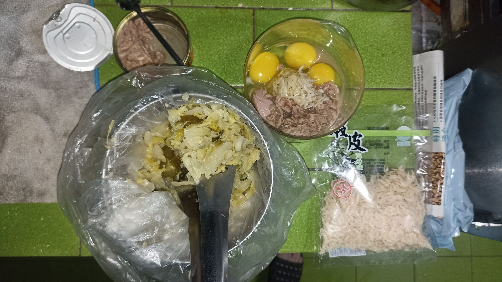 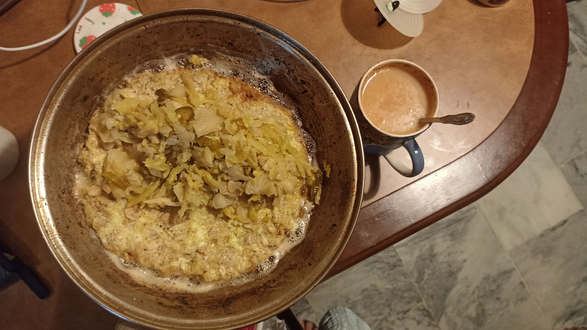
5. 21:03 149mg/dL⁷
 -`{21:10 3½R<B}`
 -`{21:11 6T>T}`[BT]
6. 00:09 114mg/dL⁸
7. 02:01 130mg/dL⁹
 -`{02:04 2½R>B}`
 -`{02:05 6T<A}`

#### 20260816Sun
1. 10:27 146mg/dL⁰
 -`{10:30 6H<A}`<!--Feel miserable, condition very bad-->
 -`{14:27 6R<B}`[豬]〘睡->16:30〙<!--Feel much better with 6R-->
2. 18:49 38mg/dL⁰[牛]
3. 23:15 162mg/dL⁹<!--Have serious violent and instable mentality-->
 -`{23:19 (7+7)T<内>B}`
 -`{23:23 4½H>A}`
4. 00:31 155mg/dL⁸
 -`{00:36 5I<T}`

#### 20260817Mon
1. 05:48 121mg/dL⁷
 -`{05:56 2½H<A}`<!--feel way better than yesterday; would it result from 5I?-->〘睡07:00->09:20〙
 -`{09:24 3H<B}`<!--藥效太快睡不飽-->
2. 11:53 43mg/dL⁶[鹽BC]
3. 19:21 70mg/dL⁵[漢堡肉₁+egg₂]
 -`{19:38 4I>B}`
4. 22:00 99mg/dL⁴
5. 00:29 137mg/dL³
 -`{00:40 7T>内,7I<B}`

#### 20260818Tue
1. 06:39 104mg/dL²〘睡->09:00〙<!--狀況尚可、有睡飽感，但可能因睡太久且2次睡眠而精神受損-->
2. 09:03 86mg/dL¹[鹽BC]
3. 13:14 90mg/dL₂[鹽BT]
4. 17:11 91mg/dL₃[18:30 牛雜湯大+榨菜] 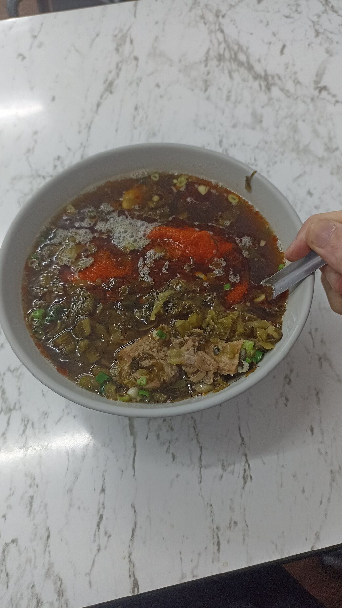〘walk₁〙
 -`{18:57 6I>A}`[BT₃]
5. 00:20 158mg/dL₄
 -`{00:23 7T<T}`
 -`{00:25 8I<A}`

#### 20260819Wed
1. 03:58 137mg/dL₅
 -`{04:01 3⁺R<B}`[鹽BC]
2. 08:30 54mg/dL₆[鹽BC+椰奶]
3. 13:29 61mg/dL₇[蝦皮+BT]
4. 18:23 82mg/dL₈[漢堡肉₁+豚+泡菜] 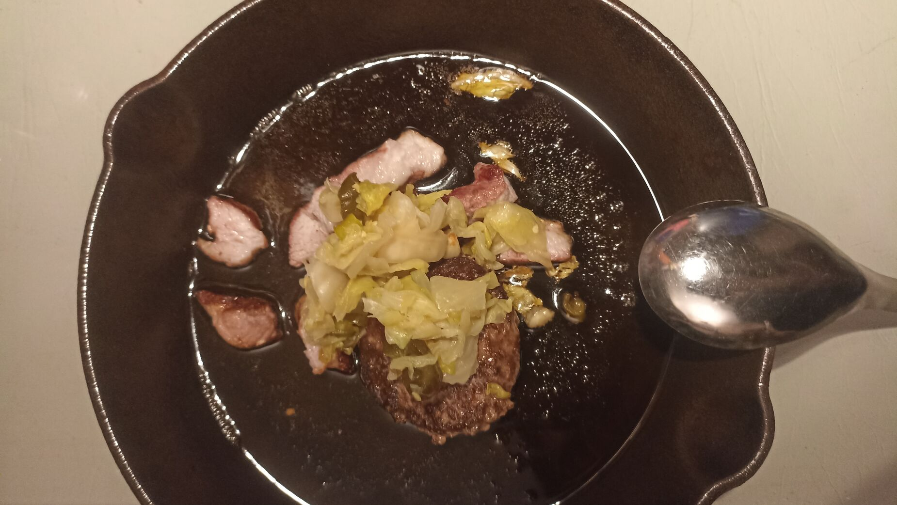
 -`{19:12 3R>B}`
5. 23:32 90mg/dL₉[甜酒+BT]
 -`{00:12 7T>T}`
 -`{00:13 6I>A}`

#### 20260820Thu
1. 08:31 166mg/dL₉<!--甜酒喝太多;7點起來應打藥再睡-->
 -`{08:34 5H<A}`
2. 12:04 60mg/dL₈[16:50 BT, 豚+泡菜+豬油沙拉+eggyork]
3. 17:28 86mg/dL₇〘20:00 昏睡〙
4. 21:45 152mg/dL₆<!--hyper導致昏睡;有吃豬肉,即使加大量油脂血糖仍會大幅上升-->
 -`{21:52 8T<内}`
 -`{21:54 8I>B}`
 -`{21:55 3R<B}`

#### 20260821Fri
1. 08:53 91mg/dL₅
2. 12:01 100mg/dL₄
 -`{12:50 1½R>A}`
3. 18:13 79mg/dL₃
 -`{18:20 6I>B}`[豬]
4. 21:33 130mg/dL₂
 -`{21:39 2½H<A}`
5. 23:11 126mg/dL¹
 -`{23:32 6T>内}`
 -`{23:33 7I<B}`
    
#### 20260822Sat
1. 05:13 70mg/dL²〘睡-›07:25〙
 -`{07:29 2⁻H>A}`<!--睡起來狀況不好-->〖室內運動〗〘14:00 walk₁〙<!--狀況仍不好-->
2. 16:04 79mg/dL³
 -`{16:17 8I>B}`[牛肉罐頭(有糖!)]
 -`{18:33 3R<B}`[牛漢堡肉₂][22:30 豬三層]
3. 23:42 200mg/dL⁴
 -`{23:43 8I<T}`
 -`{23:44 8R>B}`

#### 20260823Sun
1. 05:11 99mg/dL⁵
 -`{05:15 2½R<A}`〘睡->8:20〙<!--feel fine, but not good enough-->[鹽BC₂]
2. 12:20 144mg/dL⁶
 -`{12:21 5R<B}`
3. 17:28 85mg/dL⁷
 -`{18:42 3R>A}`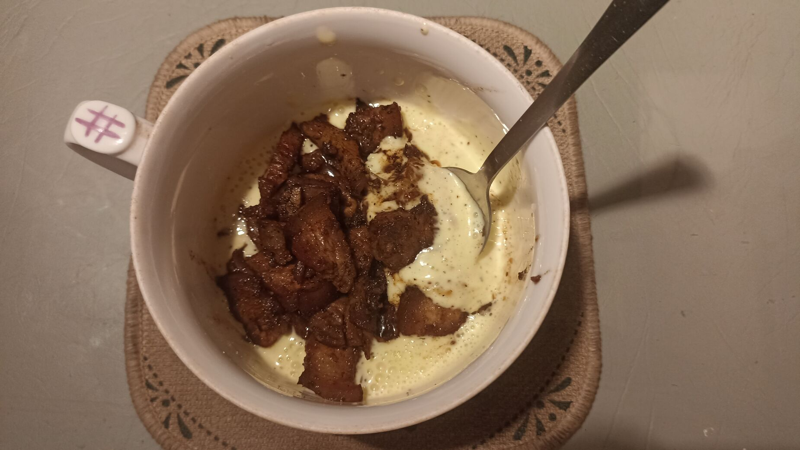[豬三層+eggyolk+butter]
4. 22:09 58mg/dL⁸[leftover(少)]
5. 00:35 97mg/dL⁹
 -`{01:07 6T>T}`
 -`{01:09 4⁻I>B}`

#### 20260824Mon
1. 05:31 129mg/dL⁰
 -`{05:35 3⁻R<A}`<!--狀況尙可-->〘睡->09:00〙
2. 09:05 106mg/dL⁰<!--狀況差-->
 -`{11:29 6½R<B}`[有糖牛肉罐頭]
3. 14:13 111mg/dL⁹
 -`{14:35 1R2I>B}`
4. 19:26 105mg/dL⁸
 -`{19:29 1½R1I>A}` 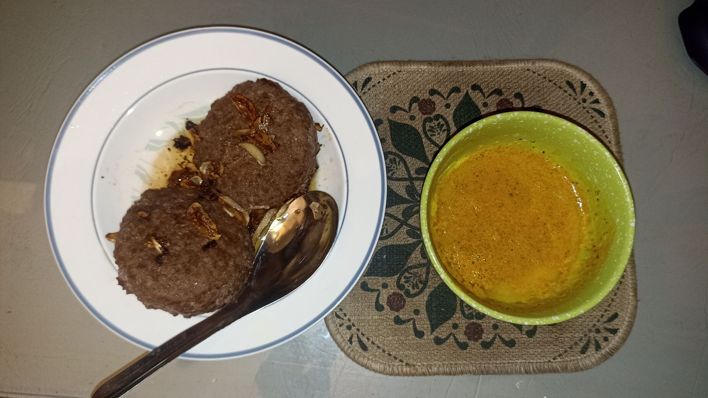[22:00 豬(少)]
5. 22:44 141mg/dL⁷
 -`{22:48 3⁻H<B}`
6. 00:26 148mg/dL⁶
 -`{00:28 8I<内}`
 -`{00:31 2½R>B}`
 
#### 20260825Tue
1. 06:09 76mg/dL⁵〘睡->09:15〙<!--still back-sleep, but no R/H/I-->
2. 09:19 93mg/dL⁴<!--feel ok without R/H injection-->[鹽BC]
3. 12:53 163mg/dL³
 -`{12:55 2⁺H5R<A}`[BT]
4. 17:33 80mg/dL²
 -`{18:37 3R½I<B}`[豬三層(一半)+湯] 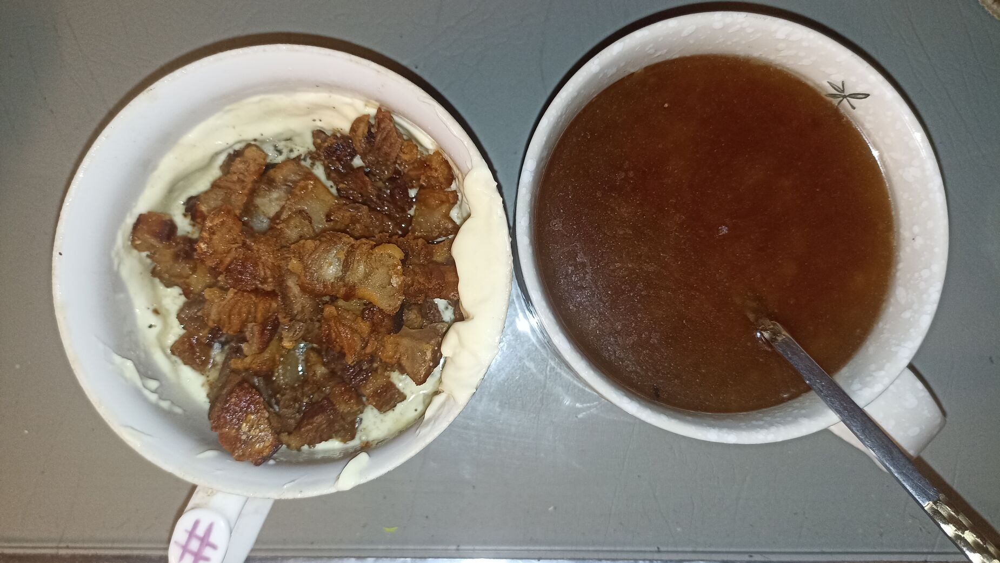[20:20 小雞胸肉₂]
5. 00:41 166mg/dL¹
 -`{00:49 8I>内}`
 -`{00:51 4½R>A}`

#### 20260826Wed
1. 06:59 159mg/dL₂
 -`{07:03 5½H<A}`〘睡〙
2. 11:47 110mg/dL₃
 -`{12:05 6I>B}`[豬肉末]〘weight〙
3. 18:10 242mg/dL₄
 -`{18:11 8H<B}`[紅燒牛肉罐頭(有糖)]
4. 20:01 175mg/dL₅
 -`{20:03 4½H>A}`
5. 00:53 73mg/dL₆
6. 04:09 113mg/dL₇
 -`{04:15 8I<T}`
 -`{04:17 2R<内}`

#### 20260827Thu
1. 08:16 82mg/dL₈〘睡->10:10〙
2. 10:34 87mg/dL₉[鹽BC,肉湯]
3. 12:41 113mg/dL₉
 -`{12:43 2½R<A}`[16:00 漢堡肉₁+豬肉渣]
 -`{16:30 3⁺R>B}`
 -`{17:56 3½R<B}`[fried-egg₃]
 -`{20:44 3R>A}`[雞胸肉₂]
4. 22:16 59mg/dL₈

#### 20260828Fri
1. 02:43 139mg/dL₇
 -`{02:47 2H3R<A}`〘睡->06:10〙
2. 06:12 109mg/dL₆
 -`{06:20 2½R>B}`[鹽BC₂]
3. 11:13 186mg/dL₅
 -`{11:15 8½H<B}`[11:50 意大利麵(大量澱粉)]
 -`{12:19 8R>A}`<!--binge-start-->
4. 13:30 208mg/dL₄
 -`{13:31 7H>B}`
5. 15:33 248mg/dL₃
 -`{15:34 9H<B}`
6. 17:03 121mg/dL₂
 -`{17:25 7I>内}`
 -`{18:20 7R<A}`
7. 20:55 61mg/dL¹
8. 23:17 215mg/dL²
 -`{23:19 (8+8)I<内>T}` 
 -`{23:20 8½R>A}`
 -`{23:21 3H>B}`
9. 01:16 136mg/dL³<!--binge-end-->

#### 20260829Sat
1. 05:21 50mg/dL⁴[ml+cf,鹽BC]〘睡->07:20〙
2. 11:37 212mg/dL⁵
 -`{11:39 8H<A}`
 -`{11:41 5R<B}`
3. 15:41 92mg/dL⁶
 -`{15:42 4½R>A}` [牛+ch.]
4. 18:42 77mg/dL⁷[ch.]
5. 23:17 177mg/dL⁸
 -`{23:21 5½H>B}`
 -`{23:25 (7+7)I<T<A}`

#### 20260830Sun
1. 06:00 96mg/dL⁹
 -`{06:41 2½R>A}`〘睡->09:20〙
2. 11:25 125mg/dL⁰[鹽BC]
 -`{11:28 3⁺R<B}`
3. 16:50 176mg/dL⁰
 -`{16:55 10H<A}`[外食:貴族世家]
4. 18:51 216mg/dL⁹
 -`{18:55 7H>B}`
 -`{18:56 7R>A}`
5. 23:02 67mg/dL⁸
6. 03:05 206mg/dL⁷
 -`{03:07 3R3H<A}`
 -`{03:09 (7+7)I>T<B}`

#### 20260831Mon
1. 06:42 100mg/dL⁶〘睡->09:00〙
2. 09:02 68mg/dL⁵[鹽BC]
3. 11:52 118mg/dL⁴
 -`{11:55 3⁺R>B}`
4. 17:46 88mg/dL³
 -`{18:14 4⁺R<B}`[牛+egg₄]
5. 22:08 159mg/dL²
 -`{22:23 5R>A}` 
6. 01:09 166mg/dL¹
 -`{01:56 (7+7)I>内<A}`
 -`{01:58 4R>B}`

#### 20260901Tue
1. 07:30 132mg/dL₂
 -`{07:37 4⁻H>A}`〘睡->09:24〙
 -`{09:36 5R<B}`[剩菜(牛+ch.)+鹽BC]
2. 12:30 61mg/dL₃
3. 18:06 191mg/dL₄
 -`{18:08 5H3R>B}` 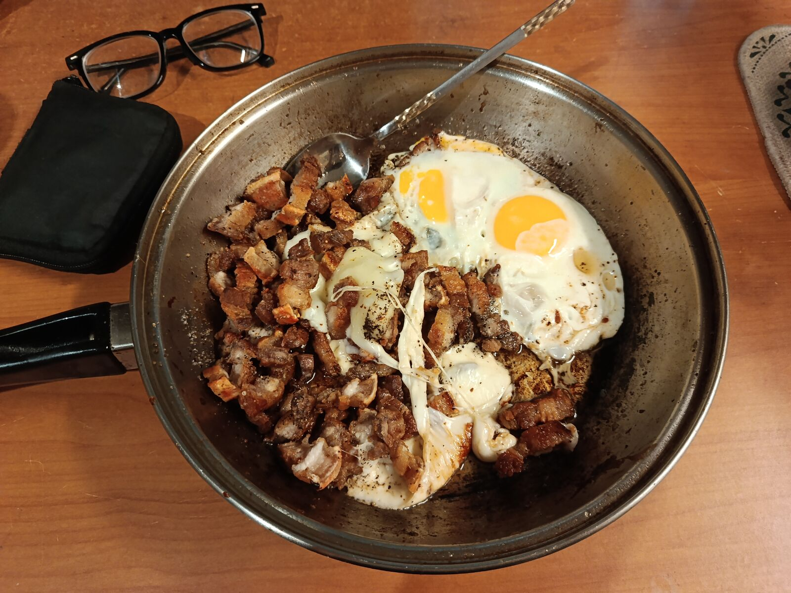[21:20 ch.]
4. 21:09 126mg/dL₅
 -`{21:59 3R<A}`[ml.]
5. 00:56 141mg/dL₆
 -`{01:01 (8+7)I<内>A}`
 -`{01:03 3½R<B}`

#### 20260902Wed
1. 05:09 103mg/dL₇
2. 07:34 119mg/dL₈〖睡->07:30〗
 -`{07:43 4½H<A}`[ml+鹽BC]
3. 10:05 112mg/dL₉
 -`{10:18 4R>B}`[鹽BC] 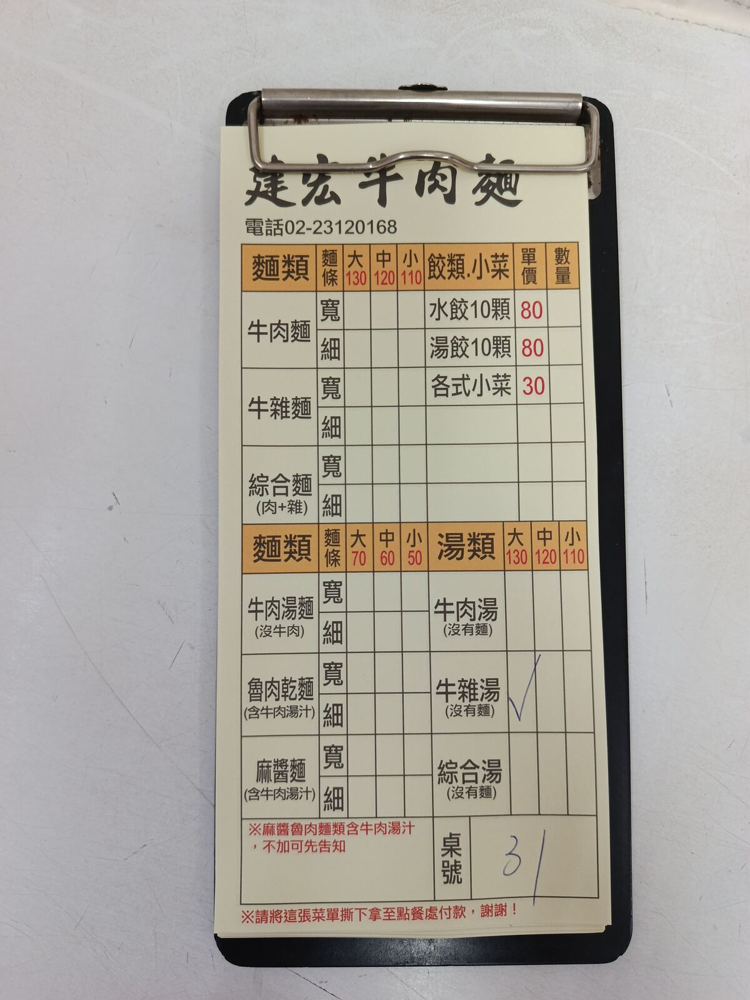 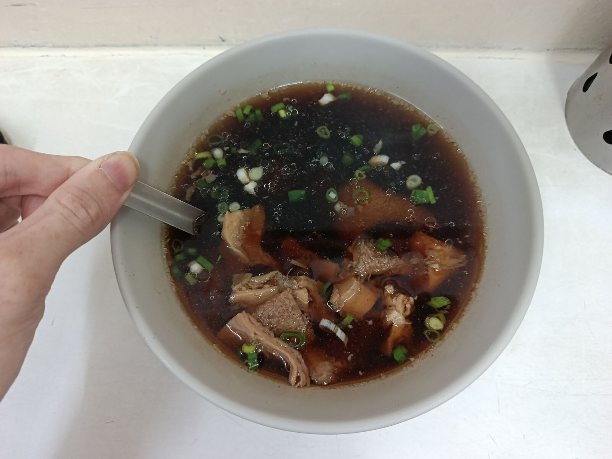
4. 16:59 138mg/dL₉
 -`{17:00 8⁺R<B}` 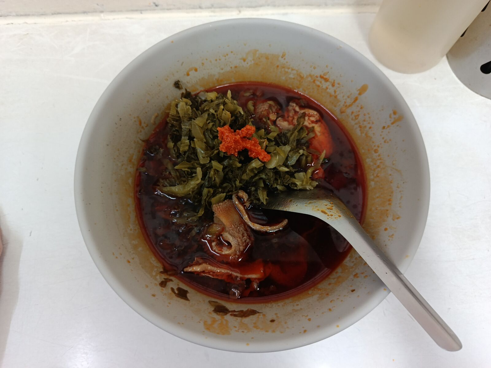[ml.+cf.]
 -`{19:25 6⁻R>A}`
5. 21:02 58mg/dL₈[ml.+cf.+堅果]
 -`{00:08 4⁻R>B}`
6. 00:36 93mg/dL₇
 -`{00:38 (8+8)I>内<B}`
  
#### 20260903Thu
1. 08:19 92mg/dL₆
 -`{08:25 6H<A}`[ml.+cf.]
 -`{10:37 4R>B}`[ch.+鹽BC]
2. 13:00 69mg/dL₅
 -`{13:35 3R<B}`[豬肉末+ch.+牛肉末][ml.+BC]
 -`{15:52 4⁻R>A}`
 -`{19:09 3½⁺R>B}` 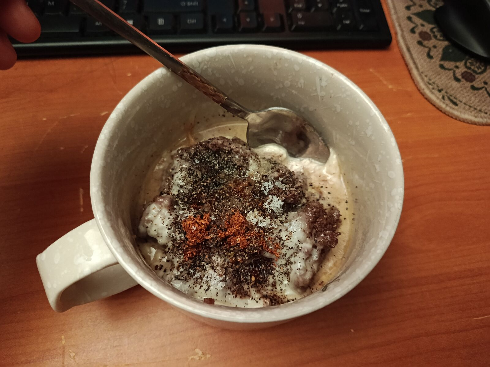[ml.+甜酒]
3. 21:44 127mg/dL₄
 -`{21:46 6R<B}`[ch.]
4. 01:07 115mg/dL₃
 -`{01:12 (8+8)I<T<A}`

#### 20260904Fri
1. 08:24 85mg/dL₂
 -`{08:39 6H>A}`[ml.+鹽BC₂]
2. 12:10 83mg/dL¹〘勞務₂〙
3. 17:09 199mg/dL²
 -`{17:12 (8+8)R<A>B}`[牛絞+egg₂+ch.]
4. 20:24 38mg/dL³[ml.(多)+ch.]
5. 23:14 154mg/dL⁴
 -`{23:40 (8+8)I>T<B}`
 -`{23:45 1H4R>A}`

#### 20260905Sat
1. 04:49 175m-->
 -`{04:52 6H<A}`〘睡->08:00〙
2. 08:48 72mg/dL⁶[鹽BC₂] 〖勞務½〗
3. 14:32 204mg/dL⁷ 
 -`{14:34 3H5R>B}`[ch.]
 -`{18:56 6R<B}`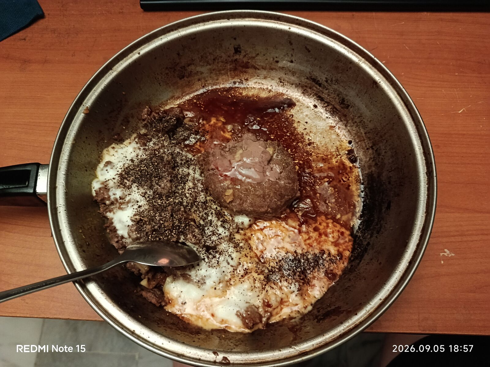[ch₂]
4. 22:22 118mg/dL⁸[ch.]

 -`{22:55 (8+8)I<内>A}` 
 -`{22:58 3⁻R>B}`

#### 20260906Sun
1. 03:35 127mg/dL⁹
 -`{03:37 3½R<A}`[鹽BC₂]
2. 08:45 135mg/dL⁰
 -`{08:47 3½R<B}`
 -`{08:49 5I<T}`[鹽BC]
3. 11:15 131mg/dL⁰
 -`{11:16 5H2R>A}`[nuts(starch)]
4. 18:19 143mg/dL⁹   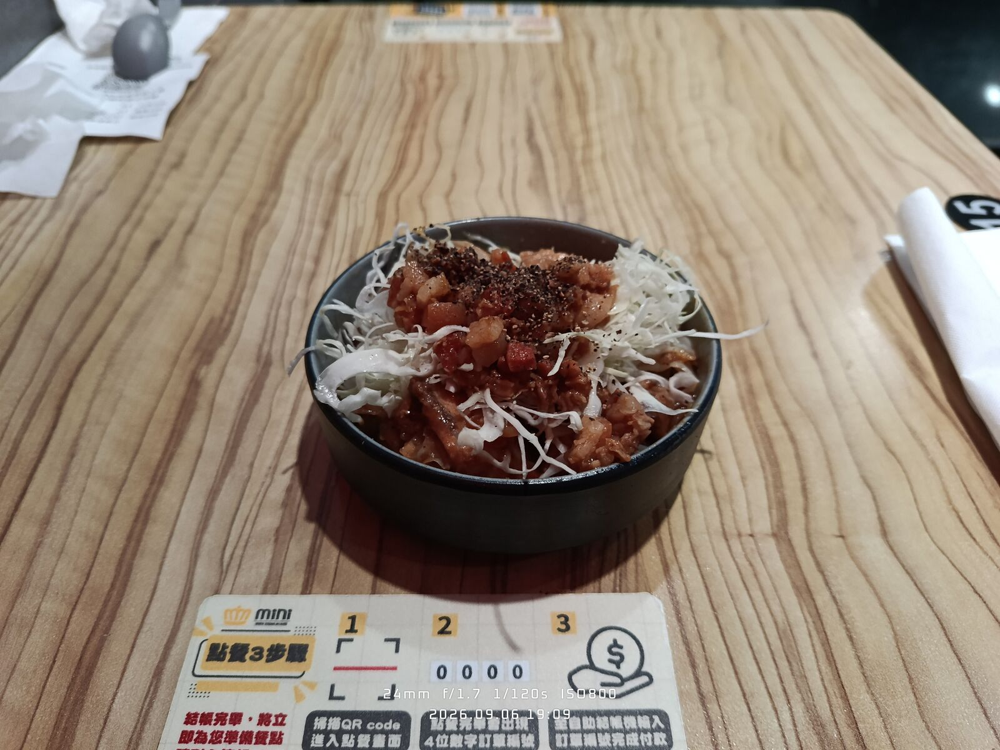
 -`{18:22 5½R4½H>B}`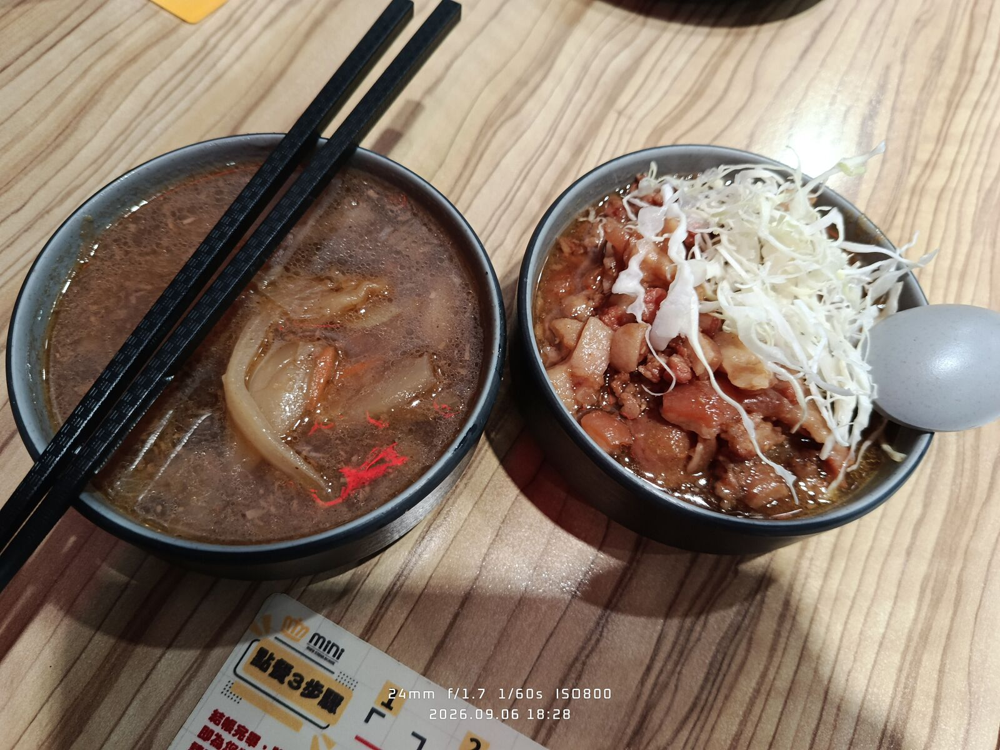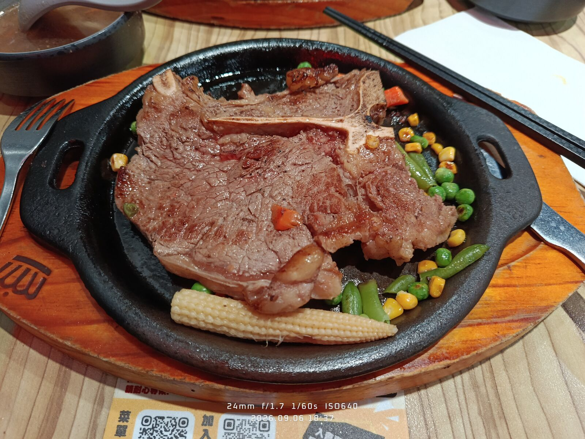
 -`{19:11 8R<A}`
5. 21:27 121mg/dL⁸
6. 23:16 105mg/dL⁷
7. 00:55 153mg/dL⁶
 -`{01:00 3½H3½R<B}`
 -`{01:02 (7+7)I>内>A}`

#### 20260907Mon
1. 08:22 162mg/dL⁵
 -`{08:24 7H>B}`〘睡〙[10:20 鹽BC]
2. 11:51 70mg/dL⁴ 
3. 15:44 166mg/dL³ <!-- violent thinking, sleeping, and it just rushed high when H is gone, even without eating (but with yesterday's big meal) --> 
 -`{15:45 6H<A}`
 -`{17:53 8R<B}`[ml.] [ch.,甜酒]
4. 23:11 129mg/dL²
 -`{23:14 4⁺R>A}`
 -`{00:06 (7+7)T<T>B}`

#### 20260908Tue
1. 05:40 168mg/dL¹
 -`{05:42 6H<A}`〘睡->09:15〙
2. 09:29 112mg/dL₂
 -`{09:31 4⁺R<B}`[鹽BC]
3. 12:57 128mg/dL₃
 -`{13:00 ½H3½R>B}`
 -`{13:00 5I>A}`
4. 18:11 97mg/dL⁴
 -`{18:17 4⁺R<B}` [ch.]
5. 21:16 77mg/dL₄
6. 23:42 153mg/dL₅
 -`{23:46 3H3R>B}`
 -`{23:48 7I+9I<T<A}`

#### 20260909Wed
1. 07:33 120mg/dL₆
 -`{07:37 2H2½R<B}`[鹽BC₂]
2. 11:20 121mg/dL⁷
 -`{11:22 2½⁺H>A}`
 -`{11:23 (5I+0I)>B}`[14:30 鹽BC]
3. 18:18 192mg/dL⁸
 -`{18:22 10H<A}` 
 -`{19:59 7I+0I<B}`
4. 20:14 198mg/dL⁹
 -`{20:15 10H>A}` 
5. 22:40 30mg/dL₉[ml.(多)+ps.+ch.]
6. 00:52 104mg/dL₈
 -`{00:57 (9+9+8)I>T>B<A}`

#### 20260910Thu
1. 03:59 133mg/dL₇
 -`{04:02 2½R<B}`〘睡->08:02〙
2. 08:03 132mg/dL₆
 -`{08:15 5⁻H<B}`[BC]
 -`{09:38 7I+0I>A}`[12:28 鹽BC]
3. 12:57 85mg/dL₅
4. 14:58 105mg/dL₄
 -`{15:09 6I+0I<A}`
5. 18:24 107mg/dL₃ 
 -`{18:31 3⁻R>B}`
 -`{19:37 7⁺I+0I<B}`
6. 21:45 91mg/dL₂[ps.]
7. 23:58 118mg/dL
 -`{00:02 3⁺R>A}` <!-- violent thinking ~00:05, gap signal; onset wait, no stack -->
 -`{01:13 8I<内}`<!-- use cellphone all night -->

#### 20260911Fri
1. 04:46 120mg/dL¹
 -`{04:49 8I<A}`〘睡->08:35〙
2. 08:54 132mg/dL²<!-- feel miserable; SERIOUS: terrible morning from playing cellphone until sleep -->
 -`{08:56 6H>B}`
 -`{08:57 8I>A}`[鹽BC]
3. 12:51 82mg/dL³[鹽BC]
 -`{14:36 8I+0I<A}`
4. 17:14 102mg/dL⁴ 
 -`{17:29 4R<B}`
 -`{18:39 8I+0I>A}`
5. 20:53 94mg/dL₅ 
 -`{21:48 7I+0I>B}`
6. 00:25 149mg/dL⁶
 -`{00:28 (8+8)I>内<A}`
 -`{00:28 2H3R<B}`

#### 20260912Sat
1. 06:03 51mg/dL⁷
 -`{06:54 8I>A}`[鹽BC]
 -`{09:38 7I<B}`
2. 14:00 77mg/dL⁸  
3. 17:10 52mg/dL⁹
 -`{17:12 8I<A}`
 -`{17:12 5R>B}`   
4. 20:23 46mg/dL⁸[ml.(多)+甜酒]
5. 23:20 118mg/dL⁷
 -`{23:24 (10+6)I<T<B}`
 -`{23:26 1⁻H3R>A}`

#### 20260913Sun
1. 05:11 76mg/dL⁶〘睡->08:30〙
2. 08:32 93mg/dL⁵
 -`{08:46 9I<A}`
3. 12:09 88mg/dL⁴  
 -`{12:18 10I>B}`  
4. 16:13 52mg/dL³[ml.]
5. 19:08 38mg/dL² 
 -`{21:46 8I>A}`
 -`{21:47 4H<B}` 
6. 02:21 130mg/dL₂
 -`{02:26 10T<T}`
 -`{02:27 4R<B}`  

#### 20260914Mon
1. 06:12 36mg/dL³[ml.+鹽BC]
 -`{09:06 8I<B}`
2. 11:35 109mg/dL₄[ch.]
 -`{12:14 7I>B}`
3. 13:37 105mg/dL₅<!-- 暴力幻想 -->
 -`{13:50 2½H>B}`[ch.+ps.] 
4. 16:25 54mg/dL₆
 -`{16:34 8I<A}`[ch.]〘睡30min〙
5. 18:40 70mg/dL⁷ 
 -`{20:52 3½R>A}`[豆漿+ch.]
6. 23:12 105mg/dL₈
 -`{23:16 (8+8)I>T<B}`

#### 20260915Tue
1. 05:54 123mg/dL⁹
 -`{05:56 2½H<A}`
 -`{05:57 8I>B}`[鹽BC+ps.][12:00 鹽BC]
2. 12:22 61mg/dL₉[ch.]
3. 19:14 137mg/dL₉
 -`{19:16 4½H>A}`
 -`{19:17 9I<B}`  <!-- 21:30 hypo-feeling -->[ml.+soybean ml+甜酒]
4. 00:06 93mg/dL₇
5. 01:03 114mg/dL₆
 -`{01:06 (8+8)I<内<A}`
 -`{01:07 1⁺R>B}`

#### 20260916Wed
1. 06:56 115mg/dL₅
 -`{07:01 3H>A}`
 -`{07:01 8I<B}`[鹽BC][09:37 鹽BC]
2. 12:51 103mg/dL₄
 -`{12:58 7I<A}`
3. 18:59 52mg/dL₃ 
 -`{19:02 9I>B}`[ps.+ch.+甜酒(少)]<!-- feel hyper -->
 -`{20:56 ½H3R>A}`
4. 22:57 40mg/dL₂[15g]
 -`{23:36 9I>内}`

#### 20260917Thu
1. 06:18 121mg/dL¹<!--woke unrefreshed, no back-sleep, overall good-->
 -`{06:21 3½H<B}`
 -`{06:22 9I>A}`
2. 11:59 71mg/dL²〘weigh〙
3. 14:04 87mg/dL³
 -`{14:11 4I>B}`
4. 17:07 44mg/dL⁴  <!--lesson: fasting 4I 87->44(-43/3h); morning 9I done by ~13:30 (7h = compressed 4-7h, not textbook 12-18h); gap-rise 71->87 only +8/h fading (liver empty post-40); NPH suppresses the rise it offsets → net crash; gap rule: rising <90 fasting = eat first; 90-110 rising = half-dose 2-4I; full dose only ≥110+food-->
5. 18:44 75mg/dL⁵
 -`{18:52 5I<A}`
6. 22:53 152mg/dL⁶
 -`{23:00 3H1½R<B}`
 -`{23:02 (7+7)I<T>A}`[ps.]

#### 20260918Fri
1. 02:36 26mg/dL⁷[02:44 22.6g, ps.⁺ch.]
2. 03:35 124mg/dL⁸〘睡->07:35〙
3. 07:38 120mg/dL⁹
 -`{07:51 4I>B}`
 -`{07:51 2H<A}`[鹽BC]
4. 09:06 103mg/dL⁰<!-- 10:57 violent thinking-->
5. 11:41 77mg/dL⁰[鹽BC+ch.]<!--13:02 精神尚可、但活力有點低落-->[ps.]
6. 16:33 144mg/dL⁹ 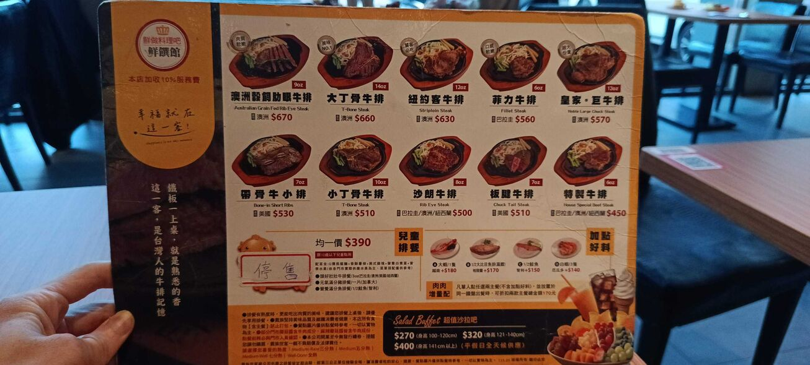
 -`{16:46 3H5R<B}` 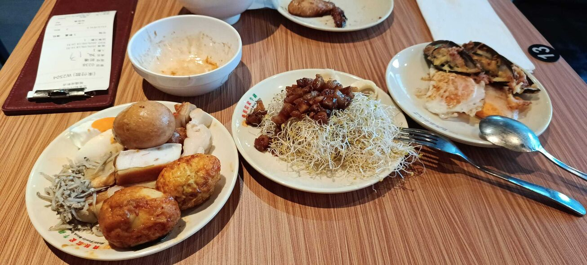 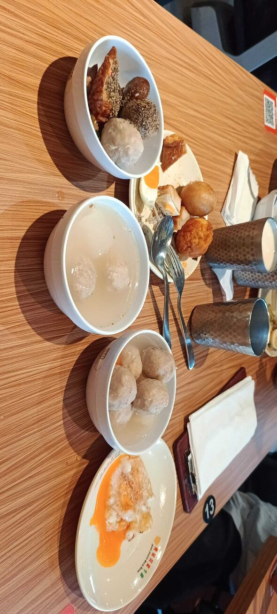<!-- 19:46 feeling hyper -->
7. 19:48 241mg/dL⁸
 -`{19:53 10H>A}`
8. 22:08 44mg/dL⁷[13.5g]
9. 23:43 107mg/dL⁶
 -`{00:11 5I<A}`

#### 20260919Sat
1. 02:55 201mg/dL⁵
 -`{03:05 6H>B}`〘睡->06:50〙
2. 06:54 181mg/dL⁴
 -`{06:56 7H<B}`
 -`{06:57 9I>A}`[鹽BC]
3. 09:32 99mg/dL³[鹽BC]
4. 11:58 101mg/dL²
 -`{13:13 0.8R>B}`
5. 15:07 122mg/dL¹
 -`{15:14 2R<A}`
6. 17:51 96mg/dL²
 -`{18:47 4½⁺R>A}` 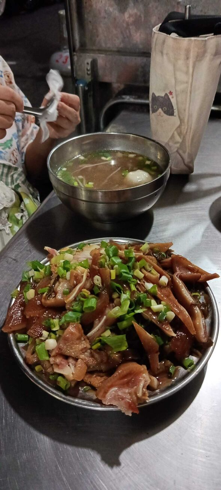
7. 21:00 178mg/dL₃
 -`{21:03 5H<B}`
8. 23:08 133mg/dL₄
 -`{23:17 (7+7)I>T>B}`

#### 20260920Sun
1. 04:21 168mg/dL₅
 -`{04:27 3½H<A}`〘睡->08:28〙
2. 08:30 144mg/dL₆ 
 -`{08:44 4⁻H>A}`
 -`{08:47 8I<B}`[鹽BC]
3. 12:11 82mg/dL⁷[鹽BC]
4. 17:06 89mg/dL₇ 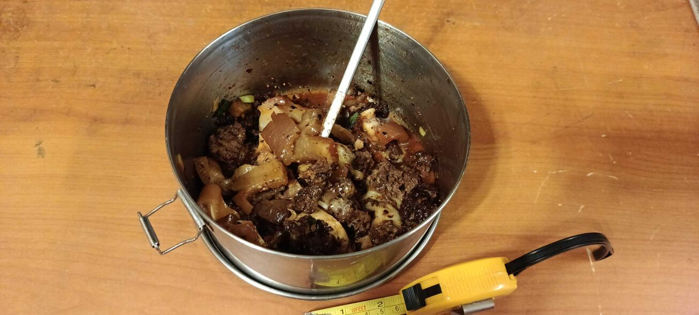
 -`{17:46 4R>B}`
5. 20:57 146mg/dL₈
 -`{20:59 4⁺H<A}`[甜酒(少),ch.]

#### 20260921Mon
1. 04:29 112mg/dL₉〘睡->08:43〙
2. 08:49 105mg/dL₈<!--unrefreshed-->
 -`{08:54 9I>B}`[鹽BC₂]
3. 12:05 144mg/dL₇
 -`{12:07 3½H<A}`
4. 16:58 93mg/dL₆ 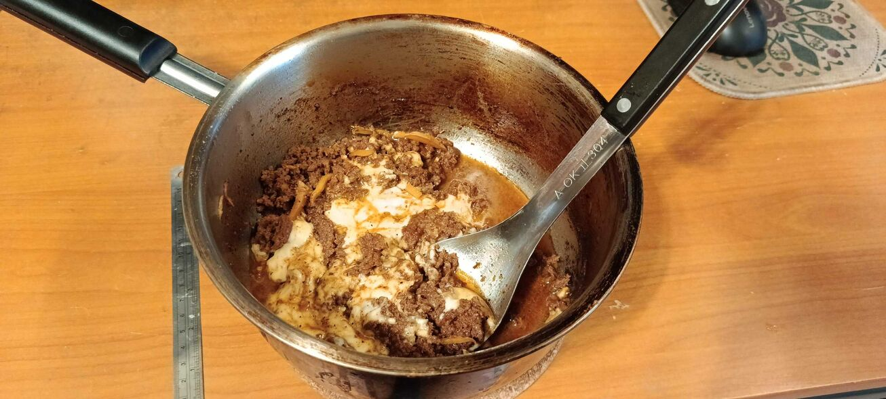
 -`{17:13 4⁻R>A}`
 -`{18:21 6I<B}`
5. 21:26 121mg/dL₅
6. 00:19 153mg/dL₄<!-- violent thinking -->
 -`{00:23 5H>B}`[ch.]
 -`{01:26 10I>内}`

#### 20260922Tue
1. 07:03 59mg/dL₃
 -`{07:37 8I<A}`[鹽BC]
2. 09:36 109mg/dL₂
3. 16:51 84mg/dL¹ 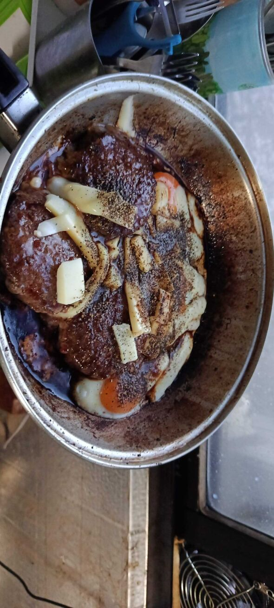
 -`{17:06 6⁻R>A}`<!-- against halve rule; peak check 19:36 -->
4. 18:55 46mg/dL²[ml.+甜酒(少)]<!-- rescue consumed; NPH cancelled -->
5. 20:29 128mg/dL³<!-- 46→128 post-peak; no second dip -->
 -`{20:35 10I<B}`<!-- gate skipped: full dose, R tail active -->
6. 22:44 143mg/dL⁴
 -`{22:54 2½R>B}`<!-- AGAINST zero-insulin rule; R peak 23:54–01:54 stacks 10I peak -->

#### 20260923Wed
1. 06:04 177mg/dL⁵<!-- survived 10I+2½R overnight, no crash; missed 00:15+04:45 checks -->
 -`{06:11 8H<A}`<!-- vs halved 3-3½H advice; ~2.3x over -->
 -`{06:12 9I<T}`<!-- vs wait-for-peak + halve (≤4I); full dose -->
2. 11:30 119mg/dL⁶<!-- 177→119, no crash; 9I tail to ~13:12 -->
 -`{13:56 5⁺R>A}`
3. 16:01 123mg/dL⁷<!-- pre-peak (true peak 16:26); 119→123 flat -->
 -`{16:04 9I<B}`<!-- vs wait-16:26 + halve (≤4I); 2.2x over, R peak not yet reached --> 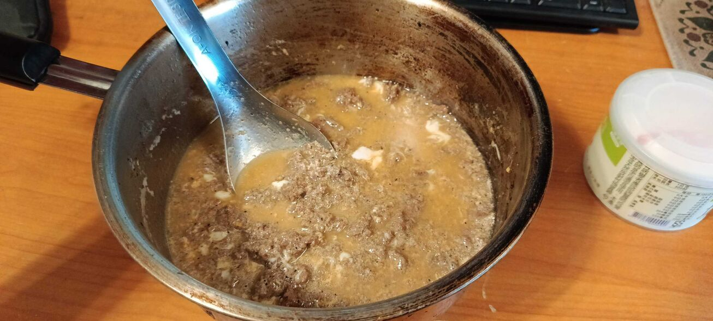
 -`{17:24 5½H>B}`[甜酒+ml.]
4. 18:29 130mg/dL⁸
 -`{18:32 3½H<A}`[ml.]
 -`{21:55 8I>A}`[ch.] 
5. 04:10 97mg/dL⁹
 -`{04:21 6½I>T}`

#### 20260924Thu
1. 09:47 105mg/dL⁰
 -`{10:08 7I<B}`
 -`{10:09 2½H>B}`[鹽BC]
2. 15:27 62mg/dL⁰
 -`{17:09 3½R<A}` 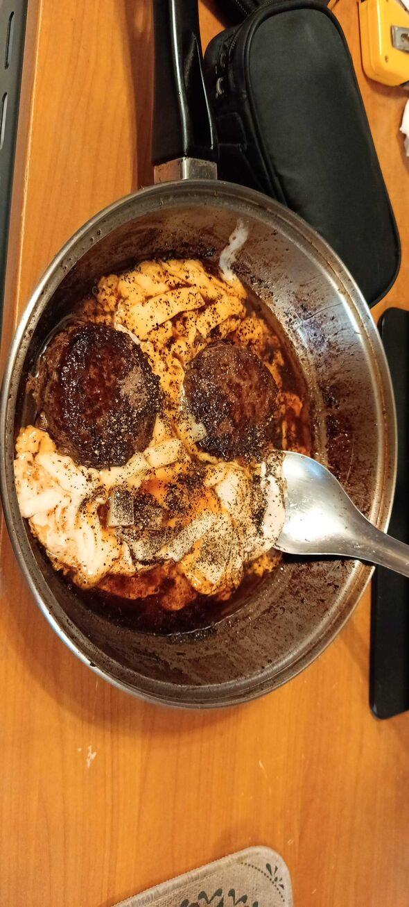
3. 20:37 85mg/dL⁰
 -`{21:30 8I>A}`[ch.]
4. 00:16 176mg/dL⁹
 -`{00:24 5½H<B}`

#### 20260925Fri
1. 05:56 151mg/dL⁸
 -`{05:58 6H>B}`
 -`{05:59 9I<A}`[ch.][鹽BC]
2. 11:54 89mg/dL⁷
 -`{13:15 3H4R>A}` 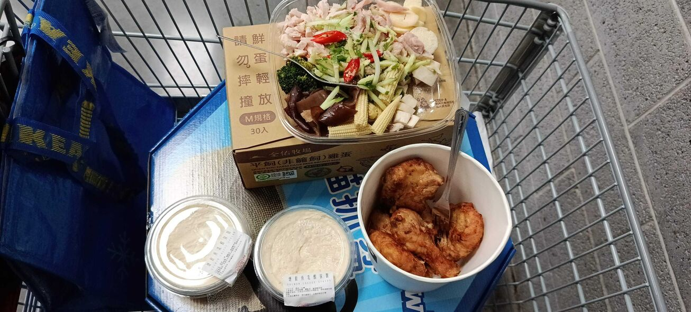
 -`{14:53 10I<B}`[19:50 ch.]
3. 19:57 129mg/dL⁶
 -`{20:00 8I>B}`
4. 22:06 90mg/dL⁵

#### 20260926Sat
1. 07:26 90mg/dL⁴
 -`{07:30 9I<A}`[鹽BC₂]
2. 11:57 128mg/dL₃
 -`{12:00 3H>A}`
 -`{14:52 7R<B}` 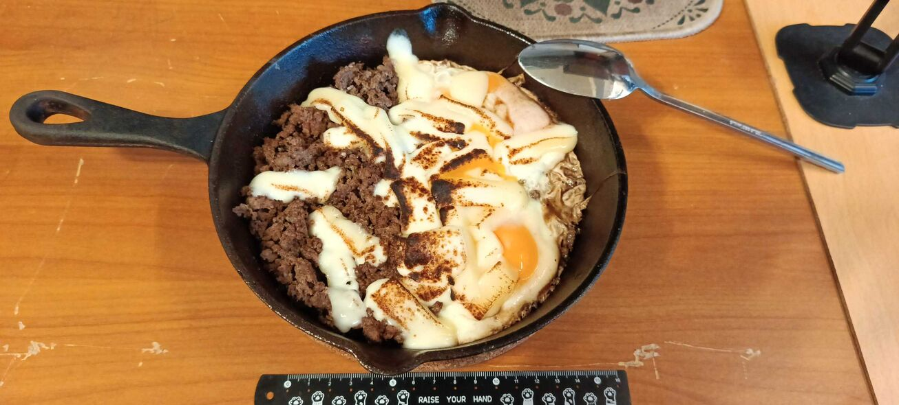[ml.]
3. 17:25 64mg/dL²[ml.]
 -`{17:30 8I>B}`[ch.][20:20 ch.][ch.]
4. 23:15 103mg/dL¹
 -`{23:29 9I<内}`

#### 20260927Sun
1. 07:29 96mg/dL₂
 -`{07:40 4⁻H<A}`[鹽BC]
 -`{09:43 8I>A}`
2. 14:07 60mg/dL₃
 -`{14:19 3½R<B}` 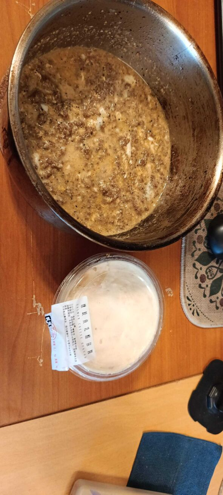[ml.+ch.]
 -`{16:12 8I>B}`[18:00 Salmon ch. spread(少)]
3. 20:17 142mg/dL₄<!-- serious violent thinking and agitated -->
 -`{20:19 4½H<A}`[21:06 ch.₂]
4. 22:18 101mg/dL₅
 -`{22:20 9I>内}`

#### 20260928Mon
1. 04:08 39mg/dL₆[ml.]<!-- hypo and sleep little, but feel energetic and good -->	
 -`{06:58 9⁺I>A}`[BC][cf.]
2. 11:47 162mg/dL₇
 -`{11:49 7½H<B}`<!-- hypo felt -->
 -`{14:24 3½R>B}` 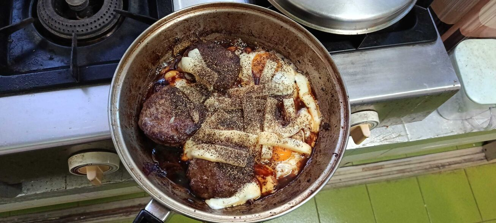[ml.]
3. 16:50 82mg/dL₈
 -`{16:53 7I<A}`
4. 20:28 168mg/dL₉
 -`{20:31 4½H>A}`[cf.少]
5. 23:50 118mg/dL₉
 -`{23:52 9I<T}`

#### 20260929Tue
1. 07:58 111mg/dL₈
 -`{08:01 4½H<B}`
 -`{08:02 9I>B}`[鹽BC]
2. 12:09 67mg/dL₇[14:10 鹽BC]
3. 16:17 64mg/dL₆<!-- It stays all the same number！-->
 -`{17:34 3R<A}`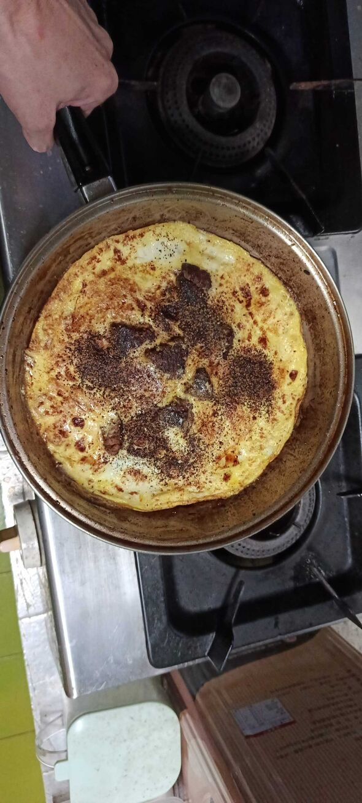
 -`{18:52 7I>A}`[BC+cf.][23:40 ch.]
4. 00:13 125mg/dL₅
 -`{00:15 9I>内}`
 -`{00:18 2½⁺R<B}`

#### 20260930Wed
1. 07:42 51mg/dL₄
 -`{07:56 10I>B}`[鹽BT., cf.]
2. 11:55 45mg/dL₃<!-- but no uncomfortable feeling at all -->[ml.+cf.][Leftover: 牛+egg+spread][鹽BC]
 -`{13:14 9I<A}`[15:42 ch.+spread+cf.]<!-- sleeping after eating -->
3. 17:27 94mg/dL₂<!-- violent thinking -->
 -`{17:58 8I>A}`[ml.(少)]
4. 23:13 49mg/dL¹<!-- ok, but acting a little be agitated -->

#### 20261001Thu
1. 06:16 43mg/dL²<!-- AI: no glucose after 23:13 49; slept through, confirmed -->[ml.+ch.+鹽BC] 
 -`{09:45 6½R<B}` 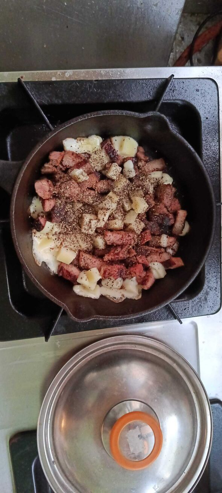[cf.]
2. 11:38 130mg/dL³
 -`{11:39 3½H>B}`
 -`{11:40 9I<A}`[13:00 cf.+ch.]<!-- hypo feeling -->[ml.+cf.][egg₃+spread]
 -`{14:46 8I>A}`
3. 21:37 142mg/dL⁴
 -`{21:40 4H<B}`[22:05 ch.]
4. 00:18 40mg/dL⁵[01:00 12.7g]

#### 20261002Fri
1. 07:45 111mg/dL⁶
 -`{07:56 3½H>B}`
 -`{07:57 8I<A}`[鹽BC₂]
2. 12:18 59mg/dL⁷
 -`{14:24 3½R>A}`[15:53 ml.] 
 -`{16:18 7I<B}`[ch.][20:02 ch.]
3. 20:52 167mg/dL⁸
 -`{20:56 6H>B}`[21:18 ml.(多), ch.][22:49 ml.][ch.]
4. 00:05 184mg/dL⁹
 -`{00:06 6H<A}`
 -`{00:08 (8+8)I<T>A}`

#### 20261003Sat
1. 07:32 47mg/dL⁰[ml.+cf.+ch₂]
2. 11:23 128mg/dL⁰
 -`{11:31 3½H<B}`[ch.]〘睡₁〙[14:53 ch.]
 -`{15:39 3½H>B}`
 -`{15:40 (6+6)I<A>A}`[small-egg₅+ch.][ml.+ch.]
3. 18:58 87mg/dL⁹[ml.+ch₂]
 -`{20:59 3½H<B}`
 -`{20:59 8I>B}`[ch.]
4. 22:13 109mg/dL⁸

#### 20261004Sun
1. 01:43 83mg/dL⁷
 -`{01:49 5I<A}`[鹽BC]
2. 11:16 145mg/dL⁶
 -`{11:17 5H2R>A}`
 -`{11:18 8I<B}`[costco外食:鹹水雞沙拉][ml., 14:30 炸雞]
 -`{15:37 3H>B}`
 -`{15:38 8I<A}`[19:15 ch.]
3. 19:50 84mg/dL⁵<!-- minov2.6flash: 8I peak check: 145→84, falling; 8I tail → ~22:38 -->
 -`{21:04 10T>T}`<!-- take T for the first time in months -->
 -`{21:06 7I>A}`

#### 20261005Mon
1. 05:47 75mg/dL⁴[鹽BC₂] <!-- 10:00 almost fell asleep -->
2. 11:01 145mg/dL³
 -`{11:03 4H<B}`
 -`{11:04 8I>B}`〘家務₂〙<!-- hypo-feeling -->[ch₂+ml.+4.7g]
 -`{16:50 4R<A}` [19:08 ch]<!-- no sleeping, good -->
 -`{19:17 8I>A}`
3. 01:30 48mg/dL²

#### 20261006Tue
1. 06:14 35mg/dL¹[ml.+4.7g+ch.][鹽BC] 
2. 11:47 189mg/dL₁<!-- OMG! Hypo rescue is too much -->
 -`{11:49 5H<B}`
 -`{11:50 10I>B}`
 -`{15:01 4R<A}` 
 -`{18:58 10I>A}`[煎雞肉塊₂][ch₃]
3. 23:08 120mg/dL₂
 -`{23:12 9I<内}`
 -`{23:13 2R<B}`

#### 20261007Wed
1. 06:16 52mg/dL³[3.9g+鹽BC]
 -`{08:34 8I>B}`[鹽BC₂+ch₂]
2. 11:59 47mg/dL₃[6.2g+鹽BC][13:38 ch.]
 -`{15:14 3½R<A}` 
 -`{18:46 8I>A}`[ch₃]
3. 22:37 39mg/dL₄[ml(少)+ch.]

#### 20261008Thu
1. 06:39 61mg/dL₅[鹽BC][鹽BC₂]
2. 12:03 189mg/dL₆
 -`{12:04 3H<B}`
 -`{12:06 9I<内}`
3. 16:37 131mg/dL₇
 -`{16:38 6R>B}`
 -`{18:36 8I<A}`[ml(多),ch₄]
4. 22:23 163mg/dL₈
 -`{22:24 4H>A}`[ch₂+無糖沙瓦6%]
 -`{00:00 8I>内}`
 -`{00:01 5T<B}`<!-- 今日狀況極差 -->

#### 20261009Fri
1. 08:01 33mg/dL₉
 -`{08:11 8I>B}`[ml.+鹽BC₂]
2. 12:40 129mg/dL₉
 -`{12:45 7I<A}`
3. 16:24 106mg/dL₈
 -`{16:26 3½R>A}` [ml.]
 -`{17:40 3½R<B}`[ml(多)]
4. 21:53 45mg/dL₇[ml.]
5. 00:54 82mg/dL₆
 -`{01:10 10T<T}`

#### 20261010Sat
1. 08:33 196mg/dL₅
 -`{08:34 9H>B}`[鹽BC₂]
2. 11:55 81mg/dL₄
 -`{15:05 5½R<A}` 
 -`{17:19 8I>A}`[ml₂+ch₃]
3. 21:55 164mg/dL₃
 -`{21:57 3½R<B}`
 -`{22:01 9⁺I>T}`

#### 20261011Sun
1. 06:05 58mg/dL₂
 -`{06:14 8I>B}`[ml.+鹽BC][ch₃]
2. 11:49 32mg/dL₁[ch.]
3. 16:12 59mg/dL¹
 -`{16:13 4R<A}` [ml.]
 -`{18:50 8I>A}`[cf.]
4. 23:47 31mg/dL²[9g]

#### 20261012Mon
1. 05:58 36mg/dL³
 -`{06:00 7I<B}`<!-- cf. too much last night resulting in bad sleep-->[ml(多)]
2. 11:28 111mg/dL⁴<!-- violent thinking -->
 -`{11:52 3⁻H>B}`
 -`{14:08 4R<A}` 
 -`{16:53 8I>A}`
3. 19:07 77mg/dL⁵[20:10 ch₂]
4. 21:56 106mg/dL⁶
 -`{22:00 9I<内}`

#### 20261013Tue
1. 07:10 48mg/dL⁷
 -`{07:22 8½I<B}`[ml.+鹽BC₂]
2. 12:24 58mg/dL⁸[3.8g+cf.][ch₂]
3. 18:20 45mg/dL⁹<!-- feeling ok -->[leftover(牛), ch₂][ch₂]
4. 00:52 135mg/dL⁰
 -`{00:56 1½H>B}`
 -`{00:57 5I>内}`

#### 20261014Wed
1. 02:53 84mg/dL⁰<!-- woke up from sleep -->〘睡〙
2. 06:40 58mg/dL⁹
 -`{07:01 6I<A}`[5.4g+鹽BC]
3. 12:50 70mg/dL⁸[鹽BC+ch₂] 
 -`{15:21 4⁻R>A}` <!-- violent thinking -->[ml(少)+cf.][ch.]
 -`{17:21 8I<B}`[ch.][22:40 ml(少)+BC(少)]
4. 00:41 170mg/dL⁷
 -`{00:51 5I<T}`
 -`{00:53 2⁺H>B}`

#### 20261015Thu
1. 03:02 136mg/dL⁶〘睡〙
2. 06:38 112mg/dL⁵
 -`{06:45 2H<A}`
 -`{06:51 5I>A}`[鹽BC][10: 00 鹽BC]
3. 12:10 57mg/dL⁴[12:17 8g]<!-- opus5.5: ok -->
 -`{16:09 3½R<B}`
4. 17:33 93mg/dL³
 -`{17:37 3I>B}`〘Walk½₁〙[diet coke][ch₂]
5. 21:45 71mg/dL²[ch₂] 

#### 20261016Fri
1. 03:25 100mg/dL¹
2. 07:02 127mg/dL₂
 -`{07:05 4⁺H<A}`
 -`{07:06 3I>A}`<!-- opus5.5: ~07:15 unspirited, foggy, heavy body, agitated at 127; no insulin from ~00:30 (3I tail end) to 07:05 -->[鹽BC₂]
3. 13:12 102mg/dL₃
 -`{13:21 0.7R<B}`[14:04 ch.] 
4. 16:06 127mg/dL₄
 -`{16:09 4R>B}`
 -`{17:18 2½R>B}`[ml.]<!-- opus5.5: ~17:25 user reports really uncomfortable all day; attributes it to going back to sleep after the 03:25 check without insulin (a pattern for ~20 years) --> 
5. 19:50 57mg/dL₅[4.4g+ml(70g)+ch.] [ch.(43g)]
6. 21:28 107mg/dL₆
 -`{21:33 4½I<A}`

#### 20261017Sat
1. 01:51 194mg/dL⁷
 -`{01:54 5H>A}`
2. 06:53 120mg/dL₈
 -`{06:56 4H<B}`
 -`{06:56 4⁻I>B}`[鹽BC₂]
3. 12:41 110mg/dL₉<!-- violent thinking -->
 -`{13:21 1.4R<A}` 
 -`{14:28 2R>A}`  [wine]
4. 17:38 118mg/dL₀
 -`{17:41 4½I<B}`[ch.(70g)][ch.(60g)]
5. 00:08 180mg/dL₉
 -`{00:12 5⁻R>B}`
 -`{00:14 8I>T}`

#### 20261018Sun
1. 08:25 56mg/dL₈<!-- opus5.5: user "I'm ok" — unaware low after 00:12 5⁻R + 00:14 8I -->
 -`{09:09 3H<A}`
 -`{09:09 5I>A}`[鹽BC+炸豆腐]
2. 13:09 88mg/dL₇ 
 -`{16:35 6R<B}`   
3. 18:07 161mg/dL₅
 -`{18:10 3H>B}`
 -`{18:10 8I<A}`
4. 22:19 112mg/dL₄
 -`{23:17 7I>B}`
5. 01:39 104mg/dL₃
 -`{03:39 3I>A}`

#### 20261019Mon
1. 06:41 28mg/dL₂<!-- shaky, fu -->[6g+ml.(89g)][10.7g]<!-- opus5.5: severe low after 18I NPH stacked 18:10–03:39 -->
2. 08:11 159mg/dL₁<!-- violent thinking -->
 -`{08:13 6H<B}`[鹽BC]
 -`{08:13 6I>B}` 
 -`{10:38 4½R<A}`[鹽BC]
3. 12:12 81mg/dL¹
 -`{14:25 4½R>A}`[meat-ball+garlic][ch.][17:40 ml.]
 -`{17:41 4⁻R<B}`[sausage₁][21:20 ml.+ch.]
 -`{21:29 6I>B}`[ch.+wine]
4. 23:30 148mg/dL²
 -`{23:34 4R<A}`

#### 20261020Tue
1. 05:52 97mg/dL³
 -`{05:57 3H>A}`
 -`{05:58 4I<B}`[鹽BC][鹽BC]
2. 12:24 158mg/dL⁴<!-- no violent thinking -->
 -`{12:29 3H>B}` 
 -`{15:35 6½R<A}`<!-- feeling quite good; no violent thinking since waking, even at 158mg/dL -->〘16:30 walk½〙
 -`{18:37 9I>A}`[ch.][21:50 ml.]
3. 22:37 65mg/dL⁵[ml.+ch.]
 -`{23:50 4½I<内}`

#### 20261021Wed
1. 04:49 58mg/dL⁶<!-- opus5.5: wake low, 2nd in 6h; 4½I @23:50 stacked after 22:37 65 -->[ml.(少)]
 -`{05:06 8I<B}`<!-- opus5.5: 8I with no recheck after 58; advised glucose first, I ≤2–3 once ≥80 -->[7.4g+鹽BC]
 -`{07:55 3H>B}`[ml.+鹽BC]<!-- opus5.5: 3H at 8I peak, no BG check since 04:49 58 -->
2. 09:52 29mg/dL⁷<!-- shaky but ok -->[12.7g+ml.(少)]<!-- opus5.5: severe low; 8I @05:06 + 3H @07:55 stacked after 04:49 58 -->
3. 11:32 73mg/dL⁸
 -`{13:40 4R<A}`[ml.][ml.]
 -`{16:44 6½I>A}`<!-- opus5.5: no BG since 11:32 73; 29 at 09:52 → advised evening I ≤3–4 -->
4. 18:51 65mg/dL⁹<!-- opus5.5: 6½I @16:44 rising to peak ~19–20:45 + 4R tail; 4th low <70 in 20h -->[ch.][20:13 sausage₂][ch.][ml.+ch.]
5. 21:55 139mg/dL⁰
 -`{21:59 3H<B}`
 -`{21:59 2R<B}`[ml.+ch.]<!-- opus5.5: advised 1R only (post-29 ×0.6); 3H+2R on 6½I tail -->
 -`{22:37 10T>内}`

#### 20261022Thu
1. 03:35 110mg/dL⁰
 -`{03:39 3½H<A}`〘睡〙
2. 07:12 74mg/dL⁹<!-- opus5.5: user mental state "comparatively ok" -->[鹽BC] 
 -`{09:57 4½R>A}`[11:00 ml.+BC]
3. 12:09 123mg/dL⁷
 -`{12:11 3⁻H<B}`
 -`{12:12 6I>B}`〘14:00-15:20 睡〙 
4. 19:06 81mg/dL⁶
 -`{19:06 5R<A}`[牛油鍋底(澱粉)+beef ball][21:52 ml.+BT]
 -`{21:53 9I>A}` <!-- opus5.5: no BG since 19:06 81; 9I on 10T (22:37 10/21) + 5R tail; past big bedtime I → 58 (10/10), 36 (10/12) -->[ch.]
5. 00:06 90mg/dL⁵[ch.]
 -`{00:51 10T<T}`

#### 20261023Fri
1. 07:19 176mg/dL⁴
 -`{07:22 8H<B}`<!-- opus5.5: 07:24 user "feeling terrible now"; thinks 4I before bed was needed; mostly physical, no violent thinking -->[ml.+BT+ch.]
 -`{08:22 8I>B}`[sausage₁]〘~11:20 睡〙
2. 11:35 107mg/dL³
 -`{11:36 6R<A}` [ml.+鹽BC]
 -`{13:29 9I>A}`<!-- opus5.5: no BG since 11:35 107; 9I on 6R peak + 8I @08:22 tail + 10T -->[ml.+鹽BC] <!-- 15:59 violent thinking -->
3. 16:13 83mg/dL²
 -`{18:24 7I<B}`<!-- opus5.5: no BG since 16:13 83; 7I on 9I @13:29 tail + 10T; 70–90 line ≈1–1½I -->[20:00 sausage₁]
4. 23:25 180mg/dL¹<!-- opus5.5: user thinks hyper from sausage + ml.; sausage (糖多 10/19) at 20:00 uncovered by R, ml. ≈10g lactose/25g; 7I @18:24 was basal, fading by ~22:30. Next time ~1½–2R per evening sausage at eating; bedtime ch. instead of ml. -->
 -`{23:29 8H>B}`<!-- opus5.5: advised 3–3½R; 8H peaks ~00:00–01:00, post-meal ISF 12–18 → ~60–90 at peak -->[ml.+BT][ch₂]
5. 01:14 126mg/dL₂
 -`{01:15 10T>T}`
 -`{01:17 6I<A}`<!-- opus5.5: 6I at 126 falling (8H tail) + 10T; peak ~03:00–05:00; cap rule ~6I only at ≥130 rising -->

#### 20261024Sat
1. 07:13 79mg/dL₃<!-- opus5.5: wake after 6I @01:17 + 10T @126, no low; advised 1H (low end, 6I tail + 2×10T overlap) + ch. -->
 -`{07:28 7I>A}`<!-- opus5.5: 7I at 79 on 2×10T; 70–90 line ≈1–1½I; peak ~09:30–11:30 → check ~10:00–10:30, eat now -->[ml.+鹽BC][ml.+鹽BC]
2. 11:16 42mg/dL₄<!-- opus5.5: severe low; 7I @07:28 at 79 on 2×10T, at I peak; no 10:00 check logged. Advised glucose 12g + ch., recheck ~11:30, no insulin until ≥80 -->
 -`{11:19 3½R<B}` 
 -`{14:29 6I>B}`<!-- opus5.5: no BG since 11:16 42 (no glucose logged; 3½R @11:19 with food); post-42 ×0.6 day; 6I peaks ~16:30–18:30 on 3½R tail + 2×10T -->[17:25 炸雞₅]
 -`{18:03 4½R<A}`[ml.+BT]<!-- 21:34 violent thinking -->
3. 23:09 114mg/dL₅<!-- opus5.5: 4½R @18:03 nearly done, 6I @14:29 done; post-42 day (×0.6 to ~23:16, ×0.75 after); 炸雞₅ breading/fat may rise late. Advised bedtime ~2½I or 1R + usual T, ch. not ml., one check ~02:30 -->
 -`{23:18 2R>A}`<!-- opus5.5: advised ~2½I or 1R; 2R peaks ~00:50–01:45, check ~01:30 -->
 -`{23:19 10T<内}`
 -`{00:30 4⁻I<B}`<!-- opus5.5: no BG since 23:09 114; 4⁻I on 2R peak + 10T, post-42 (×0.75 → ~2–3I); I peaks ~02:30–04:30 → extra check ~03:00 -->

#### 20261025Sun
1. 05:32 84mg/dL⁶<!-- fu. last night, pee:2; mental fairly ok --><!-- opus5.5: wake; 4⁻I @00:30 tail fading + 2×10T; culprit slot = morning I (7I @79 → 42 on 10/24). Advised 1H + ch./food, no big morning I (≤2I if any) -->
 -`{05:55 4I>B}`<!-- opus5.5: 4I at 84 (advised 1H); culprit slot (7I @79 → 42 10/24), post-42 12–24h, on 4⁻I tail + 2×10T. Peak ~08:00–10:00 → eat now, check 08:30 -->〘-10:33 睡〙
 -`{10:59 5½R<A}`[ml.+鹽BC]
 -`{13:22 8I>A}`
2. 17:32 111mg/dL₇
 -`{17:37 2½H<B}`<!-- opus5.5: 2½H at 111 on 8I @13:22 tail (to ~20:00) + 10T; no BG since 05:32; H peak ~18:15–19:00 → eat, check 18:45 -->[ch.]
 -`{19:22 7I>B}`[ml(少)+BT][21:30 ch₄]
3. 23:23 98mg/dL₈<!-- opus5.5: 7I @19:22 (no BG before it) past peak, tail to ~02:00; light food (ch.). Advised usual 10T only, no R/I, ch. before bed, check 01:30 -->
 -`{23:33 10T>内}`
 -`{23:35 4I<A}`<!-- opus5.5: 4I at 98 on 7I @19:22 tail + 10T, light food (advised T only); I peak ~01:30–03:30 → checks 01:30 + 03:00, ch. now, glucose bedside --><!-- whole day fu., weak body, peeing every 30m–1h, bladder and kidney feel ballooned --><!-- pee amount normal, no normal urge warning, bladder/kidney swollen discomfort; tired and unspirited these days -->[ch.]

#### 20261026Mon
1. 05:42 56mg/dL₉<!-- opus5.5: wake low after 4I @23:35 at 98 (advised T only) + 7I @19:22 tail + 2×10T. Advised glucose 8g + ch., recheck ~06:05, then 1H only once ≥70, no morning I --><!-- opus5.5: user still weak; pee×2 during sleep -->〘睡〙
2. 07:19 41mg/dL₀<!-- opus5.5: severe low, falling 56→41 with no rapid insulin peaking (4I @23:35 ~done); 2×10T overlap + empty glycogen. No glucose logged after 56. Advised glucose 12g now, stay awake, recheck 15 min; no insulin until ≥80; tonight T reduced; doctor today, add AM cortisol test -->[12.7g]<!-- opus5.5: Addison screen Qs: salt craving, orthostatic dizziness, skin darkening, weight loss/nausea → all no -->
 -`{08:42 6I>A}`<!-- opus5.5: no BG since 07:19 41 (+糖12.7g, expected ~80); 6I at post-41 morning (10/24 7I @79 → 42 at 3.8h). Peak ~10:45–12:45 → alarm 10:45, glucose ready, eat real food -->[ml.+鹽BC]
2. 12:31 107mg/dL₉ 
 -`{12:38 6R<B}`<!-- opus5.5: 6R at 107 with 牛油湯底 meal on 6I @08:42 tail (to ~14:30); post-41 day. Same meal/dose 10/23 (6R @107) → 83 at 4.5h. R peak ~14:10–15:10 → alarm 14:30 -->[ml.+BC]
 -`{15:27 6I>B}`<!-- opus5.5: 6I meal-gluconeogenesis cover (user: meal dose separate from correction; no BG since 12:31 107) on 6R @12:38 tail; post-41 day (10/24 6I @14:29 post-42 → 23:09 114, no low logged). Belly → I peak ~16:30–18:30; alarm 17:30 -->[ml.+鹽BT]
3. 17:31 74mg/dL₈<!-- opus5.5: at 6I @15:27 belly peak (~16:30–18:30), 6R done; post-41 day. Advised glucose 6g + ch., recheck ~18:30 -->[6.3g]<!-- opus5.5: user cancelled 18:30 check; next 21:30 (6I tail), bedtime ~7T no I -->[20:29 ch₂]<!-- opus5.5: user still fu. today, toilet 1–2×/h, weak and "sucked dry" all the time -->
4. 21:33 184mg/dL₇<!-- opus5.5: 74 (17:31) + 6.3g + ch. → 184; 6I @15:27 tail ending. Post-41 12–24h (×0.75), night sensitivity, 7T at bed → advised 4H (user proposes 5H), H peak ~22:05–23:05, check ~23:00, ketone strip (polyuria) -->
 -`{21:38 7H<A}`<!-- opus5.5: 7H at 184 (advised 4H); ISF ~15 → ~80 at peak, lower post-41/night → ~15g starch covers the extra ~3H; H peak ~22:10–23:10, check moved to 22:40 -->[22:13 蕃薯包(~30g, whole)+ml.][ch.]
5. 23:51 192mg/dL₆<!-- opus5.5: no 22:40 check; 7H @21:38 past peak (tail to ~00:30) + 蕃薯包+ml. → still 192. User plans 5H+10T+6I; last night 4I+10T @98 → 56/41. Advised 3H + 7T + ≤3I (or no I), check ~02:30, glucose bedside -->
 -`{23:56 7I>A}`<!-- opus5.5: 7I + 4H + 1½R + 10T at 192 (advised 3H + 7T + ≤3I) on 7H @21:38 tail; post-41 day. H/R peak ~00:30–01:45, I peak ~02:00–04:00 → checks 01:30 + 03:00, glucose bedside -->
 -`{23:57 4H1½R<B}`
 -`{23:58 10T<T}`

#### 20261027Tue
1. 06:46 100mg/dL₅<!-- opus5.5: wake; 7I @23:56 tail ending (~7h), 2×10T overlap; no 01:30/03:00 readings logged. Morning band 100–120 → advised 2H (low end: I tail + T stacking), no morning I (10/21 8I @58 → 29, 10/24 7I @79 → 42), eat; H peak ~07:30–08:15 --><!-- opus5.5: user slept ok; unsure if from heavy bedtime dose or air conditioning (24℃, likely all night); pee×1 ~midnight + ×1 after waking -->
 -`{07:38 3H3R>B}`<!-- opus5.5: one syringe; 6u at 100 (advised 2H) on 2×10T, 7I tail ~done. Wake ISF ~10–12/u → ~−60–70, offset by coffee/dawn + sausage₂ sugar → est. ~75–95. H peak ~08:10–09:10, R ~09:10–10:10 → one check ~09:30, glucose ready -->[sausage₂+綠豆皮(澱粉)₃+(ml.+鹽BC)]
 -`{09:09 8I<A}`<!-- opus5.5: no BG since 06:46 100; 8I on 3H3R @07:38 + 2×10T; past: 8I @58 → 29 (10/21), 7I @79 → 42 (10/24). I peak ~11:00–13:00 → check, eat, glucose ready --><!-- 10:55 violent thinking -->
2. 11:09 59mg/dL₄[9g]<!-- opus5.5: low at start of 8I @09:09 peak (~11:00–13:00) + 3R tail + 2×10T; 10:55 violent thinking = falling BG. Advised glucose 12–15g now + ch./food, recheck ~11:30, no insulin; 2nd low <54 risk → ×0.5 doses rest of day -->[ml.+鹽BC]<!-- opus5.5: 13:58 user fu. + sucked-dry feeling again; considering quitting cf./tea -->
3. 16:26 110mg/dL₃<!-- opus5.5: 59 (11:09) + 9g + ml. → 110, rising; 8I @09:09 tail ending, 2×10T. Post-59 0–12h ×0.75 → normal ~6I → advised ~4I with real food; I peak ~18:30–20:30 → check ~19:00 --> 
 -`{16:43 5R>A}`<!-- opus5.5: 5R at 110 with beef ball+egg₃ meal (10/23 6R @107 same meal → 83); post-59 ×0.75 ≈ 4½R. R peak ~18:15–19:15 → check ~18:45, glucose ready -->[18:10 ml.]
 -`{19:42 5I<B}`<!-- opus5.5: no BG since 16:26 110; est. ~100–130 now; advised 3I. 5I belly on 5R @16:43 tail + T, post-59, night → est. ~60–90 at peak. Belly I peak ~21:30–23:00 → alarm 22:00 (also pre-bed check), glucose bedside -->[20:50 ch₃]
4. 22:19 137mg/dL₂<!-- opus5.5: at 5I @19:42 belly peak (~21:30–23:00), 5R done; ml. 18:10 + ch₂ 20:50 + protein → higher than est. 60–90. 5I tail to ~01:00–02:00 then gap. Advised bedtime ~1R + 8T, no I -->
 -`{22:27 10T>T}`
 -`{22:28 2H>B}`
 -`{22:29 4I<A}`<!-- opus5.5: advised 1R + 8T, no I. 2H (peak ~23:00–00:00) + 4I arm (peak ~00:30–02:30) on 5I @19:42 tail + 10T, post-59, night → est. ~35–90 at lowest ~01:00–03:00. Advised slow food now (ch.+ml.), alarm 01:30, glucose bedside --><!-- opus5.5: 22:33 user still fu.; thinks dinner gluconeogenesis much stronger than expected, like 10/26 (74 → 184) --><!-- opus5.5: 23:14 fu. worse: toilet ~every 30 min, drained-out feeling; day 4. Advised 急診 tonight (urine + electrolytes + ketones), salted water meanwhile --><!-- opus5.5: 23:18 small volume each void, drained feeling at kidney area; advised 急診 (UTI/pyelo vs retention: urine test + post-void bladder scan). User chose to wait and watch -->

#### 20261028Wed
1. 07:57 130mg/dL₁<!-- opus5.5: morning; 4I @22:29 + 2H done, only 2×10T on board; post-59 12–24h but morning shot exempt. Band 120–150 → advised 4H (low end: T stacking), no morning I without a BG first -->
 -`{08:00 5H>A}`<!-- opus5.5: 5H at 130 (advised 4H) on 2×10T only; wake ISF ~10–12 → est. ~70–90 at H peak ~08:30–09:30, eat now -->[ml.+鹽fat]<!-- opus5.5: user slept long; pee×1 ~03:30 (better than 10/27 night ~every 30 min); still drained but a little better than last night -->[ch₂][10:20 牛油底+egg₂]
 -`{10:41 8I<B}`<!-- opus5.5: no BG since 07:57 130; 8I on 5H @08:00 tail + 2×10T, post-59 day; past morning 8I/7I → 29 (10/21), 42 (10/24), 59 (10/27). Belly I peak ~12:30–14:00 → check now if possible + ~12:30, real food, glucose ready -->[ml.+鹽fat]
2. 12:03 172mg/dL¹<!-- opus5.5: 130 → 172 despite 5H @08:00 + ml.×2 (fat/鹽); 8I @10:41 ~1.3h in, belly peak ~12:30–14:00 not yet reached. Unusual morning resistance → possible infection (drained/urination day 5). Advised no extra insulin now (8I est. −60 to −90 → ~85–110), ketone strip, recheck ~13:45 -->
 -`{12:07 5½H>B}`<!-- opus5.5: advised no extra (8I @10:41 peak ~12:30–14:00 still ahead). User: rise from too much ml. → 5½H stacks on 8I peak; H peak ~12:40–13:40. Est. ~40–110 at ~13:15–14:00 depending on how much lactose still absorbing → checks ~13:00 + ~13:45, glucose ready, no more ml. -->[ch.]〘睡->16:20〙 
3. 16:49 159mg/dL²<!-- opus5.5: 172 (12:03) → 5½H + 8I @10:41 both done → 159, no reading through the peak (slept 〜16:20); high resistance today (ml. + possible infection). Post-59 window ended 11:09. Meal 牛油底+egg₄+ml. at ~16:44: same meal 6R @107 → 83 (10/23); +~3R for 159 → full ~9R; advised ~7R (unknown midday course, low history). R peak ~18:15–19:15 → check ~18:45; any later I only after a BG -->
 -`{16:51 3H6R<A}`<!-- opus5.5: 9u at 159 with meal (advised ~7R; full math ~9R) on 2×10T only. H peak ~17:20–18:20 (ahead of protein/fat digestion), R ~18:20–19:20 → est. ~70–110; check ~18:15–18:30, glucose ready, no evening I without a BG -->
 -`{18:56 8I>A}`<!-- opus5.5: no BG since 16:49 159 (18:15–18:30 check skipped); 8I on 6R @16:51 peak (~18:20–19:20) + 3H tail + 2×10T. Arm I peak ~21:00–23:00; dinner gluconeogenesis may offset (10/26 74→184, 10/27 →137) but 8I has gone to 29/42/59 before → advised BG now, slow food (ch.), check ~21:00, glucose ready; bedtime dose from that reading --><!-- opus5.5: 20:07 user reports violent thinking; no BG since 16:49 159; 8I @18:56 rising toward peak + 6R tail → advised BG now -->[20:00 椰漿+ch₂]<!-- opus5.5: 22:00 user reports violent thinking again; still no BG since 16:49; 8I @18:56 at peak (~21:00–23:00) -->
4. 22:02 159mg/dL³<!-- opus5.5: 159 → 3H6R + 8I @18:56 (at peak) → still 159; ~35u today with BG 130–172 → strong resistance (infection? ml.), violent thinking at ≥100 fits user observation. Advised 3R now + usual T, no I (8I tail to ~01:00–02:00); R peak ~23:30–00:30 → check ~01:30, glucose bedside; ketone strip; urine test/doctor tomorrow -->
 -`{22:11 3H<B}`<!-- opus5.5: H instead of advised 3R; peak ~22:40–23:40 overlaps 8I @18:56 tail (to ~01:00–02:00) -->
 -`{22:13 12T<内}`<!-- opus5.5: 12T (usual 10T; advised 7–8T before) on 10T @22:27 10/27 overlap; past 10T + bedtime I → wake 56/41 (10/26). Resistant day may absorb it, but if resistance eases overnight → low risk toward morning. Check ~01:30, glucose bedside --><!-- opus5.5: ~22:15 violent thinking now light; user copes with podcasts/YouTube (years) -->
 -`{22:40 8I>B}`<!-- opus5.5: no BG since 22:02 159; 8I belly on 3H @22:11 peak + 8I @18:56 tail + 12T/10T overlap. Heavy-food-night line caps bedtime I ~6I (8–9I → 58 on 10/10, 36 on 10/12). Belly peak ~00:40–02:40 → alarms 00:45 + 02:30, ch. now, glucose bedside -->〘睡〙
5. 00:48 99mg/dL⁴<!-- opus5.5: 159 (22:02) → 99, ~−22/h; 3H done, 8I @18:56 ending, 8I @22:40 belly peak ~00:40–02:40 just starting + 12T/10T → est. ~30–60 by ~02:30 if untreated. Advised glucose 9g + ch. now, no insulin, keep 02:30 alarm --><!-- opus5.5: 01:43 user reports violent thinking; at 8I @22:40 belly peak, falling from 99 (00:48); glucose not confirmed → advised glucose first, then test -->

#### 20261029Thu
1. 06:14 59mg/dL⁵<!-- still fu.; pee×3 last night and after waking --><!-- opus5.5: wake low after 8I @22:40 at 159 + 12T/10T overlap (8I done ~05:00–06:00, T only now); 00:48 99 falling, 01:43 violent thinking, glucose not logged. Advised glucose 9–12g + ch. now, recheck ~06:35, morning shot small (1–2H) only once ≥70 + food, no morning I; post-59 ×0.75 rest of morning (shot exempt); urine test/doctor today (polyuria day 6) -->[9.5g]<!-- 08:50 violent thinking -->
 -`{09:19 2H2½R<A}`<!-- opus5.5: morning shot; no BG logged since 06:14 59 (+9.5g); on 12T/10T only, 08:50 violent thinking. H peak ~09:50–10:50, R ~10:50–11:50 → eat now, one check ~10:45, glucose ready -->[ml.+BT+fat] 
 -`{10:24 3⁻R>A}`<!-- opus5.5: meal R for 牛油底+egg₅ (same meal 6R @107 → 83 on 10/23; post-59 ×0.75 ≈ 4½R) on 2H2½R @09:19 + 12T/10T; still no BG since 06:14 59. R peak ~11:55–12:55 → one check ~12:00, glucose ready -->
2. 12:00 49mg/dL⁶<!-- opus5.5: low at 3⁻R @10:24 peak (~11:55–12:55) + 2½R @09:19 tail + 12T/10T; 2nd low today (06:14 59). Advised glucose 15g now + ch., recheck ~12:20, no insulin until ≥80; ×0.5 doses rest of day, tonight T 8T, no bedtime I without BG -->[12:03 12g+ch.]  
 -`{15:09 5R<B}`<!-- opus5.5: no BG since 12:00 49 (+12g, 12:20 recheck not logged); no food logged since 牛油底+egg₅ ~10:21; 3h after 2nd low today (59, 49) → ×0.5 window; 3⁻R @10:24 done, 12T/10T on board. Belly R peak ~16:30–17:30 → BG now, eat, check ~16:45, glucose ready --><!-- opus5.5: correction: meal was 牛雜湯大 (no noodles, ~15:06) → low-carb protein/collagen, slow rise; 5R ≈ full meal dose vs ×0.5 post-49 (~3R) → est. 60–90 at R peak ~16:30–17:30; check ~16:45, glucose ready --><!-- 16:48 violent thinking -->
3. 18:03 121mg/dL⁷<!-- opus5.5: 49 (12:00) + 12g + ch. + 牛雜湯大 ~15:06 + 5R @15:09 (past peak, tail to ~20:00) → 121; 16:48 violent thinking (no BG then). Post-49 0–12h ×0.5; dinner protein still converting (10/26 74→184, 10/27 →137). Advised ~2½–3I (half normal) or 1R, no more; I peak ~20:00–22:00 → check ~20:30; bedtime 8T, glucose bedside -->
 -`{18:07 2½H>B}`
 -`{18:08 6I<A}`<!-- opus5.5: 8½u at 121 (advised ~2½–3I or 1R) on 5R @15:09 tail, 6h after 49 (×0.5 window), 12T/10T. H peak ~18:40–19:40, arm I ~20:00–22:00; 牛雜湯 protein offsets part → est. ~40–80 at ~20:30–21:30. Advised ch./slow food now, checks ~19:30 + ~21:00, glucose ready; bedtime 8T, no more I -->[18:30 bacon₅][20:00 bacon₅][20:45 ml.+BT]
4. 22:19 160mg/dL⁸<!-- opus5.5: 121 (18:03) → 2½H + 6I @18:08 (4h, tail to ~00:00–01:00) → 160; bacon₅×2 + ml.+BT + 牛雜湯 protein converting. Post-49 ×0.5 to 00:00 then ×0.6. 10/28 159 → 3H + 8I + 12T → 99 (00:48) → 59 wake. Advised ~2R + 8T, no I; R peak ~23:50–00:50 → check ~01:30, glucose bedside -->
 -`{22:21 5½H>A}`<!-- opus5.5: 5½H at 160 (advised ~2R) on 6I @18:08 tail, <12h after 49, night. H peak ~22:50–23:50 → est. ~40–90 at ~23:30–00:30 (protein offsets part). Advised ch./ml. now, check ~23:30, glucose bedside, 8T, no I -->
5. 03:13 177mg/dL⁹<!-- opus5.5: 160 (22:19) → 5½H → 177; no 23:30 check logged; 5½H + 6I @18:08 done. No T logged tonight (12T @22:13 10/28 ~29h, fading) → likely basal gap + bacon/ml./牛雜湯 protein. Post-49 12–24h ×0.6. Advised ~3R (normal ~5R ×0.6), 8T now if not taken, no I; R peak ~04:45–05:45 → check on waking -->
 -`{03:15 4H<B}`
 -`{03:15 8I>B}`
 -`{03:16 12T>内}`<!-- opus5.5: 4H + 8I + 12T at 177 (advised ~3R + 8T, no I); post-49 12–24h. Same pattern as 10/28 (159 → 3H + 8I + 12T → 59 wake). H peak ~03:45–04:45, belly I ~05:15–07:15 → est. ~30–70 around 05:30–07:00. Advised ch.+ml. now, alarms ~05:00 + ~06:30, glucose bedside --><!-- opus5.5: user: still fu. and drained 10/29 but better than 10/28; went out for an afternoon walk --><!-- opus5.5: user: urination 10/29 ~1–2× per 2h (10/25–27 ~every 30 min–1h) -->

#### 20261030Fri
1. 07:35 64mg/dL⁰<!-- opus5.5: wake low at 8I @03:15 belly peak (~05:15–07:15, tail to ~09:00–10:00) + 4H done + 12T @03:16 on fading 12T @22:13 10/28; 3rd low in ~26h (59, 49, 64). Same stack/outcome as 10/28 (→ 59). Advised glucose 12g + ch. now, recheck ~07:55; morning shot only once ≥70, small (1H) with food, no morning I -->〘睡->08:50〙[8.9g+鹽BC]
 -`{09:27 5I<A}`<!-- opus5.5: morning shot as 5I, no BG since 07:35 64 (+8.9g + 鹽BC; advised BG first, then 1–2H, no morning I); 8I @03:15 tail ending + 12T @03:16. Past morning I after a low: 8I @58 → 29 (10/21), 7I @79 → 42 (10/24), 8I → 59 (10/27). Arm I peak ~11:30–13:30 → BG now, real food now, one check ~11:45–12:30, glucose ready -->
2. 12:08 86mg/dL⁰<!-- opus5.5: at 5I @09:27 arm peak (~11:30–13:30, tail to ~14:30–16:30) + 12T @03:16; no food logged since 鹽BC. Good number, but peak not over and trend unknown. Advised real food now (protein/fat), no insulin now; meal R only with a BG, reduced (post-64 ×0.5 window); next check ~13:30 or before eating -->
 -`{15:09 6I>A}`<!-- opus5.5: 6I with 牛油底+egg₄, no BG since 12:08 86 (at 5I peak); 5I @09:27 tail ending + 12T @03:16; post-64 0–12h (3 lows in 26h → ×0.5–0.6, normal ~6 → ~3–4). Same meal 6R @107 → 83 (10/23). Arm I peak ~17:00–19:00 → one check ~17:30, glucose ready; any evening dose only after a BG -->[牛油底+egg₄]<!-- opus5.5: 16:21 user reports violent thinking; no BG since 12:08 86; 6I @15:09 rising toward peak (~17:00–19:00) + meal digesting → advised BG now -->
3. 18:34 73mg/dL⁹<!-- opus5.5: at 6I @15:09 arm peak (~17:00–19:00, tail to ~20:00–22:00) + 12T @03:16; meal 牛油底+egg₄ ~15:09; 16:21 violent thinking (no BG then). Likely still drifting down. Advised ~6g glucose + ch./ml. now, no insulin, recheck ~19:15; bedtime T only (8T), no I unless a pre-bed BG supports it --> 
 -`{20:07 6I<B}`<!-- opus5.5: 6I belly with 牛油炒豬肉 (~150–200g pork, ~0 carb), no BG since 18:34 73 (19:15 recheck not logged); user planned 3R + 5I later, advised BG first, no R, ~3I + 8T at bed. On 6I @15:09 tail (to ~21:00–22:00) + 12T @03:16; post-64 day. Pork rise ~+40–60 over 3–6h offsets part. Belly I peak ~22:00–23:30, tail to ~01:00–02:00 → est. ~40–90 at peak. Advised BG now, ch. now, pre-bed check ~22:00, 8T only at bed (no more I/R), check ~01:30, glucose bedside --><!-- opus5.5: 21:14 user reports violent thinking; no BG since 18:34 73; 6I @20:07 belly rising toward peak (~22:00–23:30) + 6I @15:09 tail → advised BG now, glucose first if low -->[ml.+BT, ch₃]
4. 01:02 149mg/dL⁸<!-- opus5.5: 73 (18:34) → 149 despite 6I @20:07 belly (past peak, tail ending ~01:00–02:00); pork ~150–200g + ml.+BT + ch₃ converting; 21:14 violent thinking (no BG). No T logged tonight (12T @03:16 ~22h). Post-64 12–24h ×0.75 (3 lows in 26h → ×0.6). Normal ~3R → advised ~2R + 8T now, no I; R peak ~02:30–03:30 → no extra check unless symptoms, test on waking, glucose bedside -->
 -`{01:04 1½H2R>B}`
 -`{01:06 6½I<A}`
 -`{01:07 10T<T}`<!-- opus5.5: 3½u fast + 6½I + 10T at 149 (advised ~2R + 8T, no I); post-64 12–24h, 3 lows in 26h. Same pattern as 10/28 (159 → 3H + 8I + 12T → 59 wake) and 10/29 (177 → 4H + 8I + 12T → 64 wake). H peak ~01:35–02:35, R ~02:35–03:35, arm I ~03:00–05:00 (tail to ~06:00–08:00) → est. ~30–70 around 04:00–06:00 (pork protein offsets part). Advised ch. now, one check ~04:00, glucose bedside --><!-- opus5.5: user suspects the fu./drained state comes from the cat litter box in the living room (feces/litter); wore a mask there 10/29–10/30, drained body better 10/30. Possible causes: ammonia, litter dust, cat allergy, Toxoplasma (IgG/IgM blood test). Trial: mask or move the box out ~1 week; note fu. days with/without mask -->

#### 20261031Sat
1. 09:03 51mg/dL⁷<!-- opus5.5: wake low at 6½I @01:06 arm (peak ~03:00–05:00, tail ~06:00–08:00) + 1½H2R @01:04 done + 10T @01:07; no 04:00 check. 4th low in ~51h (59, 49, 64, 51) — 3rd straight wake low after big bedtime stack (10/28 → 59, 10/29 → 64). Advised glucose 15g + ch. now, recheck ~09:25; morning shot only once ≥70, small 1H with food, no morning I; ≥2 lows <54 in 48h → ×0.5 today -->[10.4g+鹽BC]<!-- opus5.5: user: inflammation and fu. better 10/31 (mask/litter trial day 3); slept too late last night -->
2. 11:42 158mg/dL⁶<!-- opus5.5: 51 (09:03) + 10.4g + 鹽BC → 158; no insulin since 01:07 except 10T @01:07 on board; no morning shot yet → rebound (counter-regulation) + dawn/cortisol + caffeine + no bolus. ≥2 lows <54 in 48h (49, 51) → normal ~6–7H ×0.5 ≈ 3H. Advised 3H now (as morning shot), no I; food with it gets no extra uni
ts; H peak ~12:15–13:15 → one check ~13:00, glucose ready -->
 -`{11:49 3H5½R>A}`<!-- opus5.5: 8½u fast at 158 (advised 3H, no extra for food) with 築間火鍋 (meat/veg/broth; balls + sauce carry some carbs); 2h46m after 51, ≥2 lows <54 in 48h → ×0.5; 10T @01:07 on board. Arm H peak ~12:20–13:20, R ~13:20–14:20 → est. ~50–100 at ~13:30–14:30 (hotpot protein offsets part). Advised eat the full meal, glucose in pocket, one check ~13:30 -->[外食:築間火鍋] 
 -`{14:02 9I<B}`<!-- opus5.5: 9I belly, no BG since 11:42 158 (13:30 check not logged); on 3H5½R @11:49 (R peak ~13:20–14:20, tail to ~16:00) + 10T @01:07; 5h after 51, ≥2 lows <54 in 48h → ×0.5. Past big I after a low: 8I @58 → 29 (10/21), 7I @79 → 42 (10/24). Hotpot protein offsets part. Belly I peak ~16:00–18:00, tail to ~19:00–21:00 → est. ~30–70 at ~16:00–17:30. Advised BG now, eat more (protein + some carbs), glucose in pocket, checks ~15:00 + ~16:30 -->
3. 18:00 134mg/dL⁵<!-- opus5.5: 158 (11:42) → 3H5½R @11:49 (done) + 9I @14:02 belly (late peak ~16:00–18:00, tail to ~19:00–21:00) + 築間火鍋 → 134; no low reported (15:00/16:30 checks not logged). 10T @01:07 fading (~17h). Hotpot protein held it up. I tail may take ~20–40 more → est. ~90–120 by ~20:00. Advised no insulin now; dinner R only small with a BG (post-51 ×0.5 to ~21:00, then ×0.6); pre-bed checks ~22:00 + bed, R + T at bed, no big I, sleep before midnight -->
 -`{18:15 3½H>B}`<!-- opus5.5: 3½H at 134 (advised no insulin; 9I @14:02 tail to ~19:00–21:00 expected −20–40); 9h after 51, ≥2 lows <54 in 48h → ×0.5 to ~21:00 (normal ~4H → ~2H, minus I tail ≈ 1H). No food logged since 築間火鍋 ~11:50. Belly H peak ~18:45–19:45 → est. ~40–80 at ~19:00–19:45. Advised eat now (protein + some carbs) or ch.+ml., glucose ready, one check ~19:15–19:30 -->[ml.+cf., ml.][21:30 ml.+fat]
4. 23:02 74mg/dL⁴<!-- opus5.5: 134 (18:00) → 3½H @18:15 (done) + 9I @14:02 (done) → 74; no 19:15 check, no dinner logged. No active fast insulin; only 10T @01:07 (~22h, fading) → basal gap risk. Post-51 12–24h, ≥2 lows <54 in 48h → ×0.6. 3 straight wake lows after big bedtime stacks. Advised ch. now + 8T (ok-but-low, little food → T), no I/R, sleep before midnight, glucose bedside, check on waking -->
 -`{00:23 8T>T}`

#### 20261101Sun
1. 08:24 112mg/dL³<!-- opus5.5: wake after 8T-only night (74 @23:02 + 8T @00:23) → 112, no low — breaks 3 straight wake lows after big bedtime stacks. User: slept ~05:00 (~3½h sleep → expect extra resistance/cortisol today). No fast insulin or I on board, 8T only. Post-51 window ends ~09:00 (morning shot exempt). Band 100–120 → advised 2½H (2–3H), eat with it, no morning I; H peak ~09:00–10:00 → one check before the next meal R --><!-- opus5.5: user (19:4x): tongue edge bitten in sleep last night; nightly tongue biting for decades; user's guess: BG >100 → violent thinking in sleep → biting. Agent: lateral tongue biting is a classic sign of nocturnal seizure (incl. hypoglycemic); also bruxism/sleep disorders. Advised neurologist (EEG, sleep study), CGM for overnight BG, dentist night guard -->
 -`{08:31 3½H<A}`<!-- opus5.5: 3½H at 112 (advised 2½H; band 100–120 → 2–3H) on 8T only; morning ISF ~10–12 → −35 to −42, dawn + coffee +10–30 → est. ~75–95 at H peak ~09:00–10:00 (lower if no food). Advised eat with it (protein/fat), one check ~09:45, glucose ready -->[BC+鹽BC] 
2. 12:22 116mg/dL²<!-- opus5.5: 112 → 3½H @08:31 (done ~12:30) + BC/鹽BC → 116; no 09:45 check. 8T only on board; 51 was 27h ago (out of ×0.6 window, but 7 lows <65 in 10 days). Meal 牛油底+豬 (~150g sliced pork) + ch. (~3 slices), small skillet. Ref 牛油底+egg₄ 6R @107 → 83 (10/23). User plans 5R → est. ~85–110 at R peak ~13:50–14:50; fine given short-sleep resistance and the trial's after-meal I. Trial: pre-I BG ~14:50–15:20, I sized then (no hotpot → ~5–6I, less if <90) -->
 -`{12:27 5⁺R>A}`[cf.]<!-- opus5.5: 5⁺R at 116 with 牛油底+豬+ch. (planned 5R; ref 6R @107 → 83). Arm R peak ~13:45–14:45, tail to ~17:00 → est. ~80–105. Trial: one check ~14:50–15:20 before the after-meal I (~5–6I, less if <90) -->
 -`{14:53 1½R4I<B}`[cf.]<!-- opus5.5: after-meal shot at ~2h25m after 5⁺R @12:27 (trial gap 2½–3h ok); no BG (advised check first, ~5I). 1½R (peak ~16:20–17:20) + belly 4I (peak ~16:50–18:50, tail ~20:00–22:00) on 5⁺R tail (to ~17:00) + 8T; ≈7½R-equiv vs 7I ≈10½. Pork protein offsets part → est. ~70–100 at ~17:30–18:30. Trial score: one check ~18:15, glucose ready --><!-- opus5.5: user: R and I mixed in one syringe → acts as one longer dose; agent: mixed human R + NPH keep their own profiles (like 70/30 premix, biphasic), so the curve is roughly R peak + I peak added --><!-- opus5.5: 17:16 user reports violent thinking; no BG since 12:22 116; 1½R4I @14:53 toward peak (~16:30–19:00) + 5⁺R @12:27 tail → advised BG now -->
3. 19:29 155mg/dL¹<!-- opus5.5: 116 (12:22) → 5⁺R @12:27 + 1½R4I @14:53 (4½h, past peak, tail to ~20:00–22:00) + cf.×2 → 155; 17:16 violent thinking (no BG then; fits rising-BG pattern). Trial score: no pre-I BG, 155 at ~4½h after I → ~2I short of 85; user's planned 7I (vs agent's 5–6I) would likely have fit (~60–95). Short sleep + cf. → resistance. 51 now 34h ago → no reduction. Advised ~3R now (4I tail −10–20 counted); R peak ~21:00–22:00 → pre-bed check ~22:00, bed T 8–10T, sleep before midnight -->
 -`{19:33 2H3R<B}`<!-- opus5.5: 5u fast at 155 (advised ~3R) on 4I @14:53 tail (−10–20 to ~20:00–22:00) + 8T. Evening ISF ~15–20/u (10/31 3½H @134 → 74), today's resistance lower → est. ~50–85 at ~21:00–22:00 (H peak ~20:00–21:00, R ~21:00–22:00). Advised ch. if hungry, glucose ready, one check ~21:15 (also pre-bed), bed T 8T, no I --><!-- opus5.5: user: lunch should have been 5⁺R → 3R3I (~2½h) → 6I (~3h later); keto meal = slow, gradual but large BG rise. Agent: plausible on a resistant day (short sleep + cf.); 21:15 reading after 2H3R shows the true total need; 2nd I sized from a BG at that time (10/01 9I + 8I blind → 40) -->
4. 22:19 73mg/dL₁<!-- opus5.5: 155 (19:29) → 2H3R @19:33 (H done, R at peak ~21:00–22:00, tail to ~00:00) → 73, ~−29/h; no 21:15 check. 4I @14:53 ending, 8T @00:23 10/31 fading. Est. ~55–65 by ~23:00 if untreated. Meal total ≈17½R-equiv already reached ~73 with R still active → user's 8R+3I+6I plan (~21½) would have overshot. Advised glucose ~6g + ch. now, recheck ~22:45 (bed check), then 8T, no I/R, sleep before midnight, glucose bedside -->
 -`{22:31 9T<内}`<!-- opus5.5: 9T (advised 8T) at 73 falling; 3R @19:33 tail to ~23:30–00:30, 8T @00:23 10/31 ~half on board. T mostly sets the next 1–2 days. Glucose/ch. not logged — advised ~6g + ch., bed check ~22:45, glucose bedside -->

#### 20261102Mon
1. 03:58 47mg/dL₂<!-- opus5.5: 73 (22:19, falling ~29/h) → 47; 22:19 glucose/ch. + 22:45 bed check not logged. 2H3R @19:33 done (~00:00); only 9T @22:31 + 8T @00:23 10/31 on board, no fast insulin → slow T-driven drift down on top of R tail. 8th low <65 in 12 days. Advised glucose ~12–15g now + ch. after, recheck ~04:20, no insulin; morning shot on waking low end -->[7.8g+鹽BC][鹽BC]〘睡8:30-10:00〙
2. 10:35 142mg/dL₃
 -`{10:37 3½H5½R>B}`[牛油底+豬+ch.+egg₂]
3. 12:45 123mg/dL₄<!-- opus5.5: 142 (10:35) → 3½H5½R @10:37 belly (H done, R peak ~12:05–13:05, tail to ~15:00) + 牛油底+豬+ch.+egg₂ → 123 at 2h08m; R still −20–40 → est. ~85–105 by ~13:30, pork/egg protein rising after. Post-47 (03:58) 0–12h → ×0.6 to ~16:00. Ref 11/01 same meal ≈17½R-equiv total on a resistant day. Trial: after-meal I ~5–6I ×0.6 → advised ~3I at ~13:15–13:30 (R+2½–3h), score check ~16:30–17:00 (target 70–90), glucose ready -->
 -`{12:47 1½H4R<A}`<!-- opus5.5: 5½u fast at 123 (advised ~3I at ~13:15–13:30, no more fast) on 5½R @10:37 at peak (−20–40 left) + 9T @22:31; post-47 0–12h ×0.6. Arm H peak ~13:15–14:15, R ~14:15–15:15, tail to ~17:00; protein +40–60 offsets part → est. ~40–80 at ~14:30–15:30. Advised ch. now, glucose in pocket, one check ~14:15–14:30, after-meal I only from a BG (likely skip or small) -->
 -`{15:03 6I>A}`<!-- opus5.5: 6I arm, no BG since 12:45 123 (14:15 check not logged); on 1½H4R @12:47 (H done, R peak ~14:15–15:15, tail to ~17:00) + 5½R @10:37 done + 9T @22:31; post-47 0–12h to ~16:00. Fast since 10:35 = 11u + 6I ≈ 20u R-equiv vs 11/01 same meal ≈17½ on a resistant day. Arm I peak ~17:00–19:00, tail ~20:00–22:00 → est. ~30–70 at ~17:00–18:30 unless food. Advised BG now, real food now, glucose in pocket, one check ~16:45–17:00, no more insulin before a BG -->
4. 18:04 140mg/dL₅<!-- opus5.5: 123 (12:45) → 1½H4R @12:47 (done ~17:00) + 6I @15:03 arm (at peak, tail to ~20:00–22:00) → 140, no low; agent's ~30–70 estimate was wrong — post-47 rebound/counter-regulation + 牛油底+豬+egg₂ protein outweighed ~20u R-equiv. Trial score: 140 at 3h after I (~1½–2I short of 85). I tail −20–40 left → est. ~100–120 by ~20:00. Post-47 12–24h ×0.75. Advised ~1R now (normal ~1½R), pre-bed checks ~21:30 + bed, bed T, sleep before midnight -->
 -`{18:06 4H<B}`<!-- opus5.5: 4H at 140 (advised ~1R) on 6I @15:03 at peak (−20–40 left, tail to ~20:00–22:00) + 9T @22:31; post-47 12–24h ×0.75. Today resistant (12:45→18:04 rose despite ~20u R-equiv), but evening H ISF ~15–20 → −60–80 → est. ~40–80 at belly H peak ~18:35–19:35. Advised ch. now, glucose in pocket, one check ~19:15–19:30 -->
5. 23:19 58mg/dL₆<!-- opus5.5: 140 (18:04) → 4H @18:06 (done ~21:00) + 6I @15:03 (done ~21:00–22:00) → 58; no 19:15 check, no food logged since lunch. Only 9T @22:31 11/01 (~25h) on board; no bedtime T yet. 2nd low today (47 @03:58). Advised glucose ~10–12g + ch. now, recheck ~23:40, no fast insulin/I tonight; bed T only once ≥70, reduced ~7T (culprit slot −2 from 9T), glucose bedside -->[9g]
 -`{00:13 8T>内}`<!-- opus5.5: 8T (agent picked 8T over 10T; culprit slot −1 from 9T before the 47). 9g taken at 58 (logged), no recheck after. Only 9T @22:31 11/01 (~26h) + this 8T on board, no fast/I. Ref 10/31 8T @74 → 112 wake, no low. Advised ch. before sleep, glucose bedside, morning shot on waking -->

#### 20261103Tue
1. 07:47 133mg/dL₇<!-- opus5.5: wake after 58 (23:19) + 9g + 8T @00:13 → 133; no fast insulin/I on board, 8T + 9T @22:31 11/01 (~33h, fading). Part rebound off the 58 + dawn. Post-58 0–12h, but morning shot exempt → low end of band 120–150 → advised 4H; morning ISF ~10–12 → −40–48, dawn + coffee +10–30 → est. ~90–110 at H peak ~08:20–09:20. Eat with it, one check before the lunch R -->
 -`{07:50 5⁻H>B}`<!-- opus5.5: 5⁻H at 133 (advised 4H; band 120–150 → 4–5H, morning exempt from post-58 reduction). Morning ISF ~10–12 → −50–58, dawn + coffee +10–30, rebound off 58 fading → est. ~70–95 at belly H peak ~08:20–09:20. Advised eat with it (protein/fat), glucose in pocket, one check ~09:00 --><!-- opus5.5: user: woke ~06:00 to pee, back to sleep until ~07:40 — suspects that, not rebound, drove the 133. Plausible: 9g at 58 → est. ~90–100, so +30–40 by morning; a ~06:00 wake starts the cortisol/adrenaline surge and dawn rise early, and only T is on board to cover it. If the rise holds up, the 5⁻H fits better than 4H → est. ~80–100 at peak -->
2. 13:36 76mg/dL₈<!-- opus5.5: 133 (07:47) → 5⁻H @07:50 belly (done ~11:00) → 76; no 09:00 check, no food logged since. Only 8T @00:13 (~13h) on board, no fast/I → likely flat now. Morning: −57 net from 5⁻H ≈ ISF ~11–12 with dawn/06:00 rise covered. Post-58 12–24h ×0.9 (47 @03:58 11/02 now ~34h). Lunch: ref 11/01 5⁺R @116 with 牛油底+豬+ch. → at 76 ~2–3R less, ×0.9 → advised ~2–2½R once eating has started (not before), after-meal I only from a BG ~2½–3h later --><!-- opus5.5: user: violent thinking in the morning (time/trigger not given), ok now. Morning BG rose ~90–100 → 133 by 07:47 with no fast insulin (06:00 wake), then fell on 5⁻H → fits the rising-BG ≥100 observation if it was around waking --> 
 -`{15:01 5R<A}`<!-- opus5.5: 5R at 76 (BG 1h25m old; advised ~2–2½R after eating starts); meal 滷三層+ch. (photo 15:02; braised pork belly: mostly fat, some sugar/soy in the braise, less protein than 豬肉片). Only 8T @00:13 on board; post-58 12–24h ×0.9. Ref 牛油底+egg₄ 6R @107 → 83 (10/23): same-size meal from 76 → est. ~45–65 at arm R peak ~16:30–17:30, tail to ~19:00–20:00; fatty belly gives a slower, smaller rise than lean pork → could go lower. Advised eat all of it plus a little extra (ch./ml.), glucose in pocket, one check ~16:30, no after-meal I unless that check is well above target and rising -->[ml.]
 -`{17:18 3½R1½I>A}`<!-- opus5.5: 3½R1½I arm, no BG since 13:36 76 (16:30 check not logged); on 5R @15:01 at peak (~16:30–17:30, tail to ~19:00–20:00) + 8T @00:13; post-58 12–24h. Meal 滷三層+ch. + ml. (logged after the 5R). Fast since 15:01 = 8½R + 1½I ≈ 10¾R-equiv from a 76 start. New R peak ~18:45–19:45, I ~19:15–21:15, tail to ~22:00–00:00 → est. <40 at ~19:00–20:00 unless BG was well above 76 or more food. Advised BG now, eat more now (ch./ml. + some carbs), glucose in pocket, check ~18:45 -->[ml.]
3. 19:17 106mg/dL₉<!-- opus5.5: 76 (13:36) → 5R @15:01 (done ~19:00) + 3½R1½I @17:18 arm (R at peak ~18:45–19:45, I rising to ~19:15–21:15, tail to ~22:00–00:00) + 滷三層+ch. + ml.×2 → 106; meal held up more than estimated, no low. Left: 3½R −20–35 + 1½I −25–40 → est. ~40–65 at ~20:30–21:00 unless more food. Post-58 12–24h. Advised ch./ml. now, no more insulin, check ~20:45, bed T only (8T), no I/R at bed, glucose bedside -->
 -`{19:23 4I<B}`<!-- opus5.5: 4I belly at 106 (6 min old; advised no more insulin) on 3½R1½I @17:18 (R at peak, I rising) + 8T @00:13; post-58 12–24h. Left now ≈ 3½R −20–35 + 1½I −25–40 + 4I −60–90 → −105–165 from 106. Belly I peak ~21:30–23:30, tail to ~00:00–02:00 → est. <40 at ~21:00–23:00 unless a real meal now. Past: 10/01 9I+8I blind → 40; 10/11 8I @58 → 32. Advised eat a real meal now (protein + ~10–15g carbs), glucose bedside, checks ~20:45 + ~22:00, bed T reduced, alarm offered -->
4. 21:18 116mg/dL₀<!-- opus5.5: 106 (19:17) → 116, rising ~+5/h despite 3½R @17:18 peak and 1½I peak; no food logged after 4I @19:23. Agent's <40 estimate wrong so far — 滷三層 fat + ml.×2 kept absorbing (slow fat-delayed rise ~+55–85 over 2h) on a resistant day; user's call held. Left: 3½R tail −5–15, 1½I −15–25, 4I belly at peak ~21:30–23:30 −60–90 (less on today's resistance), meal rise slowing → est. ~70–100 at ~23:00–00:00. Pre-bed check 1 of 2. Advised no more insulin, bed check ~22:45–23:00, bed T ~7T, glucose bedside -->
 -`{21:58 10T<T}`<!-- opus5.5: 10T (advised ~7T) at 116 (40 min old, rising slowly) on 4I @19:23 belly at peak (tail to ~00:00–02:00) + 8T @00:13 (~22h, overlap). Ref: 10/30 10T + big stack → 51 wake; 11/01 9T @73 → 47; 10/31 8T @74 → 112 wake. +2T ≈ extra −20–30 overnight → est. ~60–90 by morning. Advised bed check ~22:45–23:00 still, ch. before sleep, glucose bedside; if waking ~06:00 to pee → check then (small R only if high, per this morning's 133) --><!-- opus5.5: user (~22:00): "my situation is really bad today"; attributes it to going back to sleep ~06:00–07:40 with no insulin (only T on board) → woke 133 + morning violent thinking. Matches the waking-unspirited / insulin-gap pattern (10/16). Plan: on a ~06:00 wake, check + small R before going back to sleep -->
 -`{23:02 3H>B}`[ml.+cf.+fat]<!-- opus5.5: 3H belly, no BG since 21:18 116 (bed check not logged); on 4I @19:23 (past peak, tail to ~00:00–02:00) + 10T @21:58 + 8T @00:13 tail; ml. carbs + cf. (+10–20) offset part. Evening H ISF ~15–20 → −45–60, food/cf. +30–60 → est. ~70–110 at belly H peak ~23:30–00:30 if ~110–130 now. Advised one check ~00:15 before sleeping, glucose bedside, planned check ~01:45 --><!--  felt hypo-->[ml.]
5. 04:04 149mg/dL₀<!-- opus5.5: after 3H @23:02 + ml.+cf.+fat → "felt hypo" (no BG) → ml. → 149 at 04:04. 3H and 4I @19:23 done; only 10T @21:58 (+8T tail) on board, no fast insulin → part rebound + ml. + dawn starting; user's predicted night hyper came true. Felt-hypo unconfirmed → treat as post-hypo ×0.75; 10T on board, 10/30 10T → 51 wake. Normal ~3–4R → advised ~2½R now (R gentler than H while asleep; peak ~05:30–06:30, covers dawn to ~08:00–09:00), glucose bedside, wake check, morning shot low end of band -->
 -`{04:06 2H2⁻R<A}`<!-- opus5.5: ~4u fast at 149 (advised ~2½R) on 10T @21:58 only; felt-hypo ~midnight unconfirmed. Night/dawn ISF ~15–20 (resistant today) → −60–80, dawn +10–20 → est. ~80–110 at arm H peak ~04:40–05:40 / R ~05:40–06:40, tail to ~09:00. Advised sleep, glucose bedside, check on waking, morning shot low end of band -->

#### 20261104Wed
1. 09:43 166mg/dL₉<!-- opus5.5: wake 166 after 149 (04:04) → 2H2⁻R @04:06 (done ~09:00) → still rose; only 10T @21:58 on board. Dawn + late sleep resistance + ml. at the ~midnight felt-hypo (unconfirmed). Morning shot exempt from the post-hypo cut; band 150–180 → 6–7H, low end given 10T + recent lows → advised 6H; morning ISF ~10–12 → −60–72, coffee +10–30 → est. ~100–125 at H peak ~10:15–11:15. Eat with it, one check before the lunch R -->
 -`{09:46 7H>A}`<!-- opus5.5: 7H arm at 166 (advised 6H; band 150–180 → 6–7H); 10T @21:58 on board. Morning ISF ~10–12 → −70–84, coffee +10–30 → est. ~85–110 at arm H peak ~10:30–11:30, lower if no coffee/food. Eat with it, glucose in pocket, one check ~11:00 -->
